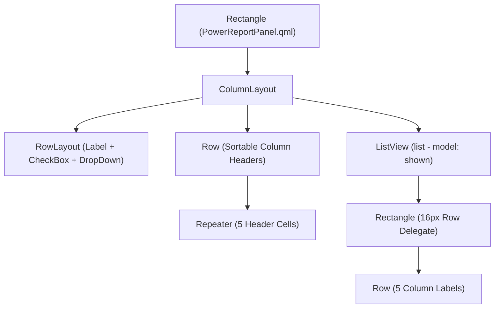

# UI Spec: PowerReportPanel
**File:** `app/qml/components/PowerReportPanel.qml`  **Pack:** `03-view-tree.md`  **Legacy Reference:** `src/Classes/PowerReportListControl.lua` + `TreeTab:BuildPowerReportList`  **Status:** Test-Covered

--------------------------------------------------------------------------------

## 1. Purpose & Parity Notes
*   **Role:** Passive tree node power calculation report panel. Ranks unallocated and allocated passive nodes by offensive/defensive stat value (Power) and efficiency (Per Point), allowing players to identify high-impact passive notables, masteries, cluster nodes, and anoints.
*   **Intentional Deviations from Legacy PoB:**
    *   *Column Width Fractions:* Adopts legacy PoB's exact column proportions (`colFrac: [0.15, 0.45, 0.16, 0.05, 0.16]`) scaled to panel width, representing Type, Node Name, Stat/Power, Points, and Per Point.
    *   *Sort Direction Inversion:* In "Show Allocated" mode (`filterIndex === 2`), default sort direction flips to ascending to highlight least efficient nodes for potential point reclamation.
    *   *Tree Navigation Signal:* Clicking any report row emits `nodeSelected(nodeId)`, allowing the parent TreeView to pan and center the passive tree directly on the target node.

--------------------------------------------------------------------------------

## 2. Lightweight Wireframe & Layout Box Model
# Component Box Model & Layout
```text
+-------------------------------------------------------------------------------+
| PowerReportPanel (Rectangle, color: theme.sideBarBg, border: 1px theme.border)|
| ColumnLayout (anchors.fill: parent, margins: 4px, spacing: 3px)               |
| +---------------------------------------------------------------------------+ |
| | RowLayout: Label: report.label | [x] Show Masteries | Filter DropDown    | |
| +---------------------------------------------------------------------------+ |
| | Header Row: [ Type ] [ Node Name ] [ <Stat> ] [ Points ] [ Per Point ]    | |
| +---------------------------------------------------------------------------+ |
| | ListView [list] (model: root.shown, delegate: 16px Row)                   | |
| +---------------------------------------------------------------------------+ |
+-------------------------------------------------------------------------------+
```

# ASCII Anatomy & Wireframe
```text
+-------------------------------------------------------------------------------+
| Stat: Combined DPS (Full Power)           [x] Show Masteries  [Show Unalloc v]| (1) Top Filter Bar
|-------------------------------------------------------------------------------|
| Type (15%) | Node Name (45%)        | Power (16%) | Pts (5%) | Per Point(16%) | (2) Sortable Headers
|------------+------------------------+-------------+----------+----------------|
| Notable    | Heartseeker            | +8.4% DPS   | 2        | +4.2% DPS      | (3) Ranked Row
| Notable    | Doom Cast              | +7.1% DPS   | 3        | +2.37% DPS     |
| Notable    | True Strikes           | +5.2% DPS   | 2        | +2.6% DPS      |
| Anoint     | Whispers of Doom       | +14.2% DPS  | Anoint   | +14.2% DPS     | (4) Anoint Row
+-------------------------------------------------------------------------------+
```

# Responsive / Overflow Rules
*   **Minimum safe width/height:** 350x200px. Fills allocated dock or tab drawer.
*   **Proportional Column Sizing:** `colWidth(i) = Math.floor((root.width - 12) * colFrac[i])`.
*   **Text Truncation:** All row labels have `clip: true` to prevent overflowing column bounds.

# Component Hierarchy


--------------------------------------------------------------------------------

## 3. Interactive States & Controls
| Control (objectName) | Type | Default State | Interactive Behavior | Edge States (Disabled / Empty / Loading / Error / Long Text) |
| ------ | ------ | ------ | ------ | ------ |
| `pob.powerreport.root` | Rectangle | `filterIndex: 0` | Filters and sorts power rows | Empty list when `report.rows` is empty. |
| `pob.powerreport.chk_mast`| CheckBox | `state: true` | Toggles mastery nodes visibility | Re-filters on toggle. |
| `pob.powerreport.filter` | DropDownControl| Unallocated | Filters between Unalloc, Clusters, Allocated| Re-filters and resets sort column to Power. |
| `pob.powerreport.hdr` | Rectangle | `sortCol: 3` | Clicking sortable header re-sorts list | Active sort column highlighted in `theme.active`. |
| `pob.powerreport.row` | MouseArea | Active | Emits `nodeSelected(modelData.id)` | Highlights on hover (`theme.hover`). |

# Complete State Matrix
*   **Filter Mode 0 (Show Unallocated):** Filters to unallocated nodes with `power > 0` excluding clusters.
*   **Filter Mode 1 (Show Unallocated & Clusters):** Includes cluster jewel notables.
*   **Filter Mode 2 (Show Allocated):** Shows allocated nodes; sort direction flips to ascending (`dir = 1`).
*   **Header Click:** Clicking column header updates `sortCol` and triggers `relist()`.

# State Matrix & Binding Hazards
*   *Anoint Distance Sorting:* Anoint nodes have `pathDist === 1000`. Sorting by Points must treat 1000 as anoint string representation while properly ordering numeric point distances.

--------------------------------------------------------------------------------

## 4. Data & Bridge Contract
*   **Reads (Report Object via `setReport`):**
    *   `report.label: string` -> description of active calculation metric
    *   `report.statLabel: string` -> column header label (e.g. `"Total DPS"`)
    *   `report.rows: array` -> `[{ id, type, name, power, powerStr, pathDist, pathPower, pathPowerStr, allocated }]`
*   **Writes / Signals Emitted:**
    *   `nodeSelected(nodeId: int)` -> emitted when user clicks a row to navigate passive tree
*   **Qt6 Bridge Safety:** Robust against null or empty report data structures (`setReport(null)`).

--------------------------------------------------------------------------------

## 5. Testable Acceptance Criteria (Qt6::QuickTest)
*   **AC-01 (Mount & Zero Warnings):** When `PowerReportPanel.qml` mounts, 0 QML warnings are logged, `sortCol === 3`, and `shown.length === 0`.
*   **AC-02 (Mastery Filter Toggle):** Unchecking "Show Masteries" removes rows where `type === "Mastery"` from `shown`.
*   **AC-03 (Sorting Execution):** Clicking header index 0 (`Type`) sorts rows alphabetically by type string.
*   **AC-04 (Allocated Mode Reversal):** In "Show Allocated" mode, default sort sorts from lowest power to highest power.
*   **AC-05 (Node Navigation Click):** Clicking row for node 4567 emits `nodeSelected(4567)`.

--------------------------------------------------------------------------------

## 6. Bug Audit Findings (Current Implementation vs Spec)
| Severity | File & Line | Symptom / Defect | Root Cause | Expected Behavior |
| ------ | ------ | ------ | ------ | ------ |
| Medium | `app/qml/components/PowerReportPanel.qml:2705` | Anoint notables sort at the bottom of 1-point nodes rather than being separated. | Numeric comparison failed on literal `pathDist === 1000`. | Normalize: `num(a.pathDist === 1000 ? "Anoint" : a.pathDist)`. |
| Low | `app/qml/components/PowerReportPanel.qml:2740` | Checkbox text overlaps dropdown on narrow sidebar widths. | Hardcoded margin spacing between controls. | Use `RowLayout` with `Layout.fillWidth: true` spacer. |
