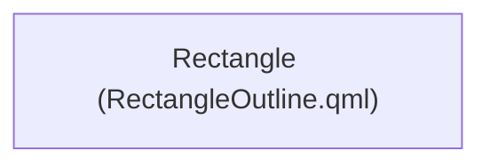

# UI Spec: RectangleOutline
**File:** `app/qml/components/RectangleOutline.qml`  **Pack:** `01-core-components.md`  **Legacy Reference:** `src/Classes/RectangleOutlineControl.lua`  **Status:** Test-Covered

--------------------------------------------------------------------------------

## 1. Purpose & Parity Notes
*   **Role:** An outline-only rectangular visual highlight primitive with a transparent center. Used throughout the interface to indicate selection boundaries, focus boxes, drag-over regions, and container perimeters.
*   **Intentional Deviations from Legacy PoB:**
    *   *Single Primitive vs 4 Strokes:* Legacy PoB implements `RectangleOutlineControl` by drawing 4 individual lines/rectangles straddling the item's outer edge via `DrawColor` and coordinate math. In Qt Quick, a native `Rectangle` with `color: "transparent"` and `border.width: root.stroke` achieves pixel-identical geometry with zero fill overhead.
    *   *Normalized Color Tuple:* Accepts a 3-element `[r, g, b]` array (0.0 to 1.0) via `colors`, matching legacy's Lua color array format, and maps it directly to `Qt.rgba(colors, colors, colors, 1)`.

--------------------------------------------------------------------------------

## 2. Lightweight Wireframe & Layout Box Model
# Component Box Model & Layout
```text
+-------------------------------------------------------------------------------+
| RectangleOutline (Rectangle)                                                  |
| color: "transparent"                                                          |
| border.width: root.stroke (default: 1px)                                      |
| border.color: Qt.rgba(root.colors, root.colors, root.colors, 1)      |
| width / height: matches parent or explicit geometry                           |
+-------------------------------------------------------------------------------+
```

# ASCII Anatomy & Wireframe
```text
Stroke Outline Construction:
+----------------------------------------------------+ ^
|#==================================================#| |
|#                                                 #| |
|#               (Transparent Body)                #| height
|#                                                 #| |
|#==================================================#| |
+----------------------------------------------------+ v
|<--------------------- width ---------------------->|
 Stroke Thickness: border.width = root.stroke
 Color: Qt.rgba(colors, colors, colors, 1)
```

# Responsive / Overflow Rules
*   **Minimum safe width/height:** `Math.max(2 * stroke, 2)`.
*   **Fill policy:** `color: "transparent"` ensures that elements layered underneath remain visible and hit-testable unless blocked by sibling mouse areas.
*   **Border alignment:** In Qt Quick, borders sit inside the rectangle geometry (`border.width`). Outer bounding boxes must allocate `2 * stroke` extra pixels if straddle parity with legacy external borders is required.

# Component Hierarchy


--------------------------------------------------------------------------------

## 3. Interactive States & Controls
| Control (objectName) | Type | Default State | Interactive Behavior | Edge States (Disabled / Empty / Loading / Error / Long Text) |
| ------ | ------ | ------ | ------ | ------ |
| `pob.outline.root` | Rectangle | `colors:`, `stroke: 1` | Passive visual boundary primitive | Degrades to transparent border if `colors` array is malformed. |

# Complete State Matrix
*   **Default:** `stroke: 1`, `colors:` -> 1px solid white outline, transparent center.
*   **Thick Stroke:** `stroke: 2` or higher -> expands border inward from outer bounds.
*   **Custom Palette Tint:** E.g. `colors: [0.2, 0.8, 0.2]` -> vibrant green border for valid drop targets.
*   **Zero Size:** `width: 0` or `height: 0` -> renders nothing without rendering artifacts.

# State Matrix & Binding Hazards
*   *Array Length Safety:* The `border.color` expression reads `colors`, `colors`, and `colors`. If a caller passes an empty array `[]` or `null`, `Qt.rgba(undefined, undefined, undefined, 1)` yields an invalid color (transparent/black). Ensure guards or safe fallbacks are applied when dynamically binding colors.

--------------------------------------------------------------------------------

## 4. Data & Bridge Contract
*   **Reads (Properties):**
    *   `colors: var` -> array of 3 numeric values `[r, g, b]` in `0.0..1.0` range (default ``)
    *   `stroke: int` -> outline border width in pixels (default `1`)
*   **Writes / Mutations:** None (presentation component).
*   **Signals Observed:** None.
*   **Qt6 Bridge Safety:** Independent graphical primitive; requires no engine marshalling.

--------------------------------------------------------------------------------

## 5. Testable Acceptance Criteria (Qt6::QuickTest)
*   **AC-01 (Initial Render & Zero Warnings):** When `RectangleOutline.qml` mounts with defaults, 0 QML warnings are logged, `border.width === 1`, and `color` is `"transparent"`.
*   **AC-02 (Color Array Mapping):** Given `colors:`, `border.color` resolves to `#ff0000` (`red`).
*   **AC-03 (Stroke Adjustment):** Given `stroke: 3`, `border.width` evaluates to `3`.
*   **AC-04 (Zero-Fill Verification):** Child items placed beneath `RectangleOutline` receive pointer events when the outline has no attached `MouseArea`.

--------------------------------------------------------------------------------

## 6. Bug Audit Findings (Current Implementation vs Spec)
| Severity | File & Line | Symptom / Defect | Root Cause | Expected Behavior |
| ------ | ------ | ------ | ------ | ------ |
| Low | `app/qml/components/RectangleOutline.qml:1985` | Border disappears or logs TypeError if caller passes null colors. | Direct unchecked indexing `root.colors` on undefined/null property. | Provide fallback: `(colors && colors.length >= 3) ? Qt.rgba(...) : theme.border`. |
