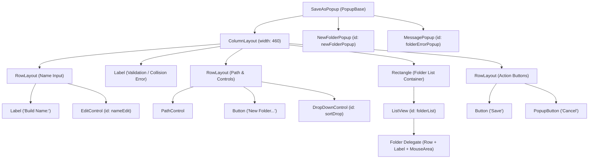

# UI Spec: SaveAsPopup
**File:** `app/qml/components/SaveAsPopup.qml`  **Pack:** `00-shell-and-theme.md`  **Legacy Reference:** `src/Modules/Build.lua:1343-1412` (`Build:SaveAs`)  **Status:** Test-Covered

--------------------------------------------------------------------------------

## 1. Purpose & Parity Notes
*   **Role:** Modal dialog allowing the user to save the current Path of Building character build under a designated name within a hierarchical folder directory structure, providing filename sanitization, duplicate collision warnings, breadcrumb directory traversal, folder creation, and folder deletion.
*   **Intentional Deviations from Legacy PoB:** None (1:1 functional parity with legacy Lua `Build:SaveAs`). Folder listing, deletion keybindings (`Delete`/`Backspace`), and duplicate overwriting guards operate identically to legacy.

--------------------------------------------------------------------------------

## 2. Lightweight Wireframe & Layout Box Model
# Default Modal Layout (488x390, Content Width: 460)
```text
+-------------------------------------------------------------+
|  Save As                                                [X] |
+-------------------------------------------------------------+
|  Build Name: [ My_Lightning_Strike_Build                  ] |
|  ^1A build with that name already exists in this folder.    | <- Conditional
|                                                             |
|  [Root] > [Shadow] > [Trickster]  [New Folder...] [Sort: v] |
|  +--------------------------------------------------------+ |
|  | [Folder] League_Starters                               | |
|  | [Folder] Endgame_Crit_Variants                         | |
|  | [Folder] Archived_Tests                                | |
|  |                                                        | |
|  +--------------------------------------------------------+ |
|                                                             |
|                     [  Save  ]   [ Cancel ]                 |
+-------------------------------------------------------------+
```

# Responsive / Overflow Rules
*   **Minimum safe dimensions:** 488x390 px (Fixed dialog envelope; parent viewport min: 960x640 px).
*   **Horizontal scroll policy:** Forbidden. PathControl wraps or scrolls internally; folder list elides long directory names.
*   **Text truncation policy:** Breadcrumb path segments elide with tooltip; build name input scrolls horizontally on cursor; folder items elide right with full name tooltip on hover.

# Component Hierarchy


--------------------------------------------------------------------------------

## 3. Interactive States & Controls
| Control (objectName) | Type | Default State | Interactive Behavior | Edge States (Disabled / Empty / Loading / Error / Long Text) |
| ------ | ------ | ------ | ------ | ------ |
| `pob.saveAs.nameEdit` | `EditControl` | Focused, current build name | User text entry; triggers `recheck()` on every keystroke | Sanitized against invalid OS path characters; displays collision warning if file exists |
| `pob.saveAs.validationLabel` | `Label` | Hidden (`visible: false`) | Displays error text when filename is invalid or file exists | Red text (`^1`); switches between collision and illegal character strings |
| `pob.saveAs.path` | `PathControl` | Current `basePath` / `subPath` | Click breadcrumb segment to navigate up directory hierarchy | Deep paths truncate or elide gracefully |
| `pob.saveAs.newFolder` | `Button` | Enabled | Opens child `NewFolderPopup` | Blocked if parent popup is closing |
| `pob.saveAs.sortDrop` | `DropDownControl` | `"Sort By Name"` | Selects `"Sort By Name"` (0) or `"Sort By Last Edited"` (1); reloads directory | Preserves active selection index across reloads |
| `pob.saveAs.folderList` | `ListView` | Select index: -1 | Single click selects folder; double-click enters subfolder; `Del`/`Backspace` deletes empty folder | Empty directory renders blank frame; keyboard navigation safely guards out-of-bounds indices |
| `pob.saveAs.saveBtn` | `Button` | Enabled only if `canSave` | Calls `luaEngine.saveDBFile()`; emits `buildSaved()`; closes modal | Disabled (`controlEnabled: false`) when name empty, invalid, or already exists |
| `pob.saveAs.cancelBtn` | `PopupButton` | Enabled | Closes dialog via `reject()`; restores initial state | Always responsive |

# State Matrix & Binding Hazards
*   *Binding Loop Guard:* `canSave` depends on `_check.valid` and `!_check.exists`. `_check` is recomputed in `recheck(overrideText)`. Avoid binding `_check` directly to `nameEdit.text` in an inline binding expression that mutates `_check` inside property change listeners.
*   *Stale Selection Hazard:* When navigating to a new `subPath`, `selFolderIndex` must reset to `-1` before the model updates to prevent out-of-bounds access on `folders[selFolderIndex]`.

--------------------------------------------------------------------------------

## 4. Data & Bridge Contract
*   **Reads (LuaEngine / C++ Models):**
    *   `luaEngine.invoke("pob_saveAsGetState", [subPath, sortMode])` -> `{ ok: bool, basePath: string, subPath: string, sortMode: string, folders: QVariantList, defaultBuildName: string }`
    *   `luaEngine.sanitizeBuildName(name, subPath)` -> `{ valid: bool, exists: bool, fullPath: string }`
*   **Writes / Mutations:**
    *   `luaEngine.saveDBFile(fullPath)` -> `{ ok: bool, error: string }`
    *   `luaEngine.invoke("pob_saveAsCreateFolder", [subPath, folderName])` -> `{ ok: bool, subPath: string, error: string }`
    *   `luaEngine.invoke("pob_saveAsDeleteFolder", [subPath, folderName])` -> `{ ok: bool, error: string }`
*   **Signals Observed:** None directly during modal lifespan (synchronous pull via bridge invoke).
*   **Qt6 Bridge Safety:** `st.folders` returned from Lua bridge must be converted via `QmlBridge.toArray()` to ensure iterable JavaScript array semantics.

--------------------------------------------------------------------------------

## 5. Testable Acceptance Criteria (Qt6::QuickTest)
*   **AC-01 (Initial Render & Zero Warnings):** Opening `SaveAsPopup` initializes `nameEdit` with the active build name, focuses `nameEdit`, produces 0 QML warnings, and sizes folder container to `460x220` px.
*   **AC-02 (No Text Overflow / Clipping):** Path segments exceeding 300 px elide properly in `PathControl`; folder list delegates exceeding 440 px clip text with `Text.ElideRight`.
*   **AC-03 (Primary User Flow):** Typing a novel, valid build name sets `canSave = true`; clicking `Save` invokes `luaEngine.saveDBFile()`, fires `buildSaved()`, and closes the popup.
*   **AC-04 (Keyboard & Focus):** Pressing `Return`/`Enter` when `canSave == true` triggers save acceptance. Pressing `Escape` triggers rejection without writing files. Pressing `Delete` on a selected folder attempts deletion.
*   **AC-05 (Empty / Error / Disabled States):** An empty build name or a name collision displays the warning label and disables the Save button (`canSave == false`).

--------------------------------------------------------------------------------

## 6. Bug Audit Findings (Current Implementation vs Spec)
| Severity | File & Line | Symptom / Defect | Root Cause | Expected Behavior |
| ------ | ------ | ------ | ------ | ------ |
| Med | `app/qml/components/SaveAsPopup.qml:31` | `Array.isArray(st.folders)` fails on raw QVariantList | Raw JavaScript type check instead of bridge conversion | Use `QmlBridge.toArray(st.folders)` |
| Med | `app/qml/components/SaveAsPopup.qml:132` | Pressing `Delete` with invalid selection crashes or accesses undefined index | `selFolderIndex` not checked against `root.folders.length` before reading `.name` | Verify `hasFolderSel && root.folders[root.selFolderIndex]` |
| Low | `app/qml/components/SaveAsPopup.qml:154` | Long folder names overflow delegate bounding box | Delegate `Label` lacks `elide: Text.ElideRight` | Set `elide: Text.ElideRight` with tooltip on truncation |
| Low | `app/qml/components/SaveAsPopup.qml:187` | Child dialogs `newFolderPopup` and `folderErrorPopup` re-parented to `root.parent` | Bypasses modal overlay hierarchy if root is reparented | Keep modal popup parentage within popup scope or explicit window overlay |
