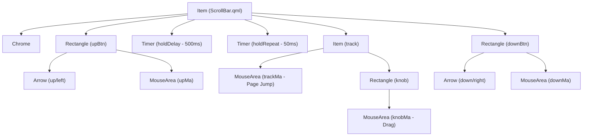

# UI Spec: ScrollBar
**File:** `app/qml/components/ScrollBar.qml`  **Pack:** `01-core-components.md`  **Legacy Reference:** `src/Classes/ScrollBarControl.lua` (323 lines)  **Status:** Test-Covered

--------------------------------------------------------------------------------

## 1. Purpose & Parity Notes
*   **Role:** Universal vertical or horizontal scroll bar primitive. Manages viewport scrolling through directional step buttons with hold-to-repeat acceleration, a draggable proportional thumb knob sized to the content/view ratio, and click-to-page track jumps (`SLIDEUP`/`SLIDEDOWN`).
*   **Intentional Deviations from Legacy PoB:**
    *   *Hold-to-Repeat State:* Legacy PoB pauses repeat cycling if the cursor drifts outside button bounds during a press and resumes when re-entering (`holdPauseTime`). ScrollBar delegates press tracking to Qt Quick's `MouseArea` pointer grab, maintaining the repeat loop until button release regardless of mouse movement.
    *   *Region Hit-Testing:* Replaces legacy manual pixel-coordinate collision checks (`UP`, `DOWN`, `KNOB`, `SLIDEUP`, `SLIDEDOWN`) with dedicated child `Item` and `MouseArea` components.
    *   *Declarative Offset Max:* Computes `offsetMax` as a reactive property binding `Math.max(0, contentDim - viewDim)` rather than requiring manual calls to `SetContentDimension`.

--------------------------------------------------------------------------------

## 2. Lightweight Wireframe & Layout Box Model
# Component Box Model & Layout
```text
Vertical Mode (dir: "VERTICAL", implicitWidth: 18px, implicitHeight: 160px):
+-------------------------------------------------------------------------------+
| ScrollBar (visible: !autoHide || active, Chrome backing)                      |
| +---------------------------------------------------------------------------+ |
| | Step Button: Up [upBtn] (width: 18px, height: 18px)                       | |
| |   Arrow (direction: "up", margins: 2px)                                   | |
| |   MouseArea [upMa] (holdDelay: 500ms, holdRepeat: 50ms)                   | |
| +---------------------------------------------------------------------------+ |
| | Track [track] (x: 0, y: 18px, width: 18px, height: height - 36px)         | |
| |   MouseArea [trackMa] (click outside knob: page jump by knobDim)          | |
| |   Rectangle [knob] (x: 0, y: knobPosForOffset(), height: knobDim)         | |
| |     MouseArea [knobMa] (drag delta mapped to setOffsetFromKnobPos)         | |
| +---------------------------------------------------------------------------+ |
| | Step Button: Down [downBtn] (x: 0, y: height - 18px, 18x18px)             | |
| |   Arrow (direction: "down", margins: 2px)                                 | |
| |   MouseArea [downMa] (holdDelay: 500ms, holdRepeat: 50ms)                 | |
| +---------------------------------------------------------------------------+ |
+-------------------------------------------------------------------------------+
```

# ASCII Anatomy & Wireframe
```text
Vertical ScrollBar:
+------+
| [^]  | (1) Up Step Button (18x18px, Arrow: "up")
+------+
|      |
| [==] | (2) Track / Knob (proportional knobDim, colored theme.muted/borderStrong)
| [==] |
|      | (3) Track Area (click-to-page jump)
+------+
| [v]  | (4) Down Step Button (18x18px, Arrow: "down")
+------+
  18px
```

# Responsive / Overflow Rules
*   **Minimum safe width/height:** 18x60px (Vertical) or 60x18px (Horizontal).
*   **Auto-Hide Policy:** When `autoHide: true` and `contentDim <= viewDim`, `visible` evaluates to `false` and width/height collapse.
*   **Knob Dimension:** Proportional to viewport: `knobDim = Math.max(shortDim, (longDim - shortDim * 2) * viewDim / Math.max(1, contentDim))`.
*   **Knob Travel Bounds:** `knobTravel = Math.max(0, (longDim - shortDim * 2) - knobDim)`. Clamped so the thumb never exceeds track boundaries.

# Component Hierarchy


--------------------------------------------------------------------------------

## 3. Interactive States & Controls
| Control (objectName) | Type | Default State | Interactive Behavior | Edge States (Disabled / Empty / Loading / Error / Long Text) |
| ------ | ------ | ------ | ------ | ------ |
| `pob.scrollbar.root` | Item | `dir: "VERTICAL"` | Coordinates offset clamping and dimensions | Hidden when `autoHide === true && !active`. |
| `pob.scrollbar.up` | Rectangle | Idle (`transparent`) | On press, scrolls `-1` step; starts hold-to-repeat | Disabled/inert when `!active` or `!controlEnabled`. |
| `pob.scrollbar.down` | Rectangle | Idle (`transparent`) | On press, scrolls `+1` step; starts hold-to-repeat | Disabled/inert when `!active` or `!controlEnabled`. |
| `pob.scrollbar.track` | MouseArea | Inactive | Click above knob pages up; click below pages down | Disabled when `!active`. |
| `pob.scrollbar.knob` | Rectangle | Proportional | Drag tracks mouse delta to set `offset` | Displays `theme.text` while pressed; `theme.borderStrong` on hover. |

# Complete State Matrix
*   **Inactive / Content Fits:** `contentDim <= viewDim`: `active: false`, step buttons inert, arrows colored `theme.muted`, knob hidden (`visible: false`).
*   **Idle Active:** `contentDim > viewDim`: step buttons active, arrows colored `theme.text`, knob visible with `theme.muted`.
*   **Button Hovered:** `upMa.containsMouse` or `downMa.containsMouse`: button fill is `theme.hover`, border is `theme.border`.
*   **Button Pressed:** `upMa.pressed` or `downMa.pressed`: button fill is `theme.active`. Fires repeat cycle (500ms delay, 50ms interval).
*   **Knob Hovered:** `knobMa.containsMouse`: knob fill is `theme.borderStrong`.
*   **Knob Dragging:** `knobMa.pressed`: knob fill is `theme.text`.
*   **Track Click:** Clicking track directly jumps offset by `knobDim` toward click position.

# State Matrix & Binding Hazards
*   *Re-entrant Max Overflow Clamp:* If `contentDim` shrinks (e.g. filtering a list), `offsetMax` drops below the active `offset`. An explicit handler `onOffsetMaxChanged: if (offset > offsetMax) offset = offsetMax` prevents viewport displacement into negative or out-of-bounds space.
*   *Divide-by-Zero Protection:* Sizing formulas must guard content dimension with `Math.max(1, contentDim)` to prevent `NaN` knob dimensions when lists are temporarily empty.

--------------------------------------------------------------------------------

## 4. Data & Bridge Contract
*   **Reads (Properties):**
    *   `contentDim: real` -> total scrollable content length in pixels
    *   `viewDim: real` -> visible viewport length in pixels
    *   `step: real` -> single-step increment in pixels (default 40)
    *   `autoHide: bool` -> hides bar when content fits
    *   `dir: string` -> `"VERTICAL"` or `"HORIZONTAL"`
*   **Writes / Methods Exposed:**
    *   `setOffset(o: real)` -> sets clamped integer scroll offset
    *   `scroll(mult: real)` -> offsets by `step * mult`
    *   `scrollIntoView(minDim: real, size: real)` -> adjusts offset to reveal target item
    *   `handleWheel(angleDeltaY: real)` -> maps wheel scroll delta to `+1`/`-1` steps
*   **Qt6 Bridge Safety:** Pure client-side component; integer clamping via `Math.floor` prevents sub-pixel blurring during text rendering in scrollable lists.

--------------------------------------------------------------------------------

## 5. Testable Acceptance Criteria (Qt6::QuickTest)
*   **AC-01 (Initial Render & Zero Warnings):** Given `contentDim: 500` and `viewDim: 200`, when `ScrollBar.qml` mounts, 0 QML warnings are emitted, `active === true`, and `offsetMax === 300`.
*   **AC-02 (AutoHide Collapse):** Given `autoHide: true` and `contentDim: 150, viewDim: 200`, `visible` evaluates to `false` and `active === false`.
*   **AC-03 (Hold-to-Repeat Timing):** When `downMa` is pressed continuously, the first step occurs at 0ms, the second step triggers at 500ms, and subsequent steps occur every 50ms.
*   **AC-04 (Track Page Jump):** When clicking the track at a position below the current knob, `offset` increases by `knobDim`, clamped to `offsetMax`.
*   **AC-05 (Scroll Into View):** Given `offset: 0, viewDim: 200`, calling `scrollIntoView(250, 40)` updates `offset` to `90` (`250 + 40 - 200`).

--------------------------------------------------------------------------------

## 6. Bug Audit Findings (Current Implementation vs Spec)
| Severity | File & Line | Symptom / Defect | Root Cause | Expected Behavior |
| ------ | ------ | ------ | ------ | ------ |
| Medium | `app/qml/components/ScrollBar.qml:2020` | Content appears blank or shifted out of view when filtering reduces list size. | `offset` retained stale values greater than the new `offsetMax`. | Clamp `offset` immediately inside `onOffsetMaxChanged`. |
| Low | `app/qml/components/ScrollBar.qml:2015` | Knob collapses to zero pixels or causes layout warnings when contentDim is 0. | Missing zero-division safeguard on `contentDim`. | Protect ratio via `Math.max(1, contentDim)`. |
