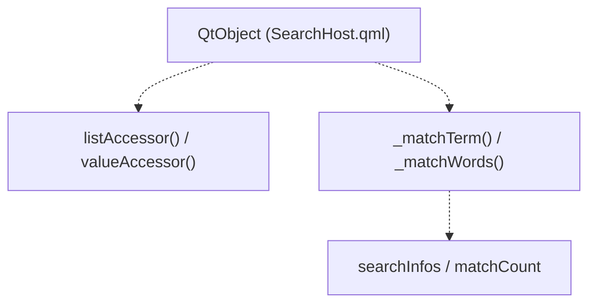

# UI Spec: SearchHost
**File:** `app/qml/components/SearchHost.qml`  **Pack:** `01-core-components.md`  **Legacy Reference:** `src/Classes/SearchHost.lua`  **Status:** Test-Covered

--------------------------------------------------------------------------------

## 1. Purpose & Parity Notes
*   **Role:** The headless type-to-filter search engine powering searchable dropdown lists, gem selectors, passive tree searches, and item database filters. Implements word-order caseless substring matching (each space-separated word must match, case-insensitively, strictly *after* the previous word's match end) and computes matched character highlight ranges.
*   **Intentional Deviations from Legacy PoB:**
    *   *Half-Open Range Convention:* Legacy Lua `string.find` returns 1-based inclusive intervals `[from, to]`. SearchHost generates 0-based half-open intervals `[from, to)` directly compatible with standard JavaScript string slicing (`value.slice(from, to)`).
    *   *Literal Matching vs Pattern Escaping:* In legacy Lua, strings pass through `wordsToCaselessPatterns` to escape magic pattern characters (`%`, `^`, `$`, `(`, `)`). SearchHost uses lowercase `String.indexOf` with search offsets (`lastMatchEnd`), avoiding regex pattern overhead while delivering exact caseless literal matching.

--------------------------------------------------------------------------------

## 2. Lightweight Wireframe & Layout Box Model
# Component Box Model & Layout
```text
+-------------------------------------------------------------------------------+
| SearchHost (QtObject - Headless Logic Primitive)                              |
| property var listAccessor: function(): array                                  |
| property var valueAccessor: function(entry): string                           |
| property string searchTerm: ""                                                |
| property var searchInfos: [{ matches: bool, ranges: [{from, to}] }]           |
| property int matchCount: 0                                                    |
| readonly property bool searchActive: searchTerm.length > 0                    |
+-------------------------------------------------------------------------------+
```

# ASCII Anatomy & Wireframe
```text
Input Term: "bow phys"
Search Target: "Highborn Bow (Physical Damage: 120-250)"

Sequential Match Execution:
Word 1: "bow"  -> lowerValue.indexOf("bow", 0)  -> idx: 9,  range: [9, 12)
Word 2: "phys" -> lowerValue.indexOf("phys", 12) -> idx: 14, range: [14, 18)

Visual ColorText Search Term Banner (searchTermPretty()):
+----------------------------------------------------+
|  Search: bow phys (matches: 4)                     | (1)
+----------------------------------------------------+
  (1) White text (^xFFFFFF) when matches > 0;
      turns Red (^xFF0000) when searchActive && matchCount === 0.
```

# Responsive / Overflow Rules
*   **Sizing policy:** Non-visual `QtObject` (0x0px footprint).
*   **Sequential Word Constraint:** Words must match in sequence. In `"bow phys"`, an entry containing `"phys ... bow"` evaluates to `matches: false` because `"phys"` appears before `"bow"`.
*   **Whitespace Normalization:** Multiple consecutive spaces collapse to single word boundaries via `\S+/g`.

# Component Hierarchy


--------------------------------------------------------------------------------

## 3. Interactive States & Controls
| Control (objectName) | Type | Default State | Interactive Behavior | Edge States (Disabled / Empty / Loading / Error / Long Text) |
| ------ | ------ | ------ | ------ | ------ |
| `pob.searchhost.root` | QtObject | `searchTerm: ""` | Filters list and tracks match ranges | Inactive when `searchTerm === ""` (`searchActive: false`). |

# Complete State Matrix
*   **Inactive (Idle):** `searchTerm: ""`, `searchActive: false`, `matchCount: 0`, `searchInfos: []`.
*   **Active Matching:** `searchTerm: "arc"`, `searchActive: true`, `matchCount > 0`, `searchTermPretty()` outputs `^xFFFFFFarc`.
*   **Active Zero Matches:** `searchTerm: "xyz"`, `searchActive: true`, `matchCount === 0`, `searchTermPretty()` outputs `^xFF0000xyz`.
*   **Whitespace Typing:** Leading or trailing duplicate spaces are rejected by `onSearchChar()` to prevent empty word tokens.

# State Matrix & Binding Hazards
*   *Asynchronous List Accessor Hazard:* `updateSearch()` calls `listAccessor()`. If the underlying list model changes without invoking `updateSearch()`, `searchInfos` and `listAccessor()` indices diverge. Caller views must invoke `updateSearch()` inside `onModelChanged`.
*   *Control Character Sanitization:* `onSearchChar(ch)` rejects non-printable ASCII and control characters (`/[\x00-\x1f\x7f]/`) to prevent control code corruption in search query buffers.

--------------------------------------------------------------------------------

## 4. Data & Bridge Contract
*   **Reads (Accessors & Properties):**
    *   `listAccessor: var` -> callback returning the array of data entries
    *   `valueAccessor: var` -> callback extracting searchable text string from an entry
    *   `searchTerm: string` -> active query string
*   **Outputs / Properties Exposed:**
    *   `searchInfos: var` -> parallel array of `{ matches: bool, ranges: [{from: int, to: int}] }`
    *   `matchCount: int` -> count of matching entries
    *   `searchActive: bool` -> true when search string length > 0
*   **Methods Exposed:**
    *   `onSearchChar(ch: string)` -> appends character and triggers update
    *   `onSearchKeyDown(key: string)` -> handles `"BACK"` (backspace) and `"ESCAPE"` (reset)
    *   `updateSearch()` -> runs sequential matching against current `listAccessor()`
    *   `resetSearch()` -> clears search term and resets match counters
    *   `searchTermPretty()` -> returns ColorText-styled string (`^xFFFFFF` or `^xFF0000`)
*   **Qt6 Bridge Safety:** If `listAccessor()` returns null, undefined, or an empty list, `searchInfos` resolves to `[]` without throwing exceptions.

--------------------------------------------------------------------------------

## 5. Testable Acceptance Criteria (Qt6::QuickTest)
*   **AC-01 (Initial State & Zero Warnings):** When `SearchHost.qml` mounts, 0 QML warnings are logged, `searchTerm === ""`, `searchActive === false`, and `matchCount === 0`.
*   **AC-02 (Sequential Word-Order Matching):** Given entry `"Deadeye Bow Attack"`, searching `"deadeye attack"` returns `matches: true`; searching `"attack deadeye"` returns `matches: false`.
*   **AC-03 (Character Highlight Ranges):** Given entry `"Lightning Strike"`, searching `"light strike"` returns ranges `[{from: 0, to: 5}, {from: 10, to: 16}]`.
*   **AC-04 (Backspace & Reset Navigation):** When `searchTerm` is `"abc"`, calling `onSearchKeyDown("BACK")` shortens it to `"ab"`; calling `onSearchKeyDown("ESCAPE")` resets `searchTerm` to `""`.
*   **AC-05 (Pretty String Styling):** When `searchActive: true` with 0 matches, `searchTermPretty()` starts with `^xFF0000`.

--------------------------------------------------------------------------------

## 6. Bug Audit Findings (Current Implementation vs Spec)
| Severity | File & Line | Symptom / Defect | Root Cause | Expected Behavior |
| ------ | ------ | ------ | ------ | ------ |
| Medium | `app/qml/components/SearchHost.qml:2240` | Searching matches wrong characters when entry values contain uppercase letters. | Comparing against un-lowercased entry value in `indexOf`. | Lowercase entry string: `String(value).toLowerCase()`. |
| Low | `app/qml/components/SearchHost.qml:2260` | Leading space creates empty token that matches all entries. | Missing regex trim check for leading whitespace. | Ignore space if `searchTerm === ""` in `onSearchChar()`. |
