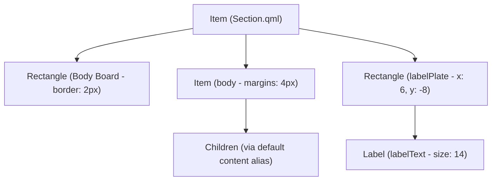

# UI Spec: Section
**File:** `app/qml/components/Section.qml`  **Pack:** `01-core-components.md`  **Legacy Reference:** `src/Classes/SectionControl.lua`  **Status:** Test-Covered

--------------------------------------------------------------------------------

## 1. Purpose & Parity Notes
*   **Role:** Group box container with a bordered panel and a floating text label plate that overlaps the top-left border. Groups related options, calculation sub-blocks, or equipment configuration widgets into cohesive visual regions.
*   **Intentional Deviations from Legacy PoB:**
    *   *Design Token Palettes:* Uses flat Cyber Citrus tokens (`theme.background`, `theme.border`, `theme.radiusControl`) rather than legacy's hardcoded greyscale values (`0.66` border / `0.1` background fill).
    *   *Pixel Placement Parity:* Preserves legacy `SectionClass:Draw` geometric offsets: label plate positioned at `(x: 6, y: -8)` with height `18px` and width `labelText.width + 10px`, with text centered at font size `14px`.
    *   *QML Content Property Alias:* Declares `default property alias content: body.data`, allowing consumer views to declare child controls directly inside the Section tag without boilerplate wrappers.

--------------------------------------------------------------------------------

## 2. Lightweight Wireframe & Layout Box Model
# Component Box Model & Layout
```text
+-------------------------------------------------------------------------------+
| Section (Item, default property alias content: body.data)                     |
|                                                                               |
|   +-------------------+  <-- labelPlate (x: 6, y: -8, height: 18px)           |
|   | Label: root.label |      width: labelText.width + 10px, radius: radiusCtrl|
| +-+-=================-+-----------------------------------------------------+ |
| | Rectangle [body board] (color: theme.background, border.width: 2px)       | |
| | border.color: theme.border, radius: theme.radiusControl                   | |
| | +-----------------------------------------------------------------------+ | |
| | | Item [body] (anchors.fill: parent, anchors.margins: 4px)              | | |
| | |   [Injected Child Controls via default content alias]                 | | |
| | +-----------------------------------------------------------------------+ | |
| +---------------------------------------------------------------------------+ |
+-------------------------------------------------------------------------------+
```

# ASCII Anatomy & Wireframe
```text
  (x: 6, y: -8)
    +------------------------+
    |  Main Skill Options    | (1) Floating Label Plate (height: 18px, border: 1px)
+---+------------------------+--------------------------------------------------+
|#                                                                             #| (2) Outer Border (2px)
|#   +---------------------------------------------------------------------+   #|
|#   |  [x] Count Active Mines                                             |   #| (3) Inner Content Area
|#   |  [ ] Include In Full DPS                                            |   #|     (anchors.margins: 4px)
|#   |  Stage Count: [ 20 ]                                                |   #|
|#   +---------------------------------------------------------------------+   #|
|#                                                                             #|
+-------------------------------------------------------------------------------+

Annotations:
(1) Floating Label Plate: overlays top-left border, filled with theme.background to obscure border line behind it.
(2) Outer Border: 2px solid theme.border with theme.radiusControl rounded corners.
(3) Inner Content Body: hosts injected children; 4px padding prevents overlap with the border.
```

# Responsive / Overflow Rules
*   **Minimum safe width/height:** 100x40px. Height and width typically fill parent layouts (`Layout.fillWidth: true`, `Layout.preferredHeight`).
*   **Negative Coordinate Overflow:** The label plate extends upward by 8px (`y: -8`). Parent containers MUST NOT set `clip: true` on the direct parent of a Section, or the upper half of the label plate will be clipped.
*   **Label Visibility Policy:** When `label === ""` or `label.length === 0`, `labelPlate.visible` evaluates to `false`, converting the component into a clean bordered group box.

# Component Hierarchy


--------------------------------------------------------------------------------

## 3. Interactive States & Controls
| Control (objectName) | Type | Default State | Interactive Behavior | Edge States (Disabled / Empty / Loading / Error / Long Text) |
| ------ | ------ | ------ | ------ | ------ |
| `pob.section.root` | Item | `label: ""` | Hosts container chrome and content slot | Adapts cleanly when children dynamically change height. |
| `pob.section.plate` | Rectangle | `visible: label.length > 0` | Positions over top border | Hidden completely when `label` is empty string. |
| `pob.section.label` | Label | `size: 14` | Centered text inside label plate | Automatically widens label plate via `labelText.width + 10`. |

# Complete State Matrix
*   **Standard Section:** `label: "Options"`, floating plate visible at `(6, -8)`, inner content padded by 4px.
*   **Anonymous Group Box:** `label: ""`, floating plate hidden, border forms an unbroken rectangle.
*   **Dynamic Children:** Inner items attach directly to `body`, inheriting layout width minus 8px total margins.

# State Matrix & Binding Hazards
*   *Stacking Layer Collision:* Legacy PoB draws the body board on `DrawLayer(-10)` and the label plate on `DrawLayer(0)`. In QML, visual items declared later stack on top of earlier siblings. `labelPlate` is deliberately declared AFTER `body` so the plate's background fill cleanly covers the top border of the body rectangle.
*   *Parent Clipping Hazard:* In scrollable parent views with `clip: true`, positioning a Section at `y: 0` cuts off the top 8px of `labelPlate`. Parent views should provide at least `topMargin: 8` when embedding Sections.

--------------------------------------------------------------------------------

## 4. Data & Bridge Contract
*   **Reads (Properties):**
    *   `label: string` -> text displayed in the floating header plate
    *   `content: list<Object>` -> alias to `body.data` for default child instantiation
*   **Writes / Mutations:** None (layout container).
*   **Signals Observed:** None.
*   **Qt6 Bridge Safety:** Pure structural QML component.

--------------------------------------------------------------------------------

## 5. Testable Acceptance Criteria (Qt6::QuickTest)
*   **AC-01 (Initial Render & Zero Warnings):** Given `label: "Settings"`, when `Section.qml` mounts, 0 QML warnings are logged, `labelPlate.visible === true`, and `labelPlate.y === -8`.
*   **AC-02 (Empty Label Collapse):** Given `label: ""`, `labelPlate.visible` evaluates to `false`.
*   **AC-03 (Child Content Hosting):** Given a child `Button` declared inside `Section`, the button's parent resolves to `body`, with top and left margins of at least 4px from the Section boundary.
*   **AC-04 (Dynamic Label Plate Sizing):** When `label` changes from `"A"` to `"A Much Longer Section Title"`, `labelPlate.width` expands reactively to `labelText.width + 10`.

--------------------------------------------------------------------------------

## 6. Bug Audit Findings (Current Implementation vs Spec)
| Severity | File & Line | Symptom / Defect | Root Cause | Expected Behavior |
| ------ | ------ | ------ | ------ | ------ |
| Medium | `app/qml/components/Section.qml:2330` | Top of section title is clipped in Options dialog columns. | Parent layout has `clip: true` and section starts at `y: 0`. | Parent container must provide at least 8px top margin above Sections. |
| Low | `app/qml/components/Section.qml:2340` | Injected child items appear underneath the body background. | Content property alias was bound to `root.data` instead of `body.data`. | Bind `default property alias content: body.data`. |
