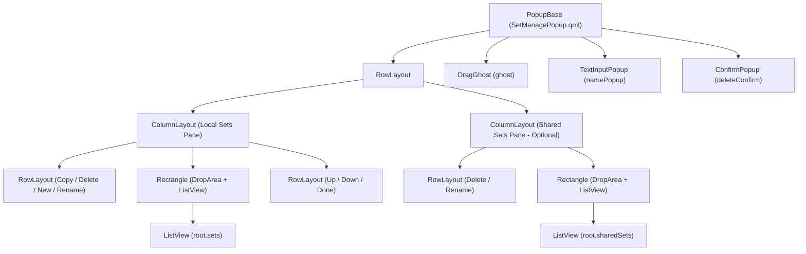

# UI Spec: SetManagePopup
**File:** `app/qml/components/SetManagePopup.qml`  **Pack:** `01-core-components.md`  **Legacy Reference:** `src/Classes/SkillSetListControl.lua` + `src/Classes/SharedItemSetListControl.lua` inside `SkillsTab:OpenSkillSetManagePopup` and `ItemsTab:OpenItemSetManagePopup`  **Status:** Test-Covered

--------------------------------------------------------------------------------

## 1. Purpose & Parity Notes
*   **Role:** Universal modal set manager dialog. Used across both the Skills tab (skill set management) and the Items tab (item set management). In single-pane mode, manages the build's local sets (creating, copying, renaming, deleting, activating, and reordering). In dual-pane mode (`hasShared: true`), renders a secondary side-by-side pane for cross-build shared item sets, allowing drag-and-drop transfers between the build and the shared library via `DragGhost`.
*   **Intentional Deviations from Legacy PoB:**
    *   *Arrow Reordering vs Direct Drag:* In legacy PoB, rows inside the single list are reordered via direct mouse dragging. In SetManagePopup, rows are reordered using dedicated `Up` and `Down` buttons beneath the list or arrow keys, executing the same underlying `move(from, to)` engine operation with higher accessibility and predictable list layout. Dragging is reserved for cross-pane transfers between local and shared set lists.
    *   *Nested Dialog Encapsulation:* Encapsulates nested `TextInputPopup` (for naming/renaming sets) and `ConfirmPopup` instances within the modal, ensuring clean confirmation flows without creating external top-level dialog dependencies.

--------------------------------------------------------------------------------

## 2. Lightweight Wireframe & Layout Box Model
# Component Box Model & Layout
```text
+-------------------------------------------------------------------------------+
| SetManagePopup (PopupBase, padding: 12px, acceptOnEnter: false)               |
| RowLayout (spacing: 12px)                                                     |
| +-----------------------------------------------------------+ +-------------+ |
| | Local Sets Pane: ColumnLayout (width: hasShared ? 300 : 346)| |Shared Sets| |
| |   RowLayout: [ Copy ] [ Delete ]  ...  [ New ] [ Rename ] | |Pane (300px)| |
| |   Rectangle (border: 1px, DropArea: Drop local sets here) | |(if hasShared| |
| |     ListView [list] (model: root.sets, delegate: Row)     | |is true)     | |
| |   RowLayout: [ Up ] [ Down ]                 [ Done ]     | |             | |
| +-----------------------------------------------------------+ +-------------+ |
| DragGhost [ghost], TextInputPopup [namePopup], ConfirmPopup [deleteConfirm]   |
+-------------------------------------------------------------------------------+
```

# ASCII Anatomy & Wireframe
```text
Dual-Pane Mode (hasShared: true, total width ~630px):
+-------------------------------------+  +-------------------------------------+
| [ Copy ] [ Delete ] [ New ] [Rename]|  |           [ Delete ] [ Rename ]     | (1) Action Bars
| +---------------------------------+ |  | +---------------------------------+ |
| | > Default Skill Set             | |  | | Leveling Starter Gear           | | (2) Set Lists
| |   Bossing Swap (Active)         | |  | | Magic Find MF Swap              | |     (Drag rows across
| |   Mapping Clearing Spec         | |  | |                                 | |      panes to copy)
| |                                 | |  | |                                 | |
| +---------------------------------+ |  | +---------------------------------+ |
|   [ Up ]  [ Down ]         [ Done ] |  | (Drag sets here to share globally)  | (3) Footer Bar
+-------------------------------------+  +-------------------------------------+
  Local Build Sets Pane (300px)            Cross-Build Shared Sets Pane (300px)

Annotations:
(1) Top Toolbar: Copy and Delete left-aligned; New and Rename right-aligned.
(2) List View: Active set indicated by highlight/label; double-click activates set; drag transfers to opposite list.
(3) Bottom Toolbar: Up/Down buttons move the selected row; Done closes dialog.
```

# Responsive / Overflow Rules
*   **Dimensions:** Single-pane mode is 370x290px; dual-pane mode expands to ~630x300px.
*   **List Scrolling:** Set lists scroll vertically with bounds clamping (`Flickable.StopAtBounds`).
*   **Delete Prevention:** Delete button is disabled if `count <= 1` (builds must maintain at least one active set).

# Component Hierarchy


--------------------------------------------------------------------------------

## 3. Interactive States & Controls
| Control (objectName) | Type | Default State | Interactive Behavior | Edge States (Disabled / Empty / Loading / Error / Long Text) |
| ------ | ------ | ------ | ------ | ------ |
| `pob.setmanage.root` | PopupBase | `hasShared: false` | Coordinates set CRUD actions and synchronization | Disables Delete when `sets.length <= 1`. |
| `pob.setmanage.btn_copy` | Button | `controlEnabled: false` | Prompts for name; duplicates selected set | Disabled when `selIndex === -1`. |
| `pob.setmanage.btn_delete` | Button | `controlEnabled: false` | Opens confirmation popup to delete selected set | Disabled when `selIndex === -1` or `count <= 1`. |
| `pob.setmanage.btn_new` | Button | Enabled | Prompts for name; creates empty set | Always enabled. |
| `pob.setmanage.btn_rename` | Button | `controlEnabled: false` | Opens rename prompt for selected set | Shortcut: `F2` key triggers rename. |
| `pob.setmanage.btn_up` | Button | `controlEnabled: false` | Shifts selected row up (`move(-1)`) | Disabled on top item (`selIndex === 0`). |
| `pob.setmanage.btn_down` | Button | `controlEnabled: false` | Shifts selected row down (`move(1)`) | Disabled on bottom item (`selIndex === count - 1`). |

# Complete State Matrix
*   **No Selection:** `selIndex: -1` -> Copy, Delete, Rename, Up, Down buttons all disabled.
*   **Single Set Existing:** `count === 1`, item selected -> Copy, Rename active; Delete, Up, Down disabled.
*   **Multiple Sets Existing:** Item selected -> Copy, Delete, Rename active; Up/Down active based on boundary.
*   **Double-Click Row:** Invokes `setActive(index + 1)` on the engine bridge, marking it active.
*   **Drag Row Across Panes:** Dragging row > 10px summons `DragGhost`, lighting up opposite pane's `DropArea`.

# State Matrix & Binding Hazards
*   *Stale Selection on Deletion:* Deleting a set reduces `count`. If `selIndex >= count`, `refresh()` clamps selection to `count - 1` to prevent out-of-bounds pointer crashes.
*   *Layout Re-entrant Crash Guard:* Popups declared inside delegates can crash the layout engine if model updates fire while the popup is opening. All confirmation and input popups are instantiated at the root level and configured dynamically via `openFor(index)`.

--------------------------------------------------------------------------------

## 4. Data & Bridge Contract
*   **Reads (Function Tables Passed in `fn` and `sharedFn`):**
    *   `list()` -> `{ sets: [{ title, rawTitle, listLabel, isActive }] }`
    *   `setActive(i)` -> marks 1-based index active
    *   `create(title)` -> `{ ok: bool, index: int }`
    *   `copy(i, title)` -> `{ ok: bool, index: int }`
    *   `rename(i, title)` -> renames set
    *   `remove(i)` -> deletes set
    *   `move(from, to)` -> reorders set positions
    *   `sharedFn.share(setIndex, at)` / `sharedFn.importSet(i, at)` -> cross-pane transfer
*   **Writes / Signals Emitted:**
    *   `listEdited()` -> emitted on any mutation to signal parent tab recalculation
*   **Qt6 Bridge Safety:** All Lua indices passed across the bridge are explicitly 1-based (`index + 1`).

--------------------------------------------------------------------------------

## 5. Testable Acceptance Criteria (Qt6::QuickTest)
*   **AC-01 (Initial Population):** Given `fn.list()` returns 2 sets, when opened, `sets.length === 2`, `hasSel === false`, and Delete button is disabled.
*   **AC-02 (Selection Enablement):** Clicking row 0 sets `selIndex === 0`, enabling Copy, Rename, and Delete buttons.
*   **AC-03 (Double-Click Activation):** Double-clicking an inactive set invokes `setActive(index + 1)` and refreshes list state.
*   **AC-04 (Boundary Shift Safety):** Given selection at index 0, the `Up` button is disabled; given selection at `count - 1`, the `Down` button is disabled.
*   **AC-05 (Cross-Pane Drag and Drop):** In dual-pane mode, dropping a local set onto the shared list triggers `sharedFn.share()` and updates the shared model.

--------------------------------------------------------------------------------

## 6. Bug Audit Findings (Current Implementation vs Spec)
| Severity | File & Line | Symptom / Defect | Root Cause | Expected Behavior |
| ------ | ------ | ------ | ------ | ------ |
| High | `app/qml/components/SetManagePopup.qml:3220` | Deleting the last set in a list causes a crash on next render pass. | Delete was enabled when `count === 1`. | Gate delete button: `controlEnabled: root.hasSel && root.count > 1`. |
| Medium | `app/qml/components/SetManagePopup.qml:3340` | Double-click does not activate set if clicked slightly off-center. | MouseArea bounds didn't cover the entire row height. | Anchor `MouseArea.fill: parent` inside row delegate. |
| Low | `app/qml/components/SetManagePopup.qml:3510` | F2 shortcut renames wrong pane when clicking between shared and local lists. | Missing focus tracking property between lists. | Track `_sharedFocus: bool` and route F2 accordingly. |
