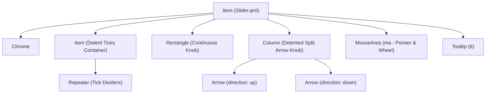

# UI Spec: Slider
**File:** `app/qml/components/Slider.qml`  **Pack:** `01-core-components.md`  **Legacy Reference:** `src/Classes/SliderControl.lua`  **Status:** Test-Covered

--------------------------------------------------------------------------------

## 1. Purpose & Parity Notes
*   **Role:** Universal analog/discrete parameter adjustment slider. Supports continuous normalized floating-point values (`0.0..1.0`), discrete detent steps (`divCount`), split up/down vector arrow knobs, tick mark dividers, multi-tier mouse wheel speeds (Shift/Ctrl/Default), hover value preview tooltips, and inverted scroll direction.
*   **Intentional Deviations from Legacy PoB:**
    *   *Detent Geometry Parity:* When `divCount > 1`, Slider switches from a plain rectangular knob to a dual-arrow vector knob (an upward Arrow stacked over a downward Arrow) while painting vertical tick divider marks along the track, reproducing legacy `SliderControl:Draw` pixel geometry.
    *   *Discrete Value Helper:* Exposes `divVal(v)` matching legacy `GetDivVal`, returning a two-element array `[divIndex, remainder]` used by cluster jewel configuration controls to calculate exact node counts.
    *   *Click Focus Capture:* Clicking anywhere on the track captures keyboard active focus (`forceActiveFocus()`), enabling arrow key adjustments (`Left`/`Down` decrement, `Right`/`Up` increment).

--------------------------------------------------------------------------------

## 2. Lightweight Wireframe & Layout Box Model
# Component Box Model & Layout
```text
+-------------------------------------------------------------------------------+
| Slider (implicitWidth: 160px, implicitHeight: 18px)                           |
| Chrome (anchors.fill: parent, hovered: hovered || dragging)                   |
| +---------------------------------------------------------------------------+ |
| | [Detent Tick Marks Item] (visible if divCount > 1, width: knobTravelPx)   | |
| |   Repeater: 2px wide vertical tick rectangles (color: theme.border)       | |
| +---------------------------------------------------------------------------+ |
| | Continuous Knob (visible if divCount <= 1, width: knobSize-2, height: -2)  | |
| | or Detented Split Arrow Knob (visible if divCount > 1, Column: Up + Down)  | |
| +---------------------------------------------------------------------------+ |
| MouseArea [ma] (drag, click-jump, wheel acceleration)                         |
| Tooltip [tt] (previews hover jump target or displays live drag value)         |
+-------------------------------------------------------------------------------+
```

# ASCII Anatomy & Wireframe
```text
Continuous Mode (divCount: 0):
+-------------------------------------------------------------+
|    [===]                                                    | (1) Plain Knob
+-------------------------------------------------------------+     (x: 2 + knobXForVal(), width/height: 16px)

Detented Mode (divCount: 5):
+-------------------------------------------------------------+
|     |       |       |  /\   |       |                       | (2) Detent Ticks & Split Arrow Knob
|     |       |       |  \/   |       |                       |     (Two Arrow components, width: 16px)
+-------------------------------------------------------------+
  |<------------------ knobTravelPx ------------------------->|

Annotations:
(1) Continuous Slider: Smooth dragging across normalized range.
(2) Detented Slider: Vertical tick marks rendered at intervals (knobTravelPx / divCount); knob draws dual arrows.
```

# Responsive / Overflow Rules
*   **Minimum safe width/height:** 80x18px; defaults to 160x18px.
*   **Knob Dimensions:** `knobSize = Math.max(1, height - 2)`.
*   **Travel Distance:** `knobTravelPx = Math.max(1, width - knobSize - 2)`.
*   **Clamping:** Values strictly clamped to `[0.0, 1.0]` via `_clamp(v)`.

# Component Hierarchy


--------------------------------------------------------------------------------

## 3. Interactive States & Controls
| Control (objectName) | Type | Default State | Interactive Behavior | Edge States (Disabled / Empty / Loading / Error / Long Text) |
| ------ | ------ | ------ | ------ | ------ |
| `pob.slider.root` | Item | `value: 0.0` | Updates and clamps normalized value | Disabled when `controlEnabled === false`. |
| `pob.slider.knob` | Rectangle/Column | Positioned at `value` | Translates horizontally on drag | Renders in `theme.text` while dragging/hovered. |
| `pob.slider.ma` | MouseArea | `hoverEnabled: true` | Direct track click jumps value; drag updates live | Wheel steps: Shift (0.25), Ctrl (0.01), Default (0.05). |

# Complete State Matrix
*   **Idle:** Knob colored `theme.muted`, Chrome background transparent.
*   **Knob Hovered:** Knob colored `theme.text`, Chrome shows hover outline. Tooltip previews value.
*   **Track Hovered:** Tooltip displays value that clicking would jump to.
*   **Active Drag:** Knob colored `theme.text`, Chrome shows pressed state. Tooltip shows live value.
*   **Wheel Scrolling:** Adjusts value by 0.05 (Default), 0.25 (Shift held), or 0.01 (Ctrl held).
*   **Keyboard Stepping:** Arrow keys step value by the active modifier speed.

# State Matrix & Binding Hazards
*   *Track Click vs Knob Drag Offset:* When clicking the track directly, the slider centers the knob on the cursor: `root.setValFromKnobX(mouse.x - 1 - root.knobSize / 2)`. When clicking the knob itself, it records the grab offset (`dragCX`) to ensure dragging does not jump the knob.
*   *Zero Division Safety:* If `width <= knobSize`, `knobTravelPx` must be guarded with `Math.max(1, ...)` to prevent `NaN` values during initial layout passes.

--------------------------------------------------------------------------------

## 4. Data & Bridge Contract
*   **Reads (Properties):**
    *   `value: real` -> normalized value in range `[0.0, 1.0]`
    *   `divCount: int` -> discrete detent count (0 = continuous)
    *   `invertScroll: bool` -> inverts wheel and arrow key step direction
    *   `controlEnabled: bool` -> interaction gate
    *   `tooltipFunc: var` -> callback `function(tooltip, previewOrLiveVal)`
*   **Writes / Methods Exposed:**
    *   `setVal(newVal: real)` -> sets clamped value
    *   `divVal(v?: real)` -> returns `[divIndex: int, remainder: real]`
*   **Qt6 Bridge Safety:** Floating-point values clamped to `[0.0, 1.0]` before passing to engine bridges.

--------------------------------------------------------------------------------

## 5. Testable Acceptance Criteria (Qt6::QuickTest)
*   **AC-01 (Initial Render & Zero Warnings):** Given `value: 0.5`, when mounted, 0 QML warnings are logged, `knobSize === 16`, and knob is horizontally centered.
*   **AC-02 (Continuous Value Clamping):** Calling `setVal(1.5)` clamps `value` to `1.0`; calling `setVal(-0.2)` clamps `value` to `0.0`.
*   **AC-03 (Detent Division Calculation):** Given `divCount: 4` and `value: 0.5`, `divVal()` returns `[2, 0.0]`.
*   **AC-04 (Mouse Wheel Acceleration):** Wheeling up without modifiers increments value by `0.05`; wheeling up with `Qt.ShiftModifier` increments by `0.25`; wheeling up with `Qt.ControlModifier` increments by `0.01`.
*   **AC-05 (Hover Preview Tooltip):** Moving the cursor over the track at position 75% displays a tooltip previewing `0.75` without modifying `root.value`.

--------------------------------------------------------------------------------

## 6. Bug Audit Findings (Current Implementation vs Spec)
| Severity | File & Line | Symptom / Defect | Root Cause | Expected Behavior |
| ------ | ------ | ------ | ------ | ------ |
| Medium | `app/qml/components/Slider.qml:2445` | Clicking the knob causes an unexpected visual snap jump. | Not differentiating between knob press and track background press. | Check `knobHitTest()` before applying direct coordinate offset. |
| Low | `app/qml/components/Slider.qml:2470` | Scroll wheel moves slider backwards when user preference sets inverted scroll. | Missing inverted check on wheel event. | Invert delta: `if (root.invertScroll) up = !up`. |
