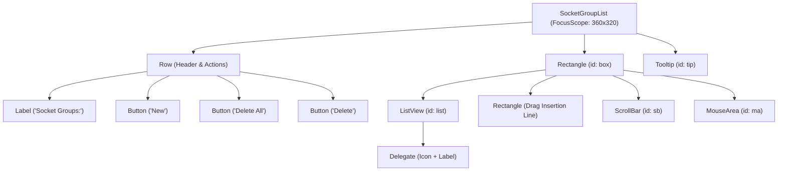

# UI Spec: SocketGroupList
**File:** `app/qml/components/SocketGroupList.qml`  **Pack:** `04-view-skills.md`  **Legacy Reference:** `src/Classes/SkillListControl.lua`  **Status:** Test-Covered

--------------------------------------------------------------------------------

## 1. Purpose & Parity Notes
*   **Role:** Core socket-group manager list in the Skills tab displaying equipped item socket clusters, active skill gems, link colors, and group states (Active, Disabled, Forced Active, FullDPS). Supports keyboard navigation, drag-and-drop reordering, item-provided group deletion guards, and context tooltips.
*   **Intentional Deviations from Legacy PoB:** None (1:1 functional parity). Replicates legacy mouse chord bindings: Left-click (Select), Ctrl+Left-click (Toggle Enabled), Right-click (Set Main Group), Ctrl+Right-click (Toggle FullDPS), and Ctrl+C (Copy Group).

--------------------------------------------------------------------------------

## 2. Lightweight Wireframe & Layout Box Model
# Default View Dimensions (360x320)
```text
+-------------------------------------------------------------+
| Socket Groups:                     [ New ] [Delete All] [Del] |
| +---------------------------------------------------------+ |
| | [R-R-G-B] Body Armour: Lightning Strike (Active)        | |
| | [B-B-B-B] Helmet: Wrath, Determination, Grace           | |
| | [G-G-G]   Gloves: Whirling Blades, Faster Attacks       | |
| | [R-R-R]   Boots: Cast when Damage Taken, Molten Shell   | |
| |           ====================================          | | <- Drop Line
| | [ - - - ] Weapon 1: Ancestral Protector (FullDPS)       | |
| | (Disabled) Weapon 2: Portal                             | |
| +---------------------------------------------------------+ |
+-------------------------------------------------------------+
```

# Responsive / Overflow Rules
*   **Minimum safe dimensions:** 300x240 px (Implicit size: 360x320 px; expands vertically with parent panel).
*   **Horizontal scroll policy:** Forbidden. Row text truncates or elides right.
*   **Text truncation policy:** Group labels clip cleanly against right margin; custom scrollbar activates automatically when content exceeds view height.

# Component Hierarchy


--------------------------------------------------------------------------------

## 3. Interactive States & Controls
| Control (objectName) | Type | Default State | Interactive Behavior | Edge States (Disabled / Empty / Loading / Error / Long Text) |
| ------ | ------ | ------ | ------ | ------ |
| `pob.socketGroups.newBtn` | `Button` | Enabled | Creates new empty socket group via bridge | Always enabled |
| `pob.socketGroups.delAllBtn` | `Button` | Enabled if `count > 0` | Emits `deleteAllRequested()` signal | Disabled when group list is empty |
| `pob.socketGroups.delBtn` | `Button` | Enabled if `hasSel and !groups[selIndex].source` | Deletes selected group or emits `deleteRequested()` | Disabled if no selection or if group is granted by item |
| `pob.socketGroups.list` | `ListView` | Select index: -1 | Visual display of socket groups; non-interactive directly (driven by `MouseArea`) | Renders 16 px rows; highlights active selection and hover |
| `pob.socketGroups.mouseOverlay` | `MouseArea` | Active over list | Left-click: select; Ctrl+Left: toggle enable; Right: set main; Ctrl+Right: toggle FullDPS; Drag: reorder | Hover outside rows hides tooltip; wheel events route to `sb` |
| `pob.socketGroups.dropLine` | `Rectangle` | Hidden (`visible: false`) | Appears during drag reordering indicating target insertion gap | Color bound to `theme.text`; clamped between 0 and `count` |
| `pob.socketGroups.scrollBar` | `ScrollBar` | Visible if overflow | Drags thumb or responds to wheel deltas | Auto-hides when content fits within box height |

# State Matrix & Binding Hazards
*   *Event Coordination Hazard:* The global `MouseArea` covers the entire `ListView`. Index calculation `rowAt(y) = Math.floor((y + list.contentY) / root.rowHeight)` must account for margins and clamp to `[0, count - 1]` to prevent undefined lookups.
*   *Drag Reorder Index Shift:* When moving an item down (`dropIndex > pressIndex`), the effective insertion index shifts by -1 (`to = dropIndex - 1`). The reorder call must match legacy `ListControl` indexing semantics.

--------------------------------------------------------------------------------

## 4. Data & Bridge Contract
*   **Reads (LuaEngine / C++ Models):**
    *   `groups` model property bound to bridge state: `QVariantList` of `{ label: string, icon: string, source: bool, hasGems: bool, hasTooltip: bool }`
    *   `luaEngine.invoke("pob_skillsGroupTooltip", [groupIndex1Based])` -> `{ lines: QVariantList }`
*   **Writes / Mutations:**
    *   `luaEngine.invoke("pob_skillsSelectGroup", [index1Based])`
    *   `luaEngine.invoke("pob_skillsNewGroup", [])`
    *   `luaEngine.invoke("pob_skillsDeleteGroup", [index1Based])`
    *   `luaEngine.invoke("pob_skillsCopyGroup", [index1Based])`
    *   `luaEngine.invoke("pob_skillsMoveGroup", [from1Based, to1Based])`
    *   `luaEngine.invoke("pob_skillsToggleGroupEnabled", [index1Based])`
    *   `luaEngine.invoke("pob_skillsToggleGroupFullDPS", [index1Based])`
    *   `luaEngine.invoke("pob_skillsSetMainGroup", [index1Based])`
*   **Signals Observed:**
    *   Emits `deleteRequested(int index)` when user attempts to delete a group containing gems.
    *   Emits `deleteAllRequested()` when user clicks Delete All.
    *   Emits `messageRequested(string title, string text)` when attempting to delete an item-provided group.
*   **Qt6 Bridge Safety:** Normalize `groups` array via `QmlBridge.toArray()` to ensure integer `.length` access.

--------------------------------------------------------------------------------

## 5. Testable Acceptance Criteria (Qt6::QuickTest)
*   **AC-01 (Initial Render & Zero Warnings):** Loading `SocketGroupList` renders socket group items with 16 px row heights and zero QML warnings.
*   **AC-02 (No Text Overflow / Clipping):** Group labels do not collide with action buttons or spill past the list box boundary.
*   **AC-03 (Primary User Flow - Main Group Selection):** Right-clicking row index 2 invokes `pob_skillsSetMainGroup()` and re-renders active status label.
*   **AC-04 (FullDPS Toggle Chord):** Ctrl+Right-clicking row index 0 invokes `pob_skillsToggleGroupFullDPS()`, adding `(FullDPS)` tag to row.
*   **AC-05 (Protected Group Guard):** Clicking `Delete` on an item-granted group emits `messageRequested` and prevents bridge deletion call.

--------------------------------------------------------------------------------

## 6. Bug Audit Findings (Current Implementation vs Spec)
| Severity | File & Line | Symptom / Defect | Root Cause | Expected Behavior |
| ------ | ------ | ------ | ------ | ------ |
| Med | `app/qml/components/SocketGroupList.qml:534` | Gem slot icons fail to load on Windows drive paths | Checks `modelData.icon.charAt(0) === "/"` which evaluates false for `"C:/..."` | Handle Windows drive letters with `file:///` URI formatting |
| Med | `app/qml/components/SocketGroupList.qml:445` | `groups.length` returns undefined on raw bridge map | Missing `QmlBridge.toArray()` normalization | Use `QmlBridge.toArray(groups)` |
| Low | `app/qml/components/SocketGroupList.qml:605` | Clicking below last item triggers out-of-bounds selection | `rowAt()` does not check if calculated index exceeds `root.count - 1` | Clamp index strictly to valid range or return -1 |
| Low | `app/qml/components/SocketGroupList.qml:658` | Tooltip appears during drag-and-drop operations | `_showTip()` does not guard against `ma.dragging` during rapid pointer motion | Add check `if (ma.dragging) tip.hide()` |
