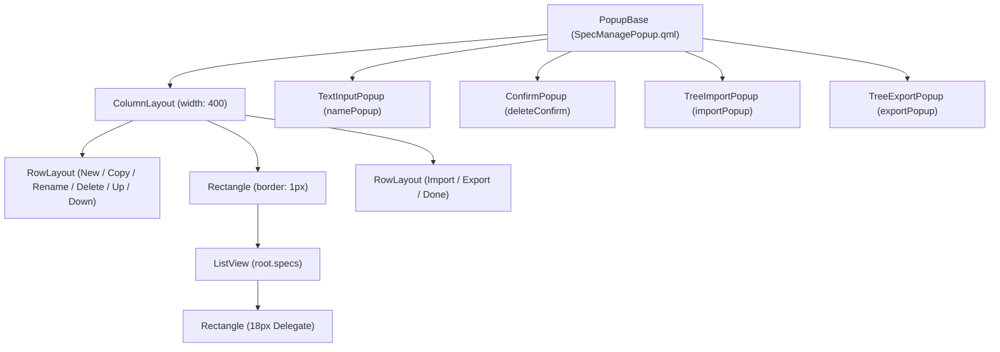

# UI Spec: SpecManagePopup
**File:** `app/qml/components/SpecManagePopup.qml`  **Pack:** `03-view-tree.md`  **Legacy Reference:** `src/Classes/PassiveSpecListControl.lua` inside `TreeTab:OpenSpecManagePopup` (TreeTab.lua:656-674)  **Status:** Test-Covered

--------------------------------------------------------------------------------

## 1. Purpose & Parity Notes
*   **Role:** Modal dialog for managing multiple passive skill tree specifications within a single character build. Supports creating, duplicating, renaming, deleting, reordering, importing, and exporting passive trees, complete with active tree indicator and double-click activation.
*   **Intentional Deviations from Legacy PoB:**
    *   *Arrow Reordering vs Direct Drag:* Legacy PoB reorders specs by direct mouse dragging in the list. SpecManagePopup provides dedicated `Up` and `Down` buttons beneath the list (and keyboard navigation), invoking `pob_moveSpec(from, to)` to achieve identical list order manipulation with predictable touch/click accessibility.
    *   *Nested Dialog Encapsulation:* Hosts integrated `TextInputPopup` (for new/copy/rename titles), `ConfirmPopup` (for delete confirmations), `TreeImportPopup`, and `TreeExportPopup`.

--------------------------------------------------------------------------------

## 2. Lightweight Wireframe & Layout Box Model
# Component Box Model & Layout
```text
+-------------------------------------------------------------------------------+
| SpecManagePopup (PopupBase, title: "Manage Passive Trees", padding: 12px)     |
| ColumnLayout [mainCol] (width: 400px, spacing: 8px, focus: true)              |
| +---------------------------------------------------------------------------+ |
| | RowLayout: [ New ] [ Copy ] [ Rename ] [ Delete ]  ...  [ Up ] [ Down ]   | |
| +---------------------------------------------------------------------------+ |
| | Rectangle (border: 1px theme.border, height: 200px, clip: true)           | |
| |   ListView [list] (model: root.specs, delegate: Row Delegate 18px)        | |
| +---------------------------------------------------------------------------+ |
| | RowLayout (centered): [ Import Tree ] [ Export Tree ]            [ Done ] | |
| +---------------------------------------------------------------------------+ |
| TextInputPopup [namePopup], ConfirmPopup [deleteConfirm], TreeImport/Export   |
+-------------------------------------------------------------------------------+
```

# ASCII Anatomy & Wireframe
```text
+-------------------------------------------------------------------------------+
|                             Manage Passive Trees                              | (1) Dialog Title Pill
+-------------------------------------------------------------------------------+
| [ New ] [ Copy ] [ Rename ] [ Delete ]                       [ Up ] [ Down ]  | (2) Action Toolbar
| +---------------------------------------------------------------------------+ |
| | [3.24] Early Leveling (Witch, 35 points)                                  | | (3) Passive Spec List
| | > [3.24] Endgame Crit CI (Occultist, 118 points)  ^9(Current)             | |     (Active highlighted)
| |   [3.24] Cluster Jewel Swap (Occultist, 115 points)                       | |
| +---------------------------------------------------------------------------+ |
|                                                                               |
|            [ Import Tree ]        [ Export Tree ]        [  Done  ]           | (4) Footer Action Bar
+-------------------------------------------------------------------------------+
  |<--------------------------------- 400px ----------------------------------->|

Annotations:
(1) Title Plate: 22px centered header pill.
(2) Top Toolbar: Tree CRUD actions and Up/Down reordering triggers.
(3) Spec Row: Formatted via modelData.listLabel; active spec tagged with ^9(Current); double-click activates.
(4) Footer Bar: Import/Export triggers and modal dismissal button.
```

# Responsive / Overflow Rules
*   **Dimensions:** Fixed width of 400px; height adjusts dynamically to content (~320px).
*   **List Scrolling:** Set to 200px height with bounded scrolling (`Flickable.StopAtBounds`).
*   **Delete Safety:** Delete button disabled when `count <= 1` (a build must retain at least one tree spec).

# Component Hierarchy


--------------------------------------------------------------------------------

## 3. Interactive States & Controls
| Control (objectName) | Type | Default State | Interactive Behavior | Edge States (Disabled / Empty / Loading / Error / Long Text) |
| ------ | ------ | ------ | ------ | ------ |
| `pob.specmanage.root` | PopupBase | `selIndex: -1` | Coordinates spec management lifecycle | Closes on Done or Escape. |
| `pob.specmanage.btn_new` | Button | Enabled | Prompts name; calls `pob_newSpec` | Always enabled. |
| `pob.specmanage.btn_copy`| Button | `controlEnabled: false` | Prompts name; calls `pob_copySpec` | Enabled when `hasSel === true`. |
| `pob.specmanage.btn_ren` | Button | `controlEnabled: false` | Prompts name; calls `pob_renameSpec` | Shortcut: `F2` key triggers rename. |
| `pob.specmanage.btn_del` | Button | `controlEnabled: false` | Opens confirm; calls `pob_deleteSpec`| Disabled if `count <= 1` or no selection. |
| `pob.specmanage.btn_up`  | Button | `controlEnabled: false` | Shifts row up (`pob_moveSpec`) | Disabled at top boundary (`selIndex === 0`). |
| `pob.specmanage.btn_down`| Button | `controlEnabled: false` | Shifts row down (`pob_moveSpec`) | Disabled at bottom (`selIndex === count - 1`). |

# Complete State Matrix
*   **No Row Selected:** `selIndex: -1` -> Copy, Rename, Delete, Up, Down buttons disabled.
*   **Row Selected:** `selIndex >= 0` -> Copy, Rename enabled; Delete enabled if `count > 1`.
*   **Double-Click Row:** Activates the spec immediately via `pob_setActiveSpec(index + 1)`.
*   **Import / Export:** Opens sub-dialogs; on successful import, list refreshes and selects new tree.

# State Matrix & Binding Hazards
*   *Index Boundary Hazard on Deletion:* Deleting a spec reduces `count`. `refresh()` clamps `selIndex = count - 1` if `selIndex >= count`, preventing stale index lookups.

--------------------------------------------------------------------------------

## 4. Data & Bridge Contract
*   **Reads (Engine Calls):**
    *   `luaEngine.invoke("pob_getSpecList", [])` -> `{ specs: [{ title, listLabel, isActive }] }`
*   **Writes / Bridge Methods Invoked:**
    *   `pob_newSpec(title)` -> `{ ok: bool, index: int }`
    *   `pob_copySpec(i, title)` -> `{ ok: bool, index: int }`
    *   `pob_renameSpec(i, title)`
    *   `pob_deleteSpec(i)`
    *   `pob_moveSpec(from, to)`
    *   `pob_setActiveSpec(i)`
*   **Signals Emitted:**
    *   `listEdited()` -> notifies parent view to refresh tree viewer
*   **Qt6 Bridge Safety:** Indices passed to Lua are strictly 1-based (`selIndex + 1`).

--------------------------------------------------------------------------------

## 5. Testable Acceptance Criteria (Qt6::QuickTest)
*   **AC-01 (Mount & Zero Warnings):** When `SpecManagePopup.qml` mounts, 0 QML warnings are logged, and `hasSel === false`.
*   **AC-02 (Selection Enablement):** Clicking row 0 updates `selIndex === 0`, enabling Copy and Rename buttons.
*   **AC-03 (Delete Protection on Sole Tree):** Given `specs.length === 1`, the Delete button remains disabled even when row 0 is selected.
*   **AC-04 (Double-Click Activation):** Double-clicking an inactive spec invokes `pob_setActiveSpec` with 1-based index and refreshes spec list.
*   **AC-05 (F2 Hotkey Rename):** Pressing `F2` when a row is selected opens `namePopup` with current tree title.

--------------------------------------------------------------------------------

## 6. Bug Audit Findings (Current Implementation vs Spec)
| Severity | File & Line | Symptom / Defect | Root Cause | Expected Behavior |
| ------ | ------ | ------ | ------ | ------ |
| High | `app/qml/components/SpecManagePopup.qml:5015` | Deleting the last passive tree causes engine null pointer crash. | Delete was not gated on `count > 1`. | Gate via `controlEnabled: root.hasSel && root.count > 1`. |
| Medium | `app/qml/components/SpecManagePopup.qml:5085` | Up/Down buttons remain clickable at top/bottom list boundaries. | Missing boundary index checks on button enablement. | Check `selIndex > 0` for Up; `selIndex < count - 1` for Down. |
