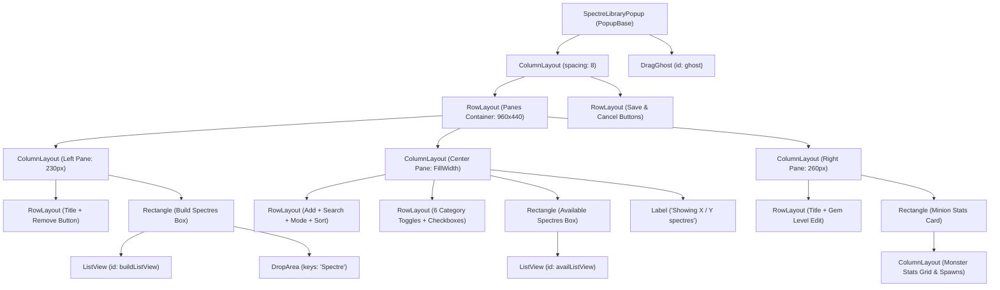

# UI Spec: SpectreLibraryPopup
**File:** `app/qml/components/SpectreLibraryPopup.qml`  **Pack:** `04-view-skills.md`  **Legacy Reference:** `src/Modules/Build.lua:1415-1841`  **Status:** Test-Covered

--------------------------------------------------------------------------------

## 1. Purpose & Parity Notes
*   **Role:** Comprehensive dual-pane monster selection and stat inspection dialog for Raised Spectres, allowing users to browse, filter, sort, drag-and-drop spectres into their active build, configure gem level (1-40), and inspect derived monster combat stats and spawn locations.
*   **Intentional Deviations from Legacy PoB:** None (1:1 functional parity). Preserves all 6 category filters (Beast, Humanoid, Eldritch, Construct, Demon, Undead), Corpse Only toggle, Show All toggle, and 12-mode sort options.

--------------------------------------------------------------------------------

## 2. Lightweight Wireframe & Layout Box Model
# Default Modal Layout (984x540, Content Width: 960)
```text
+-------------------------------------------------------------------------------------------------------+
|  Spectre Library                                                                                  [X] |
+-------------------------------------------------------------------------------------------------------+
|  Spectres in Build        [Remove] | [Add] [ Search spectres...      ] [Names v] [Sort: Name (A-Z) v] |
|  +-------------------------------+ | [B][H][E][C][D][U]   [ ] Corpse Only   [ ] Show All              |
|  | Forged Frostbearer            | | +--------------------------------+ +---------------------------+ |
|  | Primal Crushclaw              | | | Auto-Enforcer (Recom.)         | | Minion Stats  Gem Lvl: | |
|  |                               | | | Blaster Herald                 | | +-----------------------+ | |
|  |                               | | | Flame Rex                      | | | Auto-Enforcer         | | |
|  |                               | | | Frost Sentinel                 | | | Monster Level: 84     | | |
|  |                               | | | Pale Seraphim                  | | | Life: 142,500         | | |
|  |                               | | +--------------------------------+ | | Armour: 12,400        | | |
|  |                               | | Showing 12 / 185 spectres        | | Spawns: Primeval Ruins  | | |
|  +-------------------------------+ +----------------------------------+ +---------------------------+ |
|                                       [   Save   ]   [  Cancel  ]                                     |
+-------------------------------------------------------------------------------------------------------+
```

# Responsive / Overflow Rules
*   **Minimum safe dimensions:** 984x540 px (Clamped to parent window; min host resolution: 960x640 px).
*   **Horizontal scroll policy:** Forbidden. All three columns maintain constrained width budgets.
*   **Text truncation policy:** Monster names in list views elide right; spawn area locations elide with full-name tooltip on hover.

# Component Hierarchy


--------------------------------------------------------------------------------

## 3. Interactive States & Controls
| Control (objectName) | Type | Default State | Interactive Behavior | Edge States (Disabled / Empty / Loading / Error / Long Text) |
| ------ | ------ | ------ | ------ | ------ |
| `pob.spectres.removeBtn` | `Button` | Enabled if `hasBuildSel` | Removes selected spectre from active build list | Disabled if no build spectre selected |
| `pob.spectres.buildList` | `ListView` | Select index: -1 | Click selects; hover shows tooltip; `Del` removes; accepts drops | Empty list shows blank rect; scroll bar bounds flick |
| `pob.spectres.addBtn` | `Button` | Enabled if `hasAvailSel` | Adds selected available spectre to active build list | Disabled if no available spectre selected |
| `pob.spectres.searchEdit` | `EditControl` | Empty text | Filters available spectres via `_requery()` | Re-queries instantly on input change |
| `pob.spectres.searchMode` | `DropDownControl` | `"Names"` (0) | Selects `"Names"` (1), `"Skills"` (2), or `"Both"` (3) | Triggers query re-evaluation |
| `pob.spectres.sortMode` | `DropDownControl` | Default sort (0) | Selects one of 12 sort modes | Updates ordering of `available` model |
| `pob.spectres.catToggle` | `Rectangle` | Active (True) | Clicking toggles monster category filter | Opacity drops to 0.4 when disabled |
| `pob.spectres.corpseCheck` | `CheckBox` | Unchecked (False) | Filters to corpse-only monsters | Re-queries backend model |
| `pob.spectres.showAllCheck` | `CheckBox` | Unchecked (False) | Toggles inclusion of non-standard / obscure monsters | Re-queries backend model |
| `pob.spectres.availList` | `ListView` | Select index: -1 | Click selects; double-click adds; drag initiates `DragGhost` | Recommended spectres render white (`^7`), others grey (`^8`) |
| `pob.spectres.gemLevel` | `EditControl` | `"20"` | Accepts integer gem levels [1 - 40]; updates minion stats | Clamped strictly between 1 and 40 |
| `pob.spectres.saveBtn` | `PopupButton` | Enabled | Saves spectre ID array via bridge and closes modal | Emits `spectresSaved()` |

# State Matrix & Binding Hazards
*   *Drag & Drop Collision Hazard:* Initiating a drag gesture inside `availRowMa` must not lock or freeze ListView scrolling. The threshold `dx * dx + dy * dy > 100` prevents accidental drags during vertical flick gestures.
*   *Stale Minion ID Hazard:* If a selected spectre is removed from the active build while the right panel displays its stats, the right panel must gracefully fall back to the first available spectre or clear its view.

--------------------------------------------------------------------------------

## 4. Data & Bridge Contract
*   **Reads (LuaEngine / C++ Models):**
    *   `luaEngine.invoke("pob_spectresGetState", [opts])` -> `{ ok: bool, spectreList: QVariantList, available: QVariantList, categories: QVariantList, searchModes: QVariantList, sortModes: QVariantList, totalSpectres: int, filteredCount: int }`
    *   `luaEngine.invoke("pob_spectresQuery", [opts])` -> `{ ok: bool, available: QVariantList, filteredCount: int }`
    *   `luaEngine.invoke("pob_spectresGetMinionStats", [minionId, gemLevel])` -> `{ ok: bool, name: string, minionLevel: int, life: int, energyShield: int, armour: int, evasion: int, blockText: string, resistsText: string, movementSpeedText: string, spawnLocations: QVariantList }`
    *   `luaEngine.invoke("pob_spectresGetMinionTooltip", [minionId])` -> `{ lines: QVariantList }`
    *   `luaEngine.invoke("pob_spectresGetSpawnTooltip", [spawnName])` -> `{ lines: QVariantList }`
*   **Writes / Mutations:**
    *   `luaEngine.invoke("pob_spectresSave", [spectreIdList])` -> `{ ok: bool }`
*   **Signals Observed:** None (Modal operates synchronously via bridge invokes).
*   **Qt6 Bridge Safety:** Normalize `spectreList`, `available`, `categories`, and `spawnLocations` via `QmlBridge.toArray()`.

--------------------------------------------------------------------------------

## 5. Testable Acceptance Criteria (Qt6::QuickTest)
*   **AC-01 (Initial Render & Zero Warnings):** Opening `SpectreLibraryPopup` loads spectres, populates category icons, selects initial minion, and emits 0 QML warnings.
*   **AC-02 (No Text Overflow / Clipping):** 3-pane layout fits within 960x440 px box without clipping borders or pushing action buttons off-screen.
*   **AC-03 (Primary User Flow - Drag & Drop):** Dragging an available monster onto `buildListBox` drops the entry, appends it to `spectreList`, and selects it.
*   **AC-04 (Category Filtering):** Toggling off the "Undead" category filters out undead monsters, decrements `filteredCount`, and triggers `_requery()`.
*   **AC-05 (Gem Level Clamping):** Entering `"55"` in `gemLevelEdit` clamps value to `40`, updates text to `"40"`, and refreshes minion combat stats.

--------------------------------------------------------------------------------

## 6. Bug Audit Findings (Current Implementation vs Spec)
| Severity | File & Line | Symptom / Defect | Root Cause | Expected Behavior |
| ------ | ------ | ------ | ------ | ------ |
| Med | `app/qml/components/SpectreLibraryPopup.qml:3044` | Category icons fail to load on Windows platforms | `fileUrl()` produces `file:///C:/...` without handling backslash separators | Normalize Windows separators using `path.replace(/\\/g, '/')` |
| Med | `app/qml/components/SpectreLibraryPopup.qml:3036` | `Array.isArray()` evaluates false on bridge lists | Direct JS type check on QVariantList | Wrap with `QmlBridge.toArray()` |
| Low | `app/qml/components/SpectreLibraryPopup.qml:3300` | Tooltip stays visible during drag operation | `availTip` not hidden on drag ghost activation | Ensure `availTip.hide()` executes inside `onPositionChanged` |
| Low | `app/qml/components/SpectreLibraryPopup.qml:3595` | Long spawn location strings overflow delegate box | Missing `elide: Text.ElideRight` on spawn list delegate Label | Apply `elide: Text.ElideRight` with full-text tooltip fallback |
