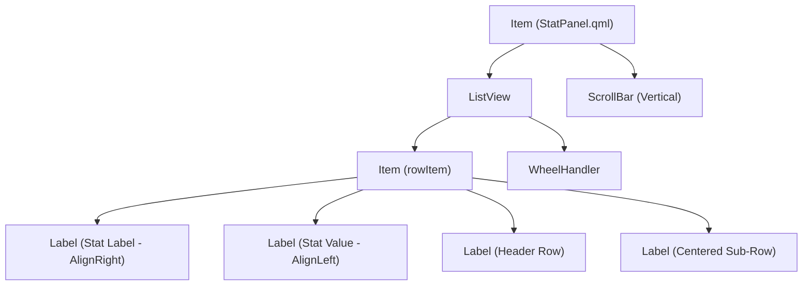

# UI Spec: StatPanel
**File:** `app/qml/components/StatPanel.qml`  **Pack:** `00-shell-and-theme.md`  **Legacy Reference:** `src/Modules/Build.lua:1637-1809` (`buildMode:RefreshStatList`, `buildMode:AddDisplayStatList`)  **Status:** Test-Covered

--------------------------------------------------------------------------------

## 1. Purpose & Parity Notes
*   **Role:** The primary character calculation output display located in the collapsible sidebar. Renders player and minion offensive, defensive, and utility metrics in a dual-column layout with right-anchored stat labels and left-aligned values, supporting hierarchical headers, disabled skill banners, and breakdown rows.
*   **Intentional Deviations from Legacy PoB:**
    *   *Column Positioning & Text Rendering:* Legacy positioned columns using absolute anchor coordinates `{{x=170, align="RIGHT_X"}, {x=174, align="LEFT"}}` measured via `.tgf` font atlas metrics. In Qt Quick, measuring with bitmap metrics but painting with TrueType vector fonts causes glyph measurement mismatch and text collision. StatPanel positions the label column within an explicit bounding box `x: 0; width: colLabelX - 2` with `horizontalAlignment: Text.AlignRight` and `elide: Text.ElideLeft`.
    *   *SkillDPS Placement:* Legacy walks a single list, interleaving SkillDPS entries directly below FullDPS. The Qt bridge splits the payload into `stats` and `skillDPS`, causing SkillDPS rows to be rendered after general player stats while strictly maintaining intra-group sorting.
    *   *Info Messages:* `mainSkill.infoMessage` / `infoMessage2` are omitted because `pob_getOutput` does not marshal them in the current bridge schema.

--------------------------------------------------------------------------------

## 2. Lightweight Wireframe & Layout Box Model
# Component Box Model & Layout
```text
+-----------------------------------------------------------------------------------+
| StatPanel (implicitWidth: theme.sideBarWidth [~310px], implicitHeight: contentH)  |
| ListView (clip: true, interactive: false, contentY: scrollBar.offset)             |
| +------------------------------------------------------------------+ +----------+ |
| | Row: Header ("Minion:", "Player:", "Skill disabled:") (h: 18px)  | |ScrollBar | |
| | Label (x: 0, font.bold: true, full width)                        | |width:18px| |
| +------------------------------------------------------------------+ |dir: VERT | |
| | Row: Standard Stat (h: 16px)                                     | |step: 40  | |
| | [Label (x: 0, w: 168px, AlignRight)]  [Value (x: 174px, w: auto)]| |autoHide: | |
| | "Effective Hit Pool:"                 "124,532"                  | | true     | |
| +------------------------------------------------------------------+ |          | |
| | Row: Center / Breakdown ("from Trigger", skillPart) (h: 14px)    | |          | |
| | [Label (x: colCenterX - width/2, centered at x: 140px)]          | |          | |
| +------------------------------------------------------------------+ |          | |
| | Row: Spacer (h: 10px, transparent gap)                           | |          | |
| +------------------------------------------------------------------+ +----------+ |
+-----------------------------------------------------------------------------------+
```

# ASCII Anatomy & Wireframe
```text
+-------------------------------------------------------------+---+
| Player:                                                     | ^ |
|                 Life:  4,521                                | | |
|        Mana Unreserved:  124                                | | |
|    Effective Hit Pool:  85,412                              | | |
|   Total DPS (FullDPS):  12,450,210                          | # |
|                                                             | # |
| Skill disabled:                                             | | |
|           Cannot be used with equipped weapon type          | | |
|                                                             | | |
| 6x Explosive Arrow (trigger):  2,451,020                    | | |
|                        Explosion                            | | |
|                  from Cast On Critical Strike               | v |
+-------------------------------------------------------------+---+
  |<--- 168px (AlignRight) --->| 4px |<--- Value (AlignLeft) --->|
  |                           170   174                          |
```

# Responsive / Overflow Rules
*   **Minimum safe width/height:** 280x200px. Width is governed by `theme.sideBarWidth`.
*   **Horizontal scroll policy:** Forbidden. Long stat labels elide to the left (`Text.ElideLeft`) to preserve key distinguishing qualifiers at the end of stat names.
*   **Vertical scroll policy:** Managed via internal `ScrollBar` (width: 18px). Scrolling is wheel-driven through a dedicated `WheelHandler`. `interactive: false` on `ListView` prevents touch drag conflicts.
*   **Row Heights:** Exact legacy port constants: Headers: 18px, Stats: 16px, Sub-rows/Center: 14px, Spacers: 10px.

# Component Hierarchy


--------------------------------------------------------------------------------

## 3. Interactive States & Controls
| Control (objectName) | Type | Default State | Interactive Behavior | Edge States (Disabled / Empty / Loading / Error / Long Text) |
| ------ | ------ | ------ | ------ | ------ |
| `pob.statpanel.list` | ListView | Populated stats | Displays rows derived from engine calculations | Empty when output payload is null; renders zero rows without errors. |
| `pob.statpanel.row.stat` | Item (Delegate) | Height: 16px | Displays stat name and formatted value | Over-cap or warning values render with `theme.warning` or `colorCodes.NEGATIVE`. |
| `pob.statpanel.row.header` | Item (Delegate) | Height: 18px | Displays section title in bold | Full width row starting at x: 0. |
| `pob.statpanel.row.center` | Item (Delegate) | Height: 14px | Displays centered qualifiers (skill parts, trigger source) | Centered around `colCenterX` (140px). |
| `pob.statpanel.scrollbar` | ScrollBar | `autoHide: true` | Tracks list scroll offset; handles wheel steps of 40px | Hidden when total content height <= visible list height. |

# State Matrix & Binding Hazards
*   *Recalculation Loop Hazard:* `luaEngine.getOutput()` triggers a full character recalculation in the backend. Binding any QML property directly to `luaEngine.getOutput()` causes an infinite CPU-pegging recalculation loop. It must ONLY be invoked inside `refresh()` guarded by `onCalcsChanged()`.
*   *Font Metric Divergence:* Never position the value column based on `label.x + label.width`. If font rendering differences push `label.width` past 170px, values overlap. The label must be clipped/elided inside `width: colLabelX - 2` with the value anchored at `x: colValueX` (174px).
*   *Dynamic Theme Escape Codes:* Theme tokens must be converted to legacy hex color escape codes (`^xRRGGBB`) dynamically using `_code(color)` to ensure custom user themes are honored without hardcoding legacy palette globals.

--------------------------------------------------------------------------------

## 4. Data & Bridge Contract
*   **Reads (LuaEngine / C++ Models):**
    *   `luaEngine.getOutput()` -> `{ player?: { stats: [...], skillDPS: [...] }, minion?: { stats: [...] }, disableReason?: string }`
        *   `stats` record: `{ label: string, valueStr: string, color?: string, warning?: bool }`
        *   `skillDPS` record: `{ name: string, dpsStr: string, count: int, trigger?: string, skillPart?: string, source?: string }`
*   **Writes / Mutations:** None (StatPanel is purely an analytical readout).
*   **Signals Observed:**
    *   `luaEngine.onCalcsChanged` -> calls `root.refresh()`
*   **Qt6 Bridge Safety:** When `output.player` or `output.minion` is null, list builders must return empty arrays without throwing property access exceptions.

--------------------------------------------------------------------------------

## 5. Testable Acceptance Criteria (Qt6::QuickTest)
*   **AC-01 (Initial Render & Zero Warnings):** Given a valid build with calculated stats, when `StatPanel.qml` mounts, 0 QML warnings are emitted, `statCount > 0`, and `contentHeight` matches the sum of individual row heights.
*   **AC-02 (Column Alignment Guarantee):** In all stat delegates (`kind === "stat"`), the label bounding box ends at `<= 168px` and the value element starts strictly at `x === 174px`, guaranteeing no text collision.
*   **AC-03 (Skill Disabled Banner):** When `output.disableReason` is populated, a header row `"Skill disabled:"` and a centered sub-row containing the disable explanation string are rendered at the top of the stat list.
*   **AC-04 (Minion Stat Partitioning):** When `output.minion` exists, the list renders `"Minion:"` followed by minion stats, a 10px spacer, `"Player:"`, and player stats in strict sequential order.
*   **AC-05 (Scroll Wheel Delta):** When wheel events occur within the list area, `scrollBar.handleWheel` is called, modifying `scrollBar.offset` by increments of 40px, clamped to `[0, contentHeight - height]`.

--------------------------------------------------------------------------------

## 6. Bug Audit Findings (Current Implementation vs Spec)
| Severity | File & Line | Symptom / Defect | Root Cause | Expected Behavior |
| ------ | ------ | ------ | ------ | ------ |
| High | `app/qml/components/StatPanel.qml:920` | UI freezes or enters an infinite layout-recalculation loop on startup. | Calling `luaEngine.getOutput()` inside a declarative binding expression. | Cache output in an imperative property and update only within `onCalcsChanged`. |
| Medium | `app/qml/components/StatPanel.qml:1115` | Stat labels visually overlap stat values when labels exceed 20 characters. | Positioning via `x: colLabelX - width` with mismatched font metrics between layout and rasterizer. | Restrict label to `width: root.colLabelX - 2` with `horizontalAlignment: Text.AlignRight`. |
| Low | `app/qml/components/StatPanel.qml:960` | SkillDPS rows appear at the bottom of the player list instead of underneath FullDPS. | Bridge payload partitions stats into separate arrays (`stats` and `skillDPS`). | Documented deviation: preserve group order until bridge provides unified display index. |
