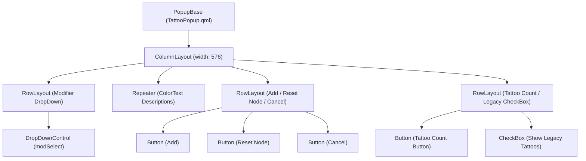

# UI Spec: TattooPopup
**File:** `app/qml/components/TattooPopup.qml`  **Pack:** `03-view-tree.md`  **Legacy Reference:** `TreeTab:ModifyNodePopup` (TreeTab.lua:868–1017)  **Status:** Test-Covered

--------------------------------------------------------------------------------

## 1. Purpose & Parity Notes
*   **Role:** Modal dialog for replacing passive node base attributes with Karui Tattoos or Runegrafts. Displays eligible tattoos filtered by node attribute type and connection count, shows formatted description blocks wrapped at 560px, tracks character tattoo limits (Tattoo Count: x/50) with hover list tooltips, and supports toggling legacy tattoos.
*   **Intentional Deviations from Legacy PoB:**
    *   *Eligibility Engine Bridge:* All node eligibility, attribute matching, and connection count requirements are evaluated inside `pob_getTattooOptions`, keeping the QML dialog purely presentation-focused.
    *   *Standardized Chrome & DropDown:* Replaces immediate-mode list controls with `DropDownControl.qml` and `ColorText.qml` wrapped in a 576px wide `PopupBase`.

--------------------------------------------------------------------------------

## 2. Lightweight Wireframe & Layout Box Model
# Component Box Model & Layout
```text
+-------------------------------------------------------------------------------+
| TattooPopup (PopupBase, title: "Replace Modifier of Node", padding: 12px)     |
| ColumnLayout (width: 576px, spacing: 6px)                                     |
| +---------------------------------------------------------------------------+ |
| | RowLayout: Label: "Modifier:" | DropDownControl [modSelect] (width: 250px) | |
| +---------------------------------------------------------------------------+ |
| | Repeater: ColorText descriptions (width: 560px, wrapMode: WordWrap)        | |
| +---------------------------------------------------------------------------+ |
| | Action Buttons: [ Add ]  [ Reset Node ]  [ Cancel ] (spacing: 10px)        | |
| +---------------------------------------------------------------------------+ |
| | Footer Row: [ Tattoo Count: x/50 Button ]  [x] Show Legacy Tattoos CheckBox | |
| +---------------------------------------------------------------------------+ |
+-------------------------------------------------------------------------------+
```

# ASCII Anatomy & Wireframe
```text
+-------------------------------------------------------------------------------+
|                          Replace Modifier of Node                             | (1) Title Plate
+-------------------------------------------------------------------------------+
|  Modifier: [ Tattoo of the Ramako Fleetfoot                         v]        | (2) Modifier Selector
|                                                                               |
|  Replaces +10 Dexterity                                                       | (3) Modifier Description
|  2% increased Movement Speed                                                  |     (Wrapped at 560px)
|                                                                               |
|                   [   Add   ]     [ Reset Node ]     [ Cancel ]               | (4) Actions Row
|                                                                               |
|             [ Tattoo Count: 14/50 ]     [ ] Show Legacy Tattoos               | (5) Tracking & Filter Row
+-------------------------------------------------------------------------------+
  |<-------------------------------- 576px ------------------------------------>|

Annotations:
(1) Title Plate: Fixed header "Replace Modifier of Node".
(2) DropDown: Lists available eligible tattoos; hover displays tooltip lines.
(3) Description Block: Auto-generated from descriptions array; parsed via ColorText.
(4) Action Row: Add applies tattoo; Reset Node clears custom modifier; Cancel closes.
(5) Footer: Tattoo count button displays list of allocated tattoos on hover; CheckBox toggles legacy items.
```

# Responsive / Overflow Rules
*   **Dimensions:** Fixed width of 576px; height adapts to the description line count (~220–300px).
*   **Word Wrapping:** Description lines enforce `wrapMode: Text.WordWrap` and `Layout.preferredWidth: 560` to prevent horizontal text overflow.

# Component Hierarchy


--------------------------------------------------------------------------------

## 3. Interactive States & Controls
| Control (objectName) | Type | Default State | Interactive Behavior | Edge States (Disabled / Empty / Loading / Error / Long Text) |
| ------ | ------ | ------ | ------ | ------ |
| `pob.tattoo.root` | PopupBase | `nodeId: -1` | Coordinates tattoo selection lifecycle | Closes on Add, Reset, or Cancel. |
| `pob.tattoo.mod_drop` | DropDownControl| Index 0 | Selects target tattoo modifier | Displays item tooltips on item hover. |
| `pob.tattoo.btn_add` | Button | `controlEnabled: true` | Invokes `pob_applyTattoo` and closes | Disabled if `current === null`. |
| `pob.tattoo.btn_reset`| Button | Enabled | Invokes `pob_resetTattooNode` and closes | Clears any existing tattoo on node. |
| `pob.tattoo.btn_count`| Button | Read-only | Hover reveals tooltip of all active tattoos | Shows count string `"x/50"`. |
| `pob.tattoo.chk_leg` | CheckBox | `state: false` | Toggles display of legacy tattoos | Re-queries `pob_getTattooOptions`. |

# Complete State Matrix
*   **Opened via `openFor(nodeId)`:** Calls `_load()`, binds tattoo options to `modSelect`, opens dialog.
*   **Modifier Selected:** Updates `current`, repaints wrapped description lines.
*   **Add Clicked:** Calls `pob_applyTattoo(nodeId, index + 1)`, emits `changed()`, closes dialog.
*   **Reset Node Clicked:** Calls `pob_resetTattooNode(nodeId)`, emits `changed()`, closes dialog.
*   **Show Legacy Toggled:** Calls `_load(showLegacy)` with new flag state.

# State Matrix & Binding Hazards
*   *Index Parity Hazard:* DropDownControl indices are 0-based; the Lua bridge expects 1-based indices (`modSelect.currentIndex + 1`).

--------------------------------------------------------------------------------

## 4. Data & Bridge Contract
*   **Reads (Engine Calls via `_load`):**
    *   `luaEngine.invoke("pob_getTattooOptions", [nodeId, showLegacy])` -> `{ options: [{ name, descriptions: [] }], defaultIndex, showLegacy, tattooCountStr, tattooLines: [] }`
*   **Writes / Bridge Methods Invoked:**
    *   `pob_applyTattoo(nodeId: int, index: int)` -> applies selected tattoo
    *   `pob_resetTattooNode(nodeId: int)` -> removes tattoo from node
*   **Signals Emitted:**
    *   `changed()` -> notifies TreeView to re-render passive tree graph
*   **Qt6 Bridge Safety:** Safe against empty option lists (`options: []`).

--------------------------------------------------------------------------------

## 5. Testable Acceptance Criteria (Qt6::QuickTest)
*   **AC-01 (Mount & Zero Warnings):** When `TattooPopup.qml` mounts, 0 QML warnings are logged, `nodeId === -1`, and `title === "Replace Modifier of Node"`.
*   **AC-02 (Description Line Wrapping):** Given a tattoo description exceeding 400px, `wrapMode` evaluates to `Text.WordWrap`.
*   **AC-03 (Tattoo Application Dispatch):** Clicking `Add` invokes `pob_applyTattoo` with 1-based option index and emits `changed()`.
*   **AC-04 (Tattoo Reset Dispatch):** Clicking `Reset Node` invokes `pob_resetTattooNode(nodeId)` and emits `changed()`.
*   **AC-05 (Legacy Toggle Reload):** Toggling `legacyCheck` invokes `pob_getTattooOptions` with `showLegacy: true`.

--------------------------------------------------------------------------------

## 6. Bug Audit Findings (Current Implementation vs Spec)
| Severity | File & Line | Symptom / Defect | Root Cause | Expected Behavior |
| ------ | ------ | ------ | ------ | ------ |
| Medium | `app/qml/components/TattooPopup.qml:2830` | Add button can be clicked when node has 0 eligible tattoos. | `controlEnabled` was not checking `root.current !== null`. | Gate via `controlEnabled: root.current !== null`. |
| Low | `app/qml/components/TattooPopup.qml:2860` | Long modifier description text extends past right dialog border. | Missing `Layout.preferredWidth: 560` on Repeater delegate. | Enforce preferred width and `Text.WordWrap`. |
