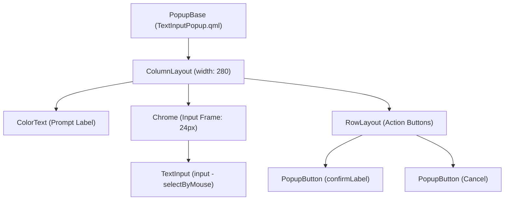

# UI Spec: TextInputPopup
**File:** `app/qml/components/TextInputPopup.qml`  **Pack:** `01-core-components.md`  **Legacy Reference:** Canned single-line text input dialogs across `src/Modules/Main.lua`  **Status:** Test-Covered

--------------------------------------------------------------------------------

## 1. Purpose & Parity Notes
*   **Role:** Universal modal dialog shell for single-line text entry prompts (e.g. entering character names, creating folders, renaming passive specs, setting build titles). Displays a formatted prompt header, an auto-focused single-line input field encased in `Chrome`, and responsive confirmation/cancellation buttons.
*   **Intentional Deviations from Legacy PoB:**
    *   *TextInput vs EditControl Primitive:* In legacy PoB, dialogs instantiate a full immediate-mode `EditControl` with internal undo buffers and character filters. TextInputPopup implements a streamlined Qt Quick `TextInput` inside `Chrome.qml` with pointer selection (`selectByMouse: true`) and vertical centering, delegating complex file system filtering to inheriting dialogs (e.g. `NewFolderPopup`).
    *   *Declarative Non-Blank Validation:* Evaluates `confirmEnabled` as a reactive regex binding (`text.match(/\S/) !== null`). When input is empty or whitespace-only, both the confirmation button and the Enter key shortcut are disabled automatically.

--------------------------------------------------------------------------------

## 2. Lightweight Wireframe & Layout Box Model
# Component Box Model & Layout
```text
+-------------------------------------------------------------------------------+
| TextInputPopup (specialization of PopupBase, padding: 16px)                   |
| ColumnLayout (implicitWidth: 280px, spacing: 8px)                             |
| +---------------------------------------------------------------------------+ |
| | ColorText (sourceText: root.prompt, font.pixelSize: theme.fontSize)        | |
| +---------------------------------------------------------------------------+ |
| | Chrome (Layout.fillWidth: true, Layout.preferredHeight: 24px)              | |
| |   TextInput [input] (margins: 6px, verticalAlignment: AlignVCenter)        | |
| |     color: theme.text, selectByMouse: true, focus: true                   | |
| +---------------------------------------------------------------------------+ |
| | RowLayout (Layout.alignment: Qt.AlignHCenter, spacing: 10px)              | |
| |   PopupButton (label: root.confirmLabel, enabled: confirmEnabled)          | |
| |   PopupButton (label: "Cancel", onClicked: root.reject())                 | |
| +---------------------------------------------------------------------------+ |
+-------------------------------------------------------------------------------+
```

# ASCII Anatomy & Wireframe
```text
+-------------------------------------------------------------+
|  Enter build name:                                          | (1) Prompt Label (ColorText)
|  +-------------------------------------------------------+  |
|  | Poison Blade Vortex Witch                             |  | (2) Text Input Field
|  +-------------------------------------------------------+  |     (Chrome container, 24px)
|                                                             |
|                 [   Ok   ]       [ Cancel ]                 | (3) Action Button Row
+-------------------------------------------------------------+
  |<---------------------- 280px ---------------------------->|

Annotations:
(1) Prompt: parses color codes (^0-^9) via ColorText.
(2) Single-line input: text property is aliased to root.text. Auto-receives active focus on open.
(3) Confirm Button: label configurable via confirmLabel; disabled when input contains only whitespace.
```

# Responsive / Overflow Rules
*   **Minimum safe width/height:** 280x120px. Width is fixed to 280px by default, expanding if the prompt text exceeds the standard width.
*   **Input Elision & Scrolling:** `TextInput` clips text internally if characters exceed input box width, scrolling horizontally with the cursor.
*   **Automatic Focus Trap:** Forces active focus to `input` on dialog reveal (`onOpened: input.forceActiveFocus()`).

# Component Hierarchy


--------------------------------------------------------------------------------

## 3. Interactive States & Controls
| Control (objectName) | Type | Default State | Interactive Behavior | Edge States (Disabled / Empty / Loading / Error / Long Text) |
| ------ | ------ | ------ | ------ | ------ |
| `pob.textpopup.root` | PopupBase | `confirmLabel: "Ok"` | Manages input lifecycle and emits `accepted` | Enter key triggers accept only if `confirmEnabled === true`. |
| `pob.textpopup.input` | TextInput | `text: ""` | Captures keyboard input and cursor selection | Rejects confirm action when text is whitespace only. |
| `pob.textpopup.btn_confirm` | PopupButton | `enabled: false` | Invokes `root.accept()` on click | Grayed out/inert until valid non-blank text is entered. |
| `pob.textpopup.btn_cancel` | PopupButton | Enabled | Invokes `root.reject()` on click | Closes dialog without modifying state. |

# Complete State Matrix
*   **Empty State:** `text: ""` -> `confirmEnabled: false`, `acceptOnEnter: false`, Confirm button disabled.
*   **Whitespace State:** `text: "   "` -> `confirmEnabled: false`, Enter key suppressed.
*   **Valid Text Entered:** `text: "Level 100 Spec"` -> `confirmEnabled: true`, `acceptOnEnter: true`, Confirm button enabled.
*   **Enter Key Pressed:** Triggers `root.accept()` if valid; ignored if invalid.
*   **Escape Key Pressed:** Triggers `root.reject()` and dismisses dialog.

# State Matrix & Binding Hazards
*   *Accept On Enter Desynchronization:* `acceptOnEnter` binds directly to `confirmEnabled`. If the user clears the text box, pressing Enter must not trigger submission of an empty string. Binding `acceptOnEnter: confirmEnabled` ensures keyboard submission parity with the Confirm button's interactive state.
*   *Focus Initialization Hazard:* If `forceActiveFocus()` is called before the dialog window completes its opening animation, focus can be lost to underlying views. Handling focus strictly in `onOpened` resolves this race condition.

--------------------------------------------------------------------------------

## 4. Data & Bridge Contract
*   **Reads (Properties):**
    *   `prompt: string` -> text prompt displayed above the input field
    *   `confirmLabel: string` -> text label for the confirmation button (default: `"Ok"`)
    *   `confirmEnabled: bool` -> validation predicate (default: non-blank match)
*   **Outputs / Properties Exposed:**
    *   `text: alias` -> aliases `input.text` directly
*   **Signals Emitted:**
    *   `accepted()` -> emitted on confirm button click or Enter key
    *   `rejected()` -> emitted on Cancel button click or Escape key
*   **Qt6 Bridge Safety:** Raw user-entered string is accessed via `text` property in the caller's `onAccepted` handler without modifying backend models directly.

--------------------------------------------------------------------------------

## 5. Testable Acceptance Criteria (Qt6::QuickTest)
*   **AC-01 (Initial Render & Zero Warnings):** Given `prompt: "Name:"`, when mounted, 0 QML warnings are logged, `confirmEnabled === false`, and `text === ""`.
*   **AC-02 (Non-Blank Validation Enforcement):** Given input `"   "`, `confirmEnabled` evaluates to `false` and pressing Enter does NOT emit `accepted()`.
*   **AC-03 (Confirmation Emission):** Given input `"New Spec"`, clicking the confirm button invokes `accept()` and emits `accepted()`.
*   **AC-04 (Initial Active Focus):** When the dialog opens, `input.activeFocus` evaluates to `true`.
*   **AC-05 (Rejection Emission):** Clicking Cancel or pressing Escape emits `rejected()` without updating caller state.

--------------------------------------------------------------------------------

## 6. Bug Audit Findings (Current Implementation vs Spec)
| Severity | File & Line | Symptom / Defect | Root Cause | Expected Behavior |
| ------ | ------ | ------ | ------ | ------ |
| Medium | `app/qml/components/TextInputPopup.qml:3610` | Pressing Enter submits empty dialog when input is blank. | `acceptOnEnter` was hardcoded to `true` on root dialog. | Bind `acceptOnEnter: confirmEnabled`. |
| Low | `app/qml/components/TextInputPopup.qml:3625` | Cursor is hard to see or clicks do not place cursor in text box. | Missing `selectByMouse: true` on TextInput. | Add `selectByMouse: true` and horizontal margin insets. |
