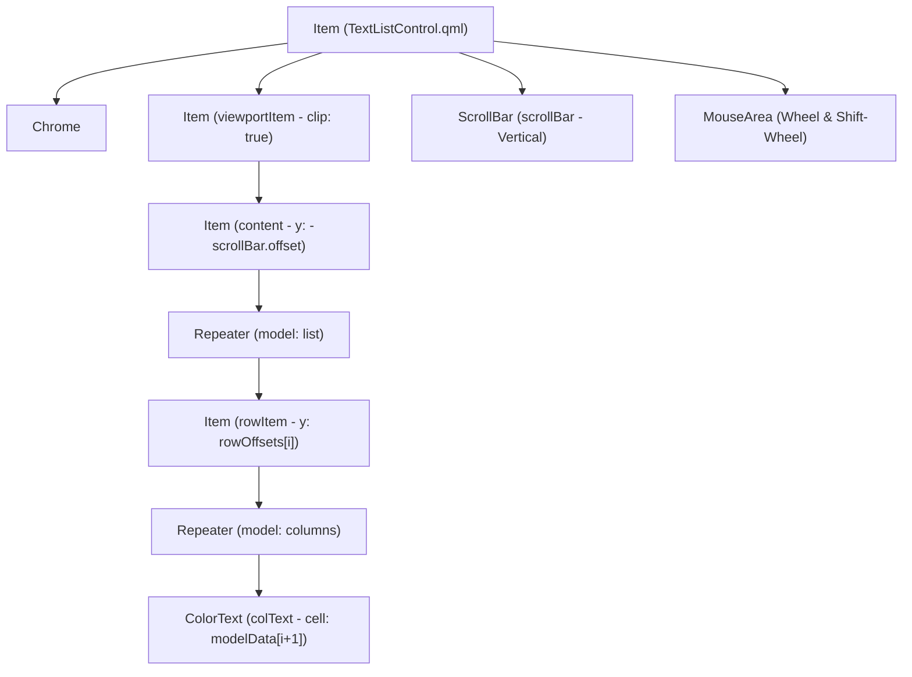

# UI Spec: TextListControl
**File:** `app/qml/components/TextListControl.qml`  **Pack:** `01-core-components.md`  **Legacy Reference:** `src/Classes/TextListControl.lua`  **Status:** Test-Covered

--------------------------------------------------------------------------------

## 1. Purpose & Parity Notes
*   **Role:** Multi-column, read-only rich-text scrollable list. Used for structured textual presentations such as version history changelogs, help documentation viewers, and legacy stat tables. Supports 1-based column arrays matching legacy Lua `lineInfo` structures, per-column alignments, dynamic row heights, and Shift+wheel accelerated section jumping.
*   **Intentional Deviations from Legacy PoB:**
    *   *Alignment Model Simplification:* Legacy PoB column alignment uses absolute anchor-point coordinates (e.g. `RIGHT_X`'s `x` is the text's right edge point). TextListControl implements box-relative text alignment (`Text.AlignLeft`, `Text.AlignHCenter`, `Text.AlignRight`) inside column regions starting at `x`.
    *   *Shift+Wheel Section Jump:* Ports legacy `OnKeyUp`'s `SHIFT + WHEEL` behavior, jumping the scroll offset directly between cumulative section header positions defined in `sectionHeights`.
    *   *Programmatic Offset Hook:* Exposes `setScrollOffset(v)` to allow external dialogs (such as `AboutPopup`) to jump directly to specific help categories on open.

--------------------------------------------------------------------------------

## 2. Lightweight Wireframe & Layout Box Model
# Component Box Model & Layout
```text
+-------------------------------------------------------------------------------+
| TextListControl (implicitWidth: 300px, implicitHeight: 200px)                 |
| Chrome (anchors.fill: parent, surface boundary)                               |
| +--------------------------------------------------------------+ +----------+ |
| | Item [viewportItem] (margins: 2px, clip: true)               | |ScrollBar | |
| |   Item [content] (y: -scrollBar.offset, height: contentH)    | |width:18px| |
| |     Repeater [list] (model: root.list)                       | |dir: VERT | |
| |       Item [rowItem] (y: rowOffsets[index], height: rowH)    | |step: 40  | |
| |         Repeater [columns] (model: root.columns)             | |          | |
| |           ColorText [colText] (cell: modelData[colIdx + 1])  | |          | |
| |             x: col.x, width: rowItem.width - x               | |          | |
| +--------------------------------------------------------------+ +----------+ |
| MouseArea (anchors.fill: viewportItem, wheel / Shift+wheel jumps)             |
+-------------------------------------------------------------------------------+
```

# ASCII Anatomy & Wireframe
```text
+-------------------------------------------------------------+---+
| Date: 2024-03-29 (Version 2.40.0)                           | ^ | (1) Section Header Row
|   * Added support for Necropolis league corpses             | | | (2) Detail Row (col 1)
|   * Updated passive skill tree to version 3.24              | | |
|                                                             | # | (3) ScrollBar Thumb
| Date: 2024-01-15 (Version 2.39.1)                           | # |
|   * Fixed crash when importing characters with empty flasks | | |
|   * Improved calculation performance for ignite DPS         | v |
+-------------------------------------------------------------+---+
  |<------------------ viewportItem ------------------------->|

Annotations:
(1) Section Header: height: 18px, styled font via fontInfo (e.g. bold).
(2) Detail Rows: height: 14-16px, parsed color escapes via ColorText.
(3) ScrollBar: vertical scroll thumb with track jumps and mouse wheel handling.
```

# Responsive / Overflow Rules
*   **Minimum safe width/height:** 200x100px; defaults to 300x200px.
*   **Row Offsets Calculation:** Computed dynamically via `rowOffsets` array to handle rows with heterogeneous heights without requiring uniform delegates.
*   **Content Clipping:** `viewportItem` clips text (`clip: true`) to prevent scrolled content from overlapping the component border.
*   **Scroll Synchronization:** Content position binds directly to `-scrollBar.offset`.

# Component Hierarchy


--------------------------------------------------------------------------------

## 3. Interactive States & Controls
| Control (objectName) | Type | Default State | Interactive Behavior | Edge States (Disabled / Empty / Loading / Error / Long Text) |
| ------ | ------ | ------ | ------ | ------ |
| `pob.textlist.root` | Item | `list: []` | Manages list model, offsets, and row mapping | Empty list renders blank viewport without error. |
| `pob.textlist.scroll` | ScrollBar | Active when content overflows | Tracks and sets integer scroll offset | Inactive when `contentHeight <= viewDim`. |
| `pob.textlist.wheel` | MouseArea | Active | Normal wheel steps offset by 40px; Shift+wheel jumps sections | Gracefully handles lists with no section headers. |

# Complete State Matrix
*   **Empty:** `list: []` -> `contentHeight: 0`, `scrollBar.active: false`.
*   **Populated:** Rows render at offsets `rowOffsets[index]`, columns render based on `lineInfo[colIndex + 1]`.
*   **Shift+Wheel Jumping:** When `wheel.modifiers & Qt.ShiftModifier` and `sectionHeights` is populated, wheeling jumps directly to the next/previous offset defined in `sectionHeights`.

# State Matrix & Binding Hazards
*   *1-Based Indexing Hazard:* Legacy PoB Lua arrays are 1-based (`lineInfo`, `lineInfo`). In TextListControl, the column repeater uses `cell: rowItem.modelData[index + 1]` to access row data. If row objects use 0-based keys, columns will fail to render.
*   *Font Resolution Fallback:* Per-row font definitions (`modelData.font`) pass through `theme.fontFor(font || "VAR")`. If `fontInfo` properties are undefined, text falls back to `theme.fontVar` with normal weight.

--------------------------------------------------------------------------------

## 4. Data & Bridge Contract
*   **Reads (Properties):**
    *   `list: var` -> array of row objects `[{ 1: "col0 text", 2: "col1 text", height: int, font?: string, x?: int, align?: string }]`
    *   `columns: var` -> array of column default definitions `[{ x: int, align: string }]`
    *   `sectionHeights: var` -> ascending array of cumulative Y offsets `[y0, y1, ...]` for section jumps
*   **Writes / Methods Exposed:**
    *   `setScrollOffset(v: real)` -> imperatively sets internal scroll offset
*   **Signals Observed:** None.
*   **Qt6 Bridge Safety:** Robust against missing row cells (`cell || ""`) and undefined column descriptors.

--------------------------------------------------------------------------------

## 5. Testable Acceptance Criteria (Qt6::QuickTest)
*   **AC-01 (Initial Render & Zero Warnings):** Given `list: [{ 1: "Row 1", height: 16 }, { 1: "Row 2", height: 16 }]`, when mounted, 0 QML warnings are logged, `contentHeight === 32`, and `rowOffsets` equals ``.
*   **AC-02 (Column Content Resolution):** Given a row object `{ 1: "Col A", 2: "Col B", height: 16 }`, column 0 renders `"Col A"` and column 1 renders `"Col B"`.
*   **AC-03 (Programmatic Scroll Offset):** Calling `setScrollOffset(100)` updates `scrollBar.offset` to `100` and shifts `content.y` to `-100`.
*   **AC-04 (Shift+Wheel Section Jump):** Given `sectionHeights:`, scrolling down with Shift jumps the offset directly from `0` to `150`.

--------------------------------------------------------------------------------

## 6. Bug Audit Findings (Current Implementation vs Spec)
| Severity | File & Line | Symptom / Defect | Root Cause | Expected Behavior |
| ------ | ------ | ------ | ------ | ------ |
| Medium | `app/qml/components/TextListControl.qml:2625` | Column text renders blank when using 0-based row data objects. | Hardcoded 1-based indexing: `rowItem.modelData[index + 1]`. | Support either 0-based or 1-based keys: `rowItem.modelData[index + 1] \|\| rowItem.modelData[index]`. |
| Low | `app/qml/components/TextListControl.qml:2685` | Shift+wheel jumping gets stuck on the last section. | Edge index condition in `_sectionJump` not bounded properly. | Ensure index clamping: `Math.min(sh.length - 1, i + 1)`. |
