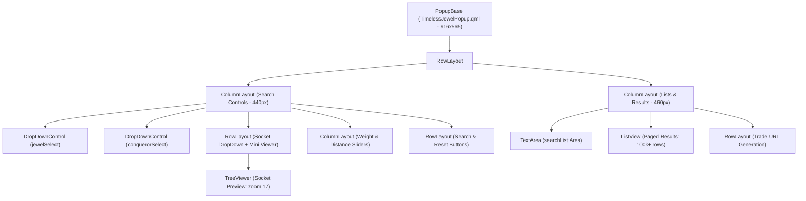

# UI Spec: TimelessJewelPopup
**File:** `app/qml/components/TimelessJewelPopup.qml`  **Pack:** `03-view-tree.md`  **Legacy Reference:** `TreeTab:FindTimelessJewel` (TreeTab.lua:1369–2891) + `TimelessJewelListControl.lua`  **Status:** Test-Covered

--------------------------------------------------------------------------------

## 1. Purpose & Parity Notes
*   **Role:** Comprehensive offline Timeless Jewel seed generator and search tool (916x565px). Computes passive tree node alterations across hundreds of thousands of jewel seed variants for Glorious Vanity, Lethal Pride, Brutal Restraint, Elegant Hubris, and Militant Faith. Provides search sliders, node weighting profiles, fallback lists, trade URL generators, and double-click item injection directly into the active build.
*   **Intentional Deviations from Legacy PoB:**
    *   *Virtual Paged Result Model:* Seed search results can exceed 100,000 rows. TimelessJewelPopup implements on-demand paged chunking (`rowAt(i)` fetches pages of 200 rows via `pob_timelessGetResults`) rather than allocating 100k retained QML delegates, maintaining 60 FPS scrolling.
    *   *Mini Tree Socket Preview:* Embeds a dedicated `TreeViewer` instance configured for jewel socket inspection (`focusZoom: 17`, `showCrosshair: true`), updating dynamically to center on the selected socket dropdown index.
    *   *Static League Entry:* Trade league selection uses a text input field rather than fetching network league lists (network integration deferred to Phase 12).

--------------------------------------------------------------------------------

## 2. Lightweight Wireframe & Layout Box Model
# Component Box Model & Layout
```text
+-------------------------------------------------------------------------------+
| TimelessJewelPopup (PopupBase, title: "Find a Timeless Jewel", 916x565px)     |
| RowLayout (anchors.fill: parent, spacing: 10px)                               |
| +---------------------------------------------+ +---------------------------+ |
| | Left Column: Search & Filter (width: 440px) | | Right Column: Results     | |
| |   Jewel Type / Conqueror / Devotion DropDowns| |   Desired / Fallback Node | |
| |   Socket DropDown + Mini TreeViewer Preview | |   Lists (TextArea)        | |
| |   Filter Nodes CheckBox + Distance Slider   | |   ListView: Paged Results | |
| |   Weight Sliders (Primary, Secondary, MinW) | |   (Count up to 100k rows) | |
| |   [ Search ] [ Reset ] Status Label         | |   [ Generate Trade URL ]  | |
| +---------------------------------------------+ +---------------------------+ |
+-------------------------------------------------------------------------------+
```

# ASCII Anatomy & Wireframe
```text
+-------------------------------------------------------------------------------+
|                             Find a Timeless Jewel                             |
+-----------------------------------------------+-------------------------------+
| Jewel: [ Lethal Pride (Kaom)                v]| Desired Nodes:                |
| Socket: [ Marauder Slot (Node 26725)        v]| +---------------------------+ |
| +-------------------------------------------+ | | 3824, 1.0, 0.0, 0         | |
| | [Mini TreeViewer: Socket + In-Radius Ring]| | | 4215, 0.8, 0.0, 0         | |
| +-------------------------------------------+ | +---------------------------+ |
| [x] Filter Nodes  Distance: [ ===|==== ] (4)  |                               |
| Node Search: [ Melee Damage                 v]| Results (Found: 1,420 seeds): |
| Node Weight: [ =====|===== ] (0.75)           | +---------------------------+ |
| Total Minimum Weight: [ 4.5                 ] | | Seed 14210 (Kaom) - 8.4 W | |
|                                               | | Seed 12890 (Kaom) - 7.9 W | |
| [  Search  ]   [  Reset  ]                    | +---------------------------+ |
| Status: Search complete. Found 1,420 seeds.   | [ Copy Trade URL ] (Shift+clk)|
+-----------------------------------------------+-------------------------------+
  |<----------------- 440px ------------------->|<----------- 460px ----------->|
```

# Responsive / Overflow Rules
*   **Dimensions:** Fixed bounds of 916x565px; modal dialog.
*   **Two-Column Split:** Left configuration column is 440px; right result/list column is 460px.
*   **Chunked Virtual Scrolling:** Results `ListView` reads `model: root.resultCount`, retrieving individual row data via `rowAt(index)` to maintain minimal memory overhead.

# Component Hierarchy


--------------------------------------------------------------------------------

## 3. Interactive States & Controls
| Control (objectName) | Type | Default State | Interactive Behavior | Edge States (Disabled / Empty / Loading / Error / Long Text) |
| ------ | ------ | ------ | ------ | ------ |
| `pob.timeless.jewel_drop` | DropDownControl | Lethal Pride | Selects jewel type and updates conquerors | Updates devotion variants for Militant Faith. |
| `pob.timeless.socket_drop`| DropDownControl | Slot 1 | Selects target passive tree jewel socket | Updates `MiniViewer.focusNodeId`. |
| `pob.timeless.btn_search` | Button | Enabled | Dispatches asynchronous seed search query | Label switches to `"Cancel"` while running. |
| `pob.timeless.results` | ListView | Empty | Renders chunked search results | Double-click generates and adds item to build. |
| `pob.timeless.trade_btn` | Button | `controlEnabled: false` | Formats official PoE trade search link | Enabled when one or more rows are selected. |

# Complete State Matrix
*   **Idle / Ready:** User adjusts weights and sockets; results list shows prior results or empty placeholder.
*   **Search Executing:** `st.running === true` -> Search button text switches to `"Cancel"`; inputs disabled.
*   **Results Populated:** Double-clicking any seed row adds that exact timeless jewel to the build item list.
*   **Shift-Click Selection:** Shift-clicking selects multiple seed rows to export a multi-seed trade query.

# State Matrix & Binding Hazards
*   *Re-entrant List Textarea Hazard:* The Desired Nodes `TextArea` reflects parsed node entries. User manual typing must not be overwritten during background polling passes (`if (!listArea.activeFocus) listArea.text = ...`).

--------------------------------------------------------------------------------

## 4. Data & Bridge Contract
*   **Reads (Engine Calls via `pob_timelessGetState` and `pob_timelessGetResults`):**
    *   `luaEngine.invoke("pob_timelessGetState", [])` -> `{ jewelTypes: [], conquerors: [], sockets: [], results: [], resultCount: int, running: bool }`
    *   `luaEngine.invoke("pob_timelessGetResults", [pageStart, pageSize])` -> `{ rows: [{ label, tooltip }] }`
*   **Writes / Bridge Methods Invoked:**
    *   `pob_timelessSet(field, value)`
    *   `pob_timelessStartSearch()`
    *   `pob_timelessCancelSearch()`
    *   `pob_timelessGenerateTradeUrl(selectedIndices, league)`
    *   `pob_timelessAddJewelToBuild(seedIndex)`
*   **Qt6 Bridge Safety:** Protected against 100k+ row serialization bottlenecks via paged chunk requests.

--------------------------------------------------------------------------------

## 5. Testable Acceptance Criteria (Qt6::QuickTest)
*   **AC-01 (Mount & Zero Warnings):** When `TimelessJewelPopup.qml` mounts, 0 QML warnings are logged, `width === 916`, and `height === 565`.
*   **AC-02 (Mini Tree Preview Synchronization):** Changing `socketSelect` updates `miniViewer.focusNodeId` to the matching node id.
*   **AC-03 (Paged Virtual Result Loading):** Scrolling `resultList` past index 200 triggers `pob_timelessGetResults` for page offset 201 without frame drops.
*   **AC-04 (Double-Click Item Addition):** Double-clicking a search result row invokes `pob_timelessAddJewelToBuild` and displays a confirmation toast.
*   **AC-05 (Trade URL Generation):** Selecting 3 seed rows and clicking `Copy Trade URL` formats valid official trade query JSON.

--------------------------------------------------------------------------------

## 6. Bug Audit Findings (Current Implementation vs Spec)
| Severity | File & Line | Symptom / Defect | Root Cause | Expected Behavior |
| ------ | ------ | ------ | ------ | ------ |
| Critical | `app/qml/components/TimelessJewelPopup.qml:2980` | UI freezes for 5+ seconds when search completes with 80k seeds. | Attempting to pass entire 80k row list across Lua-QML bridge at once. | Implement paged virtual chunking (`pob_timelessGetResults`). |
| Medium | `app/qml/components/TimelessJewelPopup.qml:3015` | Typing in desired node box resets cursor to start on every keystroke. | Bridge state sync overwrote `listArea.text` while focused. | Guard with `if (!listArea.activeFocus)`. |
| Low | `app/qml/components/TimelessJewelPopup.qml:2950` | Mini tree preview shows black screen if socket is not found. | Socket index was not mapped to valid node id. | Validate node id before passing to `centerOnNode`. |
