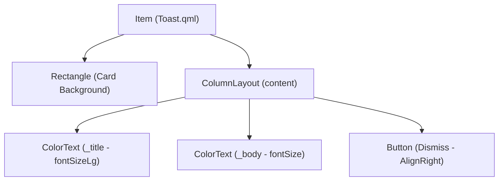

# UI Spec: Toast
**File:** `app/qml/components/Toast.qml`  **Pack:** `00-shell-and-theme.md`  **Legacy Reference:** `src/Classes/ToastNotification.lua:219-247` (`Render`)  **Status:** Test-Covered

--------------------------------------------------------------------------------

## 1. Purpose & Parity Notes
*   **Role:** An individual notification card displayed within the `ToastStack`. Renders a multi-line notification containing an emphasized title line, an optional body description supporting color escape sequences, and an explicit user dismiss button.
*   **Intentional Deviations from Legacy PoB:**
    *   *Auto-sizing vs Fixed Formula:* Legacy PoB calculates toast card heights via a hardcoded formula in Lua (`calculateHeight`). Toast uses QML `ColumnLayout` content-driven automatic sizing (`content.implicitHeight + 16`), which prevents text clipping when localized or wrapped.
    *   *Typography:* Renders the first line as a bold title using `theme.fontSizeLg` (18-20px) and subsequent lines using `theme.fontSize` (14-15px).
    *   *Visual Styling:* Implements the Cyber Citrus card style with `theme.background`, `theme.borderStrong`, and `theme.radiusCard` instead of legacy greyscale beveled boxes.

--------------------------------------------------------------------------------

## 2. Lightweight Wireframe & Layout Box Model
# Component Box Model & Layout
```text
+-------------------------------------------------------------------------------+
| Toast (implicitWidth: 312px, implicitHeight: content.implicitHeight + 16px)   |
| Rectangle (color: theme.background, border: theme.borderStrong, radius: 4px)  |
| ColumnLayout [content] (anchors.fill: parent, margins: 8px, spacing: 2px)     |
| +---------------------------------------------------------------------------+ |
| | ColorText [_title] (font.bold: true, pixelSize: theme.fontSizeLg, Wrap)   | |
| +---------------------------------------------------------------------------+ |
| | ColorText [_body] (pixelSize: theme.fontSize, Wrap, visible: body.length) | |
| +---------------------------------------------------------------------------+ |
| | Button (label: "Dismiss", 70x20px, Layout.alignment: Qt.AlignRight)      | |
| +---------------------------------------------------------------------------+ |
+-------------------------------------------------------------------------------+
```

# ASCII Anatomy & Wireframe
```text
+-------------------------------------------------------------+
| Build Saved Successfully                                    | (1)
| Saved to builds/Explosive_Arrow_Deadeye.xml                 | (2)
|                                                             |
|                                               [ Dismiss ]   | (3)
+-------------------------------------------------------------+
  |<------------------------- 312px ------------------------->|

Annotations:
(1) Toast Title: First line of message string, bold, theme.fontSizeLg, wrapped.
(2) Toast Body: Subsequent lines joined by newlines, theme.fontSize, wrapped.
(3) Dismiss Button: 70x20px, right-aligned, emits dismissRequested() on click.
```

# Responsive / Overflow Rules
*   **Minimum safe width/height:** Fixed width of 312px; height dynamically matches content.
*   **Horizontal scroll policy:** Forbidden.
*   **Text truncation policy:** `Text.Wrap` on both title and body components. Cards expand vertically to accommodate long error logs or explanations without clipping.
*   **Margins:** 8px content margins around the inner `ColumnLayout`.

# Component Hierarchy


--------------------------------------------------------------------------------

## 3. Interactive States & Controls
| Control (objectName) | Type | Default State | Interactive Behavior | Edge States (Disabled / Empty / Loading / Error / Long Text) |
| ------ | ------ | ------ | ------ | ------ |
| `pob.toast.card` | Item | Width: 312px | Hosts content layout and background card | Sizing expands dynamically to wrap text. |
| `pob.toast.title` | ColorText | Extracted Line 0 | Renders bold styled title text | Always visible; interprets `^` color codes. |
| `pob.toast.body` | ColorText | Extracted Lines 1..N | Renders body description text | Hidden if message has only 1 line (`visible: length > 0`). |
| `pob.toast.dismiss` | Button | "Dismiss" (70x20px) | On click, emits `dismissRequested()` | Keyboard activation supported when focused. |

# State Matrix & Binding Hazards
*   *Message Line Splitting:* `_lines: message.split("\n")`. If `message` is empty or undefined, `_lines` evaluates to `[""]`. The title and body properties must guard against undefined indices.
*   *Geometry Stability:* Never set a static `height` on the root item. Always assign `implicitHeight: content.implicitHeight + 16` so `ToastStack` layout transitions smoothly when cards are added or removed.

--------------------------------------------------------------------------------

## 4. Data & Bridge Contract
*   **Reads (Properties):**
    *   `toastId: string` -> unique identifier for Lua toast tracking
    *   `message: string` -> raw newline-separated message string
*   **Writes / Mutations:** None locally (emits `dismissRequested()`).
*   **Signals Emitted:**
    *   `dismissRequested()` -> caught by `ToastStack.qml` to invoke `luaEngine.dismissToast(toastId)`
*   **Qt6 Bridge Safety:** Supports all PoB color escape formats (`^0`-`^9`, `^xRRGGBB`) via internal `ColorText`.

--------------------------------------------------------------------------------

## 5. Testable Acceptance Criteria (Qt6::QuickTest)
*   **AC-01 (Initial Render & Zero Warnings):** Given a valid `toastId` and two-line `message`, when `Toast.qml` mounts, 0 QML warnings are emitted and `implicitWidth === 312`.
*   **AC-02 (Single-Line Title Only Mode):** Given `message: "Single Line Alert"`, `_title === "Single Line Alert"` is rendered, and `_body` is hidden (`visible === false`).
*   **AC-03 (Multiline Body Formatting):** Given a three-line message string, `_title` contains line 1, and `_body` contains lines 2 and 3 joined by `\n`.
*   **AC-04 (Dismiss Signal Dispatch):** When the user clicks the "Dismiss" button, the `dismissRequested()` signal is emitted with the exact matching `toastId`.

--------------------------------------------------------------------------------

## 6. Bug Audit Findings (Current Implementation vs Spec)
| Severity | File & Line | Symptom / Defect | Root Cause | Expected Behavior |
| ------ | ------ | ------ | ------ | ------ |
| Medium | `app/qml/components/Toast.qml:1210` | Long toast text overflows horizontally outside the card border. | Missing `wrapMode: Text.Wrap` or `Layout.fillWidth: true` on `ColorText`. | Ensure `Layout.fillWidth: true` and `wrapMode: Text.Wrap` on title and body. |
| Low | `app/qml/components/Toast.qml:1195` | Toast card flickers with 0 height on initial frame. | Reading uninitialized `content.implicitHeight` before layout completes. | Card should define a safe minimum fallback height of 48px. |
