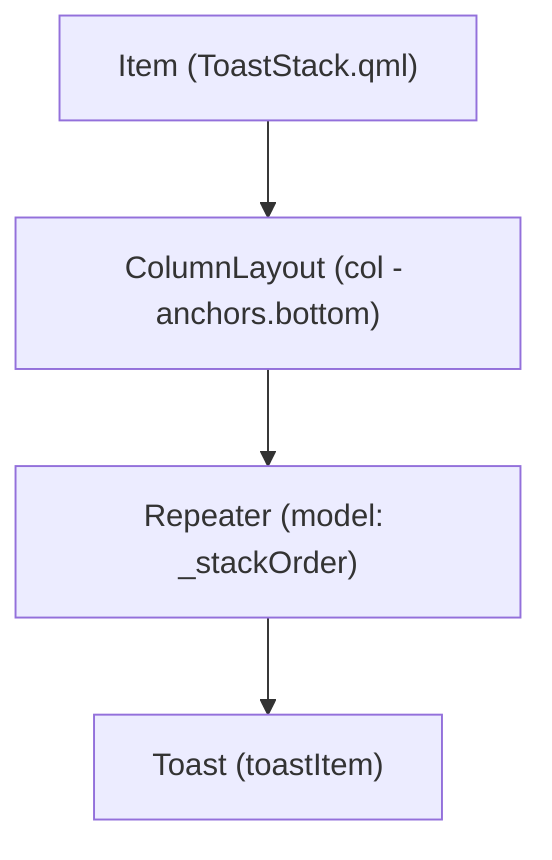

# UI Spec: ToastStack
**File:** `app/qml/components/ToastStack.qml`  **Pack:** `00-shell-and-theme.md`  **Legacy Reference:** `src/Classes/ToastNotification.lua` (bottom-up stacking loop)  **Status:** Test-Covered

--------------------------------------------------------------------------------

## 1. Purpose & Parity Notes
*   **Role:** The floating toast notification container. Stacks active toast notification cards vertically from the bottom-left corner of the application window, displaying the newest notifications at the top of the stack while pushing older toasts downward toward the bottom anchor.
*   **Intentional Deviations from Legacy PoB:**
    *   *Hide Duration Animation:* Legacy animates toast dismissals over a 75ms fade-out. Because the Lua-side host removes dismissed toasts immediately from its active list, ToastStack applies an entrance opacity fade (`250ms`, matching legacy's `SHOW_DURATION`) and relies on `ColumnLayout` / `Repeater` item removal transitions for exit animations.
    *   *Push-Pull Synchronization:* Uses the push-signal `onToastsChanged` followed by the pull-getter `luaEngine.getToasts()`, matching the asynchronous pattern established for system error notifications.

--------------------------------------------------------------------------------

## 2. Lightweight Wireframe & Layout Box Model
# Component Box Model & Layout
```text
+-------------------------------------------------------------------------------+
| ToastStack (implicitWidth: 312px, implicitHeight: col.implicitHeight)         |
| ColumnLayout [col] (anchors.left: parent.left, anchors.bottom: parent.bottom) |
| width: 312px, spacing: 4px                                                    |
| +---------------------------------------------------------------------------+ |
| | Toast Item [Newest] (width: 312px, opacity 0 -> 1 over 250ms)            | |
| +---------------------------------------------------------------------------+ |
| | Toast Item [Older]  (width: 312px, opacity: 1.0)                          | |
| +---------------------------------------------------------------------------+ |
| | Toast Item [Oldest] (width: 312px, opacity: 1.0, nearest bottom anchor)   | |
| +---------------------------------------------------------------------------+ |
+-------------------------------------------------------------------------------+
```

# ASCII Anatomy & Wireframe
```text
Application Window (Bottom-Left Region, yOffset above BottomBar):
+------------------------------------------------------------------------+
|                                                                        |
| +-------------------------------------------------------------+        |
| | Item Imported: Crimson Jewel                                | (New)  |
| | Added to active build item inventory                        |        |
| |                                               [ Dismiss ]   |        |
| +-------------------------------------------------------------+        |
|   | 4px spacing                                                        |
| +-------------------------------------------------------------+        |
| | Build Saved Successfully                                    | (Old)  |
| |                                               [ Dismiss ]   |        |
| +-------------------------------------------------------------+        |
|                                                                        |
+------------------------------------------------------------------------+
  |<--- 312px --->|
```

# Responsive / Overflow Rules
*   **Minimum safe width/height:** 312x0px (when no toasts exist).
*   **Horizontal scroll policy:** Forbidden. Anchored to the bottom-left corner.
*   **Vertical layout policy:** `ColumnLayout` anchors to `parent.bottom`, expanding upward as toasts arrive. If total toast height exceeds available window space, the newest entries push upward toward the top chrome.
*   **Stack Ordering:** Toasts are reversed via `_stackOrder`: the newest toast appears at the top, and the oldest toast rests at the bottom.

# Component Hierarchy


--------------------------------------------------------------------------------

## 3. Interactive States & Controls
| Control (objectName) | Type | Default State | Interactive Behavior | Edge States (Disabled / Empty / Loading / Error / Long Text) |
| ------ | ------ | ------ | ------ | ------ |
| `pob.toaststack.root` | Item | Empty (`height: 0`) | Adapts height to contain all active toast cards | Height collapses to 0 when all toasts are dismissed. |
| `pob.toaststack.repeater`| Repeater | Model: `_stackOrder` | Instantiates `Toast` delegates with entry opacity animation | Updates dynamically when `toastsChanged` fires. |
| `pob.toaststack.toast` | Toast | Opacity: 0 -> 1 | On `dismissRequested`, calls `luaEngine.dismissToast(id)` | Card is removed upon engine state update. |

# State Matrix & Binding Hazards
*   *Stack Order Reversal:* Legacy iterates toasts oldest-first and adds upward y-offsets. In a standard QML `ColumnLayout` anchored to the bottom, the array must be reversed (`for (var i = root.toasts.length - 1; i >= 0; i--) out.push(root.toasts[i]);`) so that the oldest toast remains physically pinned closest to the bottom bar.
*   *Signal Storm Hazard:* Rapid successive notifications (e.g. bulk importing items) can emit multiple `toastsChanged` signals in a single frame. The stack order calculation must be a pure functional projection of `root.toasts`.

--------------------------------------------------------------------------------

## 4. Data & Bridge Contract
*   **Reads (LuaEngine / C++ Models):**
    *   `luaEngine.getToasts()` -> `[{ id: string, message: string }]`
*   **Writes / Mutations:**
    *   `luaEngine.dismissToast(id: string)` -> `void`
*   **Signals Observed:**
    *   `luaEngine.onToastsChanged` -> calls `root.toasts = luaEngine.getToasts()`
*   **Qt6 Bridge Safety:** `luaEngine.getToasts()` must always return a valid `QVariantList`. If null, `root.toasts` defaults to `[]`.

--------------------------------------------------------------------------------

## 5. Testable Acceptance Criteria (Qt6::QuickTest)
*   **AC-01 (Initial Render & Zero Warnings):** When the application launches with an empty toast queue, `ToastStack.qml` mounts, 0 QML warnings are emitted, and `implicitHeight === 0`.
*   **AC-02 (Stack Order Verification):** Given two toasts `[A, B]` where `B` is newer, `_stackOrder` contains `[B, A]`, rendering `B` visually above `A` in the `ColumnLayout`.
*   **AC-03 (Entrance Animation):** When a new toast mounts, its initial `opacity` is 0 and animates to 1.0 over 250ms via `NumberAnimation`.
*   **AC-04 (Dismiss Routing):** When `toastItem.dismissRequested` is emitted for a toast with `id: "toast_42"`, `luaEngine.dismissToast("toast_42")` is invoked immediately.

--------------------------------------------------------------------------------

## 6. Bug Audit Findings (Current Implementation vs Spec)
| Severity | File & Line | Symptom / Defect | Root Cause | Expected Behavior |
| ------ | ------ | ------ | ------ | ------ |
| Medium | `app/qml/components/ToastStack.qml:1280` | Dismissed toast causes instant snap of remaining cards without smooth layout settling. | Missing layout transition animation on `ColumnLayout`. | Add `populate` and `remove` transitions to `Repeater` or `ColumnLayout`. |
| Low | `app/qml/components/ToastStack.qml:1260` | Stack exceeds top window bounds when more than 6 notifications are triggered. | Uncapped stack height without maximum constraint or scrolling. | Cap maximum visible toasts to 5 or clamp `implicitHeight` against window height. |
