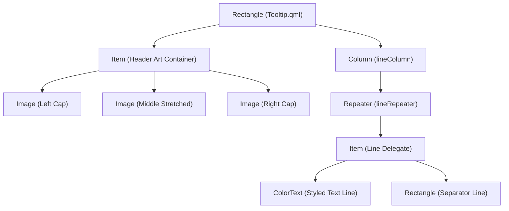

# UI Spec: Tooltip
**File:** `app/qml/components/Tooltip.qml`  **Pack:** `01-core-components.md`  **Legacy Reference:** `src/Classes/Tooltip.lua` (643 lines)  **Status:** Test-Covered

--------------------------------------------------------------------------------

## 1. Purpose & Parity Notes
*   **Role:** Universal floating hover-tooltip card used across all UI controls, stat lists, passive tree nodes, and items. Provides a programmatic API (`clear`, `addLine`, `addSeparator`, `checkForUpdate`, `showAt`), automated text wrapping, viewport edge-detection with automatic coordinate flipping, and optional PoE item header art with influence badges.
*   **Intentional Deviations from Legacy PoB:**
    *   *Window Overlay Stacking:* Legacy PoB renders tooltips during the immediate-mode draw pass on layer 100. In Qt Quick, any parent container with `clip: true` would truncate child tooltips. When `floating: true` (default), `showAt` reparents the tooltip to `QC.Overlay.overlay` and translates coordinates from its declaration home (`_home`), guaranteeing it displays above all views and modals without clipping.
    *   *Typography Rasterization Guard:* Text dimensions are measured using `.tgf` metrics for exact layout parity, but Qt rasterizes characters using TrueType fonts. Sizing calculations take `Math.max(tgfSize, laidOutSize)` so tooltips never clip rendered glyphs.

--------------------------------------------------------------------------------

## 2. Lightweight Wireframe & Layout Box Model
# Component Box Model & Layout
```text
+-------------------------------------------------------------------------------+
| Tooltip (z: 1000 when floating, color: rgba(0,0,0,0.85), border: theme.borderStrong)
| [Rarity Header Art] (visible if showHeaderArt && headerLeft != "")            |
|   Left Cap (headerSideWidth) | Middle Fill (stretched) | Right Cap            |
| +---------------------------------------------------------------------------+ |
| | Column [lineColumn] (margins: hPad=12px, vPad=10px, spacing: 2px)          | |
| |   Repeater [lineRepeater]                                                 | |
| |     Row: Separator (isSeparator: true, height: sz, line: 1px theme.border)| |
| |     Row: Line (ColorText, font.pixelSize: size, centered if line.center) | |
| +---------------------------------------------------------------------------+ |
+-------------------------------------------------------------------------------+
```

# ASCII Anatomy & Wireframe
```text
Item Tooltip with Header Art & Influence Badges:
+------------------------------------------------------------------------+
| [Badge1]            Lioneye's Glare                 [Badge2]           | (1)
|                    Imperial Bow                                        | (2)
+------------------------------------------------------------------------+
| Bow                                                                    | (3)
| Quality: +20%                                                          | (3)
| Physical Damage: 160-340                                               | (3)
| Critical Strike Chance: 5.00%                                          | (3)
| Attacks per Second: 1.45                                               | (3)
|------------------------------------------------------------------------| (4) Separator
| Requires Level 66, 212 Dex                                             | (3)
|------------------------------------------------------------------------| (4) Separator
| Hits can't be Evaded                                                   | (5) Mod Lines
| (200-250)% increased Physical Damage                                   | (5)
+------------------------------------------------------------------------+
  |<--- hPad: 12px --->|                       |<--- hPad: 12px --->|

Annotations:
(1) Rarity header background: composed of left, middle (tiled/stretched), and right artwork assets.
(2) Item title and base type: centered ColorText strings rendered in rarity color.
(3) Item requirements and core properties: left-aligned 14px ColorText lines.
(4) Visual Separator: 1px horizontal divider line with configurable vertical clearance.
(5) Explicit Modifiers: formatted using PoB color escape sequences (^7, ^1, ^xRRGGBB).
```

# Responsive / Overflow Rules
*   **Viewport Edge Clamping & Flipping:** When positioned via `showAt(hx, hy, hw, hh, viewport)`:
    *   Horizontal: Places tooltip to the right (`hx + hw + 5`). If it overflows `viewport.x + viewport.width`, flips to the left (`hx - 5 - width`).
    *   Vertical: If horizontal flip causes overlap with the target item, offsets downward (`hy + hh`). If bottom overflows `viewport.y + viewport.height`, shifts upward (`hy + hh - height`).
*   **Word Wrapping:** When `maxWidth > 0`, `addLine()` automatically segments text lines using `_wrapString()`, splitting strings at word boundaries based on measured font widths.

# Component Hierarchy


--------------------------------------------------------------------------------

## 3. Interactive States & Controls
| Control (objectName) | Type | Default State | Interactive Behavior | Edge States (Disabled / Empty / Loading / Error / Long Text) |
| ------ | ------ | ------ | ------ | ------ |
| `pob.tooltip.root` | Rectangle | Hidden (`visible: false`) | Positions and sizes to wrap content lines | Hidden when `lines.length === 0`. |
| `pob.tooltip.header` | Item | Hidden (`showHeaderArt: false`) | Displays PoE rarity graphics behind header lines | Renders only when item metadata is provided via `setItemMeta()`. |
| `pob.tooltip.lines` | Column | Spacing: 2px | Renders text lines and separator dividers | Text lines center or left-align based on line parameters. |

# Complete State Matrix
*   **Hidden / Cleared:** `visible: false`, `lines: []`, `maxWidth: 0`, `childTooltips: []`.
*   **Standard Control Tooltip:** `showHeaderArt: false`, single or multiline ColorText, `color: rgba(0,0,0,0.85)`, border: `theme.borderStrong`.
*   **Item Rarity Tooltip:** `showHeaderArt: true`, header art active, border tinted to `borderColorOverride` (Unique, Rare, Magic, Normal).
*   **Flipped Position:** Tooltip coordinates adjust automatically to stay fully within the visible window viewport bounds.

# State Matrix & Binding Hazards
*   *Overlay Reparenting Lifetime Hazard:* When `floating: true`, `showAt` reparents the tooltip to `QC.Overlay.overlay`. If the declaring view or component is destroyed while the tooltip is open, an orphaned tooltip could linger on the window overlay. Tooltip monitors `_homeShown`: `on_HomeShownChanged: if (!_homeShown) visible = false`.
*   *Rebuild Gate Optimization:* Rebuilding tooltips on every mouse movement consumes excessive CPU. Callers should wrap tooltip updates with `if (tt.checkForUpdate([params])) { ... }`, which performs memoized comparisons and clears old lines only when inputs change.

--------------------------------------------------------------------------------

## 4. Data & Bridge Contract
*   **Reads (Item Metadata Schema via `setItemMeta`):**
    *   `header: string` -> rarity name ("UNIQUE", "RARE", etc.)
    *   `headerLeft: string`, `headerMiddle: string`, `headerRight: string` -> asset paths
    *   `headerHeight: int`, `headerSideWidth: int` -> geometry slices
    *   `influenceIcon1: string`, `influenceIcon2: string` -> influence badges
    *   `color: string` -> rarity border color override
*   **Writes / Methods Exposed:**
    *   `clear()` -> resets lines, wrapping constraints, and item metadata
    *   `addLine(size: int, text: string, font?: string, center?: bool)` -> adds formatted text line
    *   `addSeparator(size?: int)` -> inserts horizontal dividing line
    *   `checkForUpdate(params: array)` -> returns `true` if parameter array has changed
    *   `showAt(hx, hy, hw, hh, viewport)` -> calculates placement and reveals tooltip
    *   `hide()` -> hides tooltip
*   **Qt6 Bridge Safety:** File paths for local assets are automatically sanitized via `_fileUrl()` to prepend `file://` or `file:///` across Windows and Linux platforms.

--------------------------------------------------------------------------------

## 5. Testable Acceptance Criteria (Qt6::QuickTest)
*   **AC-01 (Initial Render & Zero Warnings):** Given a default Tooltip, when mounted, 0 QML warnings are emitted, `visible === false`, and `lines.length === 0`.
*   **AC-02 (Text Wrapping Constraint):** Given `maxWidth: 200`, calling `addLine(14, "This is a very long description that exceeds maximum width")` segments the input into multiple lines in `root.lines`.
*   **AC-03 (Consecutive Separator Suppression):** Calling `addSeparator()` twice consecutively adds only 1 separator item to `root.lines`.
*   **AC-04 (Memoization via CheckForUpdate):** Given `checkForUpdate(["Item A", 20])` returns `true`, immediately calling `checkForUpdate(["Item A", 20])` returns `false` without clearing content.
*   **AC-05 (Viewport Flipping):** Given a window width of 1000px and a control at `hx: 900`, `showAt` positions the tooltip to the left of the control (`ttX < 900`).

--------------------------------------------------------------------------------

## 6. Bug Audit Findings (Current Implementation vs Spec)
| Severity | File & Line | Symptom / Defect | Root Cause | Expected Behavior |
| ------ | ------ | ------ | ------ | ------ |
| High | `app/qml/components/Tooltip.qml:3740` | Tooltip remains visible on screen after its parent view is closed or switched. | Tooltip reparented to `QC.Overlay.overlay` lost connection to parent view lifecycle. | Hide tooltip automatically when `_homeShown` becomes false. |
| Medium | `app/qml/components/Tooltip.qml:3825` | Glyphs clip or overlap border on high-DPI displays. | Relying solely on bitmap `.tgf` metrics for bounding box sizing. | Use `Math.max(tgfSize, laidOutSize)` against rendered `Item.height`. |
| Low | `app/qml/components/Tooltip.qml:3695` | Local image paths fail to load on Windows platforms. | Missing file protocol prefix handling for absolute drive paths. | Format URLs via `_fileUrl(path)`. |
