# UI Spec: TopBar
**File:** `app/qml/components/TopBar.qml`  **Pack:** `00-shell-and-theme.md`  **Legacy Reference:** `src/Modules/Build.lua:121-308` (`buildMode:Init` `anchorTopBar`)  **Status:** Test-Covered

--------------------------------------------------------------------------------

## 1. Purpose & Parity Notes
*   **Role:** The top horizontal application chrome strip in Build mode. Manages high-level build session state (sidebar collapse toggle, return to build list, save/save-as), displays the editable build name with unsaved indicator, and provides global character progression controls (allocated passive points display, auto/manual level toggle, level input, class selector with tree-reset confirmation, ascendancy, secondary ascendancy, loadouts dropdown, and active mode readout).
*   **Intentional Deviations from Legacy PoB:**
    *   *Width derivations:* Legacy derives `buildName` width by manually subtracting all siblings' widths from the screen width (`Build.lua:150-155`). TopBar uses Qt Quick's `RowLayout` with an explicit spacer (`Item { Layout.fillWidth: true }`) and bounded constraints (`Layout.minimumWidth: 60`, `Layout.maximumWidth: 260`).
    *   *Dialog ownership:* File picker dialogs and unsaved-changes modals are decoupled from TopBar; TopBar raises signals (`saveAsRequested`, `savePromptRequested`, `saveFailed`) which are handled by the shell (`main.qml`). The class change confirmation modal (`ConfirmPopup`) is owned locally to intercept class changes before engine mutation.
    *   *Controls isolation:* `QtQuick.Controls` is deliberately omitted from TopBar's imports to prevent type ambiguity with `app/qml/components/Button.qml`.

--------------------------------------------------------------------------------

## 2. Lightweight Wireframe & Layout Box Model
# Component Box Model & Layout
```text
+-----------------------------------------------------------------------------------------------------------------------------------------------------+
| TopBar (implicitHeight: theme.topBarHeight [32px], color: theme.titleBar, z: 1)                                                                      |
| RowLayout (height: theme.controlSize [18-20px], margins: left/right theme.space2 [4px], spacing: theme.space2 [4px])                                |
| +--------+------------+--------+-----------+-----------------------+---+-------------------+--------+-------+---------+------------+----------+---+ |
| | [>>/<<]| [<< Back]  | [Save] | [Save As] | BuildNamePlate [*]    | S | PassivePointsPlate| [Auto] | [Lvl] | [Class] | [Ascend]   | [Loadout]| M | |
| +--------+------------+--------+-----------+-----------------------+ p +-------------------+--------+-------+---------+------------+----------+ o | |
| | btnW   | btnW       | btnW   | btnW      | min:60 max:260 elided | a | pointsLabel       | btnW   | 50px  | 95px    | 120px      | 145px    | d | |
| | 24px   | 68px       | 52px   | 68px      | + unsaved warning '*' | c | border: 1px hover | 58px   | num   | drop    | drop       | drop     | e | |
| +--------+------------+--------+-----------+-----------------------+ e +-------------------+--------+-------+---------+------------+----------+---+ |
|                                                                    | r                                                                              |
+--------------------------------------------------------------------+---+----------------------------------------------------------------------------+
```

# ASCII Anatomy & Wireframe
```text
Left Group (Build Controls):
+-----+ +---------+ +------+ +---------+ +--------------------------------+
| >>  | | << Back | | Save | | Save As | | Explosive Arrow Deadeye   *    |
+-----+ +---------+ +------+ +---------+ +--------------------------------+
  (1)       (2)        (3)       (4)       (5)                       (6)

Right Group (Character Progression Controls):
+---------------+ +--------+ +-----+ +----------+ +-------------+ +---------------+ +------------+
| 118/123  0/8  | | Manual | | 98  | | Ranger v | | Deadeye   v | | Default     v | | Mode: BUILD|
+---------------+ +--------+ +-----+ +----------+ +-------------+ +---------------+ +------------+
       (7)           (8)       (9)       (10)          (11)             (12)             (13)

Annotations:
(1) Sidebar collapse toggle button (labels ">>" when collapsed, "<<" when expanded).
(2) Back button: returns to build list; triggers save prompt if unsaved.
(3) Save button: disabled if shell.canSave is false; triggers SaveAs if dbFileName is empty.
(4) Save As button: requests SaveAs dialog via shell signal.
(5) Build name plate: Text elides right; shows tooltip with full dbFileSubPath on mouse hover.
(6) Unsaved indicator: visible if shell.unsaved == true; colored theme.warning.
(7) Passive points display: border highlights on hover; tooltip details point breakdown.
(8) Level tracking mode toggle ("Auto" / "Manual").
(9) Character level numeric edit control (1-100).
(10) Base class dropdown (triggers tree-reset ConfirmPopup when changing classes).
(11) Ascendancy class dropdown (disabled if class has no ascendancies).
(12) Loadouts dropdown (displays loadouts, sync, manage, and help actions).
(13) Mode indicator readout (theme.accent).
```

# Responsive / Overflow Rules
*   **Minimum safe width/height:** 960x32px. At widths < 960px, controls remain pinned to their preferred widths; the flex spacer compresses to 0px, and the build name plate compresses to its minimum width of 60px with `Text.ElideRight`.
*   **Horizontal scroll policy:** Forbidden. Bar height is fixed to `theme.topBarHeight` (32px).
*   **Text truncation policy:** `nameText` elides right (`Text.ElideRight`). `pointsLabel`, `levelEdit`, and dropdown headers maintain strict fixed or metric-based widths.
*   **Tooltip placement:** Tooltips hang below the 32px bar into the underlying view. Viewport coordinate translation maps the window content bounds to prevent clipping.

# Component Hierarchy

```mermaid
flowchart TD
    Root["Rectangle (TopBar.qml)"] --> Row["RowLayout"]
    Row --> BtnCollapse["Button (Collapse SideBar)"]
    Row --> BtnBack["Button (Back)"]
    Row --> BtnSave["Button (Save)"]
    Row --> BtnSaveAs["Button (Save As)"]
    Row --> NamePlate["Item (namePlate)"]
    NamePlate --> NameText["Text (Elided Name)"]
    NamePlate --> UnsavedMark["Text (' *')"]
    NamePlate --> NameMA["MouseArea (Hover)"]
    NamePlate --> NameTip["Tooltip"]
    Row --> Spacer["Item (Layout.fillWidth: true)"]
    Row --> PointsPlate["Rectangle (pointsPlate)"]
    PointsPlate --> PointsLabel["Label (Parsed ColorText)"]
    PointsPlate --> PointsMA["MouseArea (Hover)"]
    PointsPlate --> PointsTip["Tooltip"]
    Row --> BtnLevelMode["Button (Auto/Manual)"]
    Row --> EditLevel["EditControl (Level 1-100)"]
    Row --> DropClass["DropDownControl (Class)"]
    Row --> DropAscend["DropDownControl (Ascendancy)"]
    Row --> DropSecondary["DropDownControl (Alt Ascendancy)"]
    Row --> DropLoadouts["DropDownControl (Loadouts)"]
    Row --> TxtMode["Text (Mode Indicator)"]
    Root --> ClassConfirm["ConfirmPopup (Reparented to Window)"]
```


--------------------------------------------------------------------------------

## 3. Interactive States & Controls
| Control (objectName) | Type | Default State | Interactive Behavior | Edge States (Disabled / Empty / Loading / Error / Long Text) |
| ------ | ------ | ------ | ------ | ------ |
| `pob.topbar.collapse` | Button | Enabled / "<<" | Inverts `sideBarCollapsed` via `luaEngine.setSideBarCollapsed()`; emits `collapseToggled` | Hidden when `!hasBuild`. |
| `pob.topbar.back` | Button | Enabled / "<< Back" | Emits `savePromptRequested("LIST")` if unsaved; calls `luaEngine.closeBuild()` otherwise | Disabled if `!hasBuild`. |
| `pob.topbar.save` | Button | Enabled / "Save" | Calls `luaEngine.saveDBFile("")`; triggers `saveAsRequested` if no file path exists | Disabled if `shell.canSave === false` or `!hasBuild`. Emits `saveFailed` on error. |
| `pob.topbar.saveAs` | Button | Enabled / "Save As" | Emits `saveAsRequested()` | Disabled if `!hasBuild`. |
| `pob.topbar.namePlate` | Item / Text | "Unnamed build" | Shows subPath tooltip on hover | Min width 60px, max 260px; elides right with `...` if text overflows; appends red `*` when dirty. |
| `pob.topbar.points` | Rectangle / Label | Border: `theme.border` | Displays allocated/available points; shows breakdown tooltip on hover | Border changes to `theme.borderStrong` on hover; empty string degrades gracefully without layout collapse. |
| `pob.topbar.levelMode` | Button | "Auto" / "Manual" | Toggles `levelAutoMode` via `luaEngine.setLevelAutoMode()` | Tooltip dynamically updates based on mode. |
| `pob.topbar.level` | EditControl | "1" (Numeric) | Input range 1-100; commits via `luaEngine.setCharacterLevel()`; auto-switches mode to Manual | Invalid or non-numeric reverts to cached level on blur/revert. Disabled when `!hasBuild`. |
| `pob.topbar.class` | DropDownControl | Cur class | On selection, runs `luaEngine.setClass(id, "check")`; prompts `ConfirmPopup` if tree reset needed | Reverts dropdown index if user cancels confirmation dialog. |
| `pob.topbar.ascend` | DropDownControl | Cur ascendancy | Commits via `luaEngine.setAscendClass(id)` | Disabled if current class has 0 ascendancies (`root.ascendancies.length === 0`). |
| `pob.topbar.secondary` | DropDownControl | Cur alt ascendancy | Commits via `luaEngine.setSecondaryAscendClass(id)` | Disabled and hidden unless `root.classList.secondaryEnabled === true`. |
| `pob.topbar.loadouts` | DropDownControl | Active loadout | Triggers loadout selection, sync, or signals `manageLoadoutsRequested` / `loadoutHelpRequested` | Header and separator items are non-interactive (`itemEnabled: false`). |

# State Matrix & Binding Hazards
*   *Imperative Control Syncing:* `classDrop.currentIndex`, `ascendDrop.currentIndex`, `secondaryDrop.currentIndex`, `loadoutDrop.currentIndex`, and `levelEdit.text` must NEVER be bound directly to engine expressions. User interactions (`_pick`, `textEdited`) overwrite declarative bindings in QML. Synchronization must strictly occur through the imperative `_syncControls()` helper invoked by `refresh()`.
*   *Re-entrancy Latch:* `luaEngine.getShellState()` triggers `EstimatePlayerProgress`, which mutates character level in auto mode and can fire `calcsChanged` synchronously. All state updates must be guarded by `if (root._refreshing) return; root._refreshing = true; ... root._refreshing = false;`.
*   *Mode Gate Check:* `luaEngine.currentMode === "BUILD"` is mandatory. In `LIST` mode, `getShellState()` can retain stale build objects from a previous session. Controls must check `hasBuild: inBuildMode && shell.level !== undefined`.
*   *Dialog Reparenting:* `ConfirmPopup` defaults to centering inside its visual parent. Inside a 32px bar, this causes clipping. It must explicitly bind `parent: root._win ? root._win.contentItem : null`.

--------------------------------------------------------------------------------

## 4. Data & Bridge Contract
*   **Reads (LuaEngine / C++ Models):**
    *   `luaEngine.currentMode` -> `string` ("BUILD", "LIST")
    *   `luaEngine.getShellState()` -> `{ level: int, levelAutoMode: bool, sideBarCollapsed: bool, unsaved: bool, buildName: string, dbFileName: string, dbFileSubPath: string, canSave: bool, points: { str: string, tooltip: string } }`
    *   `luaEngine.getClassList()` -> `{ curClassId: int, curAscendClassId: int, curSecondaryAscendClassId: int, secondaryEnabled: bool, classes: [...], secondaryAscendancies: [...] }`
    *   `luaEngine.invoke("pob_loadoutsGetState", [])` -> `{ ok: bool, activeDropdownIndex0: int, dropdown: [{ label: string, value: any, kind: string }] }`
*   **Writes / Mutations:**
    *   `luaEngine.setSideBarCollapsed(bool)` -> `{ collapsed: bool }`
    *   `luaEngine.closeBuild()` -> `void`
    *   `luaEngine.saveDBFile("")` -> `{ ok: bool, error?: string }`
    *   `luaEngine.setLevelAutoMode(bool)` -> `void`
    *   `luaEngine.setCharacterLevel(int)` -> `void`
    *   `luaEngine.setClass(int, string)` -> `{ needsConfirm: bool, label: string, canConnect: bool }`
    *   `luaEngine.setAscendClass(int)` -> `void`
    *   `luaEngine.setSecondaryAscendClass(int)` -> `void`
    *   `luaEngine.invoke("pob_loadoutsSelect", [value])` -> `void`
    *   `luaEngine.invoke("pob_loadoutsSync", [])` -> `void`
*   **Signals Observed:**
    *   `luaEngine.onBuildDataChanged` -> triggers `root.refresh()`
    *   `luaEngine.onCalcsChanged` -> triggers `root.refresh()`
    *   `luaEngine.onModeChanged` -> triggers `root.refresh()`
    *   `luaEngine.onTreeChanged` -> triggers `root.refresh()`
    *   `luaEngine.onItemsChanged`, `onSkillsChanged`, `onConfigChanged` -> trigger `root.refreshLoadouts()`
*   **Qt6 Bridge Safety:** All model lists (`classes`, `secondaryAscendancies`, `dropdown`) must be checked with `Array.isArray()` before passing to child controls.

--------------------------------------------------------------------------------

## 5. Testable Acceptance Criteria (Qt6::QuickTest)
*   **AC-01 (Initial Render & Zero Warnings):** Given the app is in `BUILD` mode with a loaded character, when `TopBar.qml` mounts, then 0 QML engine warnings are logged and all controls within `RowLayout` have `implicitHeight > 0` and `width > 0`.
*   **AC-02 (No Text Overflow & Name Elision):** At 960x32, 1100x32, and 1600x32, when `buildName` contains a 100-character string, `nameText.paintedWidth` does not exceed `namePlate.width - namePlate.markW`, `nameText.elide` is active, and hovering displays the full path in `nameTip`.
*   **AC-03 (Class Change Confirmation Workflow):** Given an active passive tree, when the user selects a new class from `classDrop` that requires a tree reset, then `classConfirm.visible` becomes `true`, the dropdown's visible text reverts to the original class, and clicking "Continue" invokes `luaEngine.setClass(id, "force")`.
*   **AC-04 (Save & Save-As Signaling):** Given a new build with `dbFileName == ""`, when the user clicks "Save", then `saveAsRequested` is emitted instead of invoking `luaEngine.saveDBFile("")`.
*   **AC-05 (Empty / List Mode State):** Given `luaEngine.currentMode === "LIST"`, then `root.hasBuild` evaluates to `false`, build management buttons and dropdowns are hidden (`visible: false`), and no bridge binding errors occur.

--------------------------------------------------------------------------------

## 6. Bug Audit Findings (Current Implementation vs Spec)
| Severity | File & Line | Symptom / Defect | Root Cause | Expected Behavior |
| ------ | ------ | ------ | ------ | ------ |
| High | `app/qml/components/TopBar.qml:5150` | Unqualified `import QtQuick.Controls` causes fatal ambiguous symbol errors for `Button`. | TopBar directory contains custom `Button.qml`, clashing with standard controls import. | Keep `QtQuick.Controls` unimported or import with namespace `import QtQuick.Controls as QQC`. |
| High | `app/qml/components/TopBar.qml:5200` | Stale build controls remain visible and active over the build library when returning to list mode. | Gating solely on `getShellState()` payload; `main.modes.BUILD` outlives `CloseBuild`. | TopBar must explicitly gate visibility with `readonly property bool inBuildMode: luaEngine.currentMode === "BUILD"`. |
| Medium | `app/qml/components/TopBar.qml:5335` | Class confirmation modal appears clipped or renders off-screen outside the 32px bar. | `PopupBase` defaults to centering inside its visual parent (`root`). | Explicitly reparent modal via `parent: root._win ? root._win.contentItem : null`. |
| Medium | `app/qml/components/TopBar.qml:5220` | Level input field text gets reverted while the user is actively typing. | Declarative binding to `shell.level` triggers on asynchronous background recalc. | Imperatively update `levelEdit.text` in `_syncControls()` only when `!levelEdit.editing`. |
| Low | `app/qml/components/TopBar.qml:5450` | Stray caret characters in build names (e.g. `^7Build`) render invisible or distort colors. | Passing raw build names into `Label` (which parses PoB color escapes). | Render build name via plain Qt Quick `Text` element instead of `Label`. |
