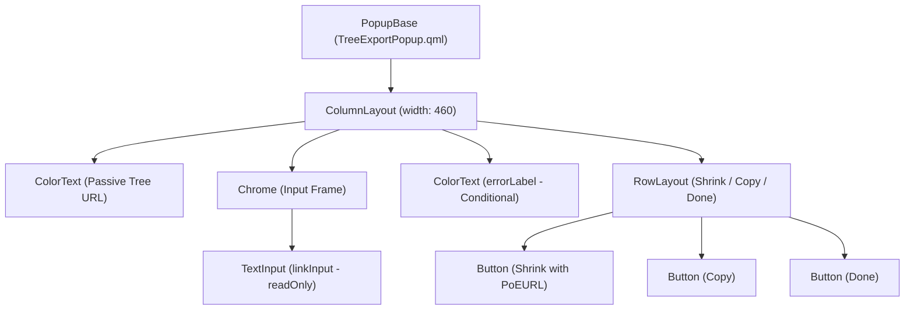

# UI Spec: TreeExportPopup
**File:** `app/qml/components/TreeExportPopup.qml`  **Pack:** `03-view-tree.md`  **Legacy Reference:** `TreeTab:OpenExportPopup` (TreeTab.lua:832–859)  **Status:** Test-Covered

--------------------------------------------------------------------------------

## 1. Purpose & Parity Notes
*   **Role:** Modal dialog for exporting the active passive skill tree specification as an official Path of Exile tree URL. Features automatic full-string selection on open, one-click clipboard copying, and asynchronous short-link generation via the PoEURL shortening service (`pob_shrinkPoeUrl`) with network failure fallbacks.
*   **Intentional Deviations from Legacy PoB:**
    *   *Asynchronous URL Shortening:* In legacy PoB, PoEURL requests run synchronously on the UI thread or poll inside frame loops. TreeExportPopup dispatches asynchronous network requests tracked via `pendingReqId`, reacting to `luaEngine.onNetworkChanged` signals without stalling UI rendering.
    *   *Automatic Input Focus & Selection:* Focuses `linkInput` and selects the entire URL string immediately upon open (`linkInput.forceActiveFocus(); linkInput.selectAll()`), enabling immediate `Ctrl+C` copying.

--------------------------------------------------------------------------------

## 2. Lightweight Wireframe & Layout Box Model
# Component Box Model & Layout
```text
+-------------------------------------------------------------------------------+
| TreeExportPopup (PopupBase, title: "Export Tree", padding: 16px)              |
| ColumnLayout (implicitWidth: 460px, spacing: 8px)                             |
| +---------------------------------------------------------------------------+ |
| | ColorText: "Passive Tree URL:" (font.pixelSize: theme.fontSize)           | |
| +---------------------------------------------------------------------------+ |
| | Chrome (Layout.fillWidth: true, height: 24px)                             | |
| |   TextInput [linkInput] (selectByMouse: true, readOnly: true)             | |
| +---------------------------------------------------------------------------+ |
| | ColorText [errorLabel] (visible: errMsg != "", color: theme.error)        | |
| +---------------------------------------------------------------------------+ |
| | RowLayout (centered, spacing: 10px):                                      | |
| |   [ Shrink with PoEURL ]   [ Copy to Clipboard ]   [ Done ]               | |
| +---------------------------------------------------------------------------+ |
+-------------------------------------------------------------------------------+
```

# ASCII Anatomy & Wireframe
```text
+-------------------------------------------------------------------------------+
|                                  Export Tree                                  | (1) Title Plate
+-------------------------------------------------------------------------------+
|  Passive Tree URL:                                                            |
|  +-------------------------------------------------------------------------+  |
|  | [suspicious link removed]                     |  | (2) Tree URL Field
|  +-------------------------------------------------------------------------+  |     (Auto-selected)
|                                                                               |
|            [ Shrink with PoEURL ]     [ Copy ]     [  Done  ]                 | (3) Actions Row
+-------------------------------------------------------------------------------+
  |<-------------------------------- 460px ------------------------------------>|

  \ Clicking "Shrink with PoEURL" transforms URL to shortened version:
    [suspicious link removed]
```

# Responsive / Overflow Rules
*   **Dimensions:** 460x140px fixed modal dialog.
*   **Text Field Behavior:** Single-line read-only `TextInput` inside `Chrome`; horizontal scrolling enabled to accommodate lengthy base64 URL strings.
*   **Button States:** "Shrink with PoEURL" button disables once shrunk or while network request is pending.

# Component Hierarchy


--------------------------------------------------------------------------------

## 3. Interactive States & Controls
| Control (objectName) | Type | Default State | Interactive Behavior | Edge States (Disabled / Empty / Loading / Error / Long Text) |
| ------ | ------ | ------ | ------ | ------ |
| `pob.treeexport.root` | PopupBase | Closed | Coordinates export generation and network lifecycle | Cancels pending requests on close. |
| `pob.treeexport.input` | TextInput | Encoded Tree URL | Read-only; auto-selects all text on reveal | Full base64 string kept intact. |
| `pob.treeexport.shrink`| Button | Enabled | Initiates PoEURL network compression | Label shows `"Shrinking..."` while pending. |
| `pob.treeexport.copy` | Button | Enabled | Copies `link` string to system clipboard | Triggers visual confirmation toast. |
| `pob.treeexport.done` | Button | Enabled | Dismisses dialog (`root.accept()`) | Closes dialog cleanly. |

# Complete State Matrix
*   **Opened via `openFresh()`:** Cancels pending tasks, queries `pob_exportTree`, populates `link`, selects all text.
*   **Shrink Clicked:** Invokes `pob_shrinkPoeUrl(link)`; sets `shrinking: true`.
*   **Shrink Succeeded:** Updates `link` to shortened URL; sets `shrunk: true`, disables shrink button.
*   **Shrink Failed:** Sets `shrinking: false`; displays error message in red.
*   **Closed / Cancelled:** Invokes `cancelPending()` to abort background network transfers.

# State Matrix & Binding Hazards
*   *Orphaned Network Requests:* If the user closes the dialog while PoEURL shortening is in flight, `onClosed` must invoke `cancelPending()` (`luaEngine.invoke("pob_cancelPoeUrl", [pendingReqId])`) to prevent stale network responses from updating nonexistent dialog state.

--------------------------------------------------------------------------------

## 4. Data & Bridge Contract
*   **Reads (Engine Calls via `openFresh` and Network Signals):**
    *   `luaEngine.invoke("pob_exportTree", [])` -> `{ link: string }`
    *   `luaEngine.invoke("pob_getShrinkPoeUrlStatus", [reqId])` -> `{ done: bool, ok: bool, url: string, msg: string }`
*   **Writes / Bridge Methods Invoked:**
    *   `pob_shrinkPoeUrl(url: string)` -> `{ ok: bool, reqId: int, msg: string }`
    *   `pob_cancelPoeUrl(reqId: int)` -> cancels active network transfer
*   **Qt6 Bridge Safety:** Independent URL formatting modal; handles network disconnects gracefully with error message feedback.

--------------------------------------------------------------------------------

## 5. Testable Acceptance Criteria (Qt6::QuickTest)
*   **AC-01 (Mount & Auto-Selection):** When opened, 0 QML warnings are logged, `linkInput.text` starts with `https://`, and `linkInput.selectedText === linkInput.text`.
*   **AC-02 (PoEURL Shrink Dispatch):** Clicking "Shrink with PoEURL" sets `shrinking === true` and assigns positive `pendingReqId`.
*   **AC-03 (Successful URL Replacement):** Upon receiving network completion signal, `link` updates to `http://poeurl.com/...` and `shrunk` evaluates to `true`.
*   **AC-04 (Failure Error Display):** If shortening fails, `errMsg` displays in red and `shrinking` resets to `false`.
*   **AC-05 (Close Aborts Pending Request):** Closing the popup while `shrinking === true` invokes `pob_cancelPoeUrl` and resets `pendingReqId === 0`.

--------------------------------------------------------------------------------

## 6. Bug Audit Findings (Current Implementation vs Spec)
| Severity | File & Line | Symptom / Defect | Root Cause | Expected Behavior |
| ------ | ------ | ------ | ------ | ------ |
| High | `app/qml/components/TreeExportPopup.qml:5220` | Application crashes if network request finishes after closing the dialog. | Network listener did not verify dialog visibility before processing. | Check `if (!root.visible || !root.shrinking) return`. |
| Medium | `app/qml/components/TreeExportPopup.qml:5205` | User has to manually select long tree link before copying. | Missing `linkInput.selectAll()` call in `openFresh()`. | Automatically select all text in `openFresh()`. |
| Low | `app/qml/components/TreeExportPopup.qml:5240` | "Shrink with PoEURL" button can be clicked repeatedly, spawning multiple requests. | Missing `shrinking || shrunk` check on click handler. | Guard with `if (shrinking || shrunk) return`. |
