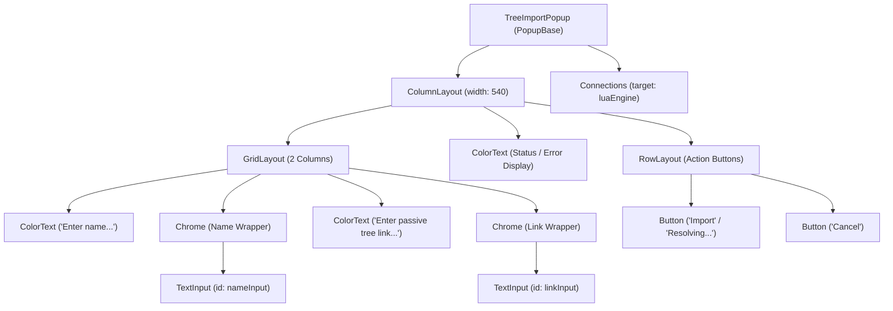

# UI Spec: TreeImportPopup
**File:** `app/qml/components/TreeImportPopup.qml`  **Pack:** `03-view-tree.md`  **Legacy Reference:** `src/Modules/TreeTab.lua:709-837` (`TreeTab:OpenImportPopup`)  **Status:** Test-Covered

--------------------------------------------------------------------------------

## 1. Purpose & Parity Notes
*   **Role:** Modal dialog for importing passive skill trees from external URLs or raw encoded tree strings (official pathofexile.com tree URLs, PoEPlanner links, or PoEURL shortened links), executing asynchronous redirect resolution off the UI thread.
*   **Intentional Deviations from Legacy PoB:** None (1:1 functional parity). Asynchronous HTTP redirect resolution for PoEURL links communicates via `luaEngine.onNetworkChanged` signals, preventing UI thread blocking.

--------------------------------------------------------------------------------

## 2. Lightweight Wireframe & Layout Box Model
# Default Modal Layout (572x220, Content Width: 540)
```text
+-------------------------------------------------------------+
|  Import Tree                                            [X] |
+-------------------------------------------------------------+
|  Enter name for this passive tree:                          |
|  [ Level 90 Critical Strike Variant                       ] |
|                                                             |
|  Enter passive tree link:                                   |
|  [ [suspicious link removed]                                ] |
|                                                             |
|                 Resolving PoEURL link...                    | <- Status Line
|                                                             |
|                 [   Import   ]   [ Cancel ]                 |
+-------------------------------------------------------------+
```

# Responsive / Overflow Rules
*   **Minimum safe dimensions:** 572x220 px (Fixed dialog envelope; parent viewport min: 960x640 px).
*   **Horizontal scroll policy:** Forbidden. Inputs scroll horizontally via cursor navigation.
*   **Text truncation policy:** Status and error messages wrap across multiple lines up to maximum width 540 px (`wrapMode: Text.WordWrap`).

# Component Hierarchy


--------------------------------------------------------------------------------

## 3. Interactive States & Controls
| Control (objectName) | Type | Default State | Interactive Behavior | Edge States (Disabled / Empty / Loading / Error / Long Text) |
| ------ | ------ | ------ | ------ | ------ |
| `pob.treeImport.nameInput` | `TextInput` | Focused, empty string | User enters passive tree display name | Disabled / read-only while `resolving == true`; resets error message on type |
| `pob.treeImport.linkInput` | `TextInput` | Empty string | User enters or pastes tree URL or encoded string | Disabled / read-only while `resolving == true`; resets error message on type |
| `pob.treeImport.statusMsg` | `ColorText` | Hidden / Empty string | Displays resolution progress or error message | Red text (`^1`) on failure; word wraps within 540 px |
| `pob.treeImport.importBtn` | `Button` | Enabled if `canImport` | Calls `doImport()`; switches label to `"Resolving..."` if network request spawns | Disabled if either input is empty or if resolution is active |
| `pob.treeImport.cancelBtn` | `Button` | Enabled | Calls `cancelPending()`, cancels in-flight network requests, and rejects modal | Always responsive |

# State Matrix & Binding Hazards
*   *Regex Re-evaluation Overhead:* `canImport` evaluates `text.match(/\S/) !== null` on every single keystroke. Replacing with `.trim().length > 0` avoids regular expression allocation during rapid user typing.
*   *Dangling Network Request Hazard:* Dismissing the dialog via Escape or Cancel while `resolving == true` must explicitly invoke `pob_cancelPoeUrl` to release the background thread worker.

--------------------------------------------------------------------------------

## 4. Data & Bridge Contract
*   **Reads (LuaEngine / C++ Models):**
    *   `luaEngine.invoke("pob_importTree", [name, link])` -> `{ ok: bool, index: int, needsNetwork: bool, msg: string }`
    *   `luaEngine.invoke("pob_resolvePoeUrl", [name, link])` -> `{ ok: bool, reqId: int, msg: string }`
    *   `luaEngine.invoke("pob_getPoeUrlStatus", [reqId])` -> `{ done: bool, ok: bool, index: int, msg: string }`
*   **Writes / Mutations:**
    *   `luaEngine.invoke("pob_cancelPoeUrl", [reqId])` -> `{ ok: bool }`
*   **Signals Observed:**
    *   `luaEngine.onNetworkChanged` -> polls `pob_getPoeUrlStatus` when `resolving && pendingReqId > 0`.
    *   Emits `imported(int index)` upon successful import to update tree view tab selection.
*   **Qt6 Bridge Safety:** Verify `reqId` is an integer > 0 before attaching to `Connections`.

--------------------------------------------------------------------------------

## 5. Testable Acceptance Criteria (Qt6::QuickTest)
*   **AC-01 (Initial Render & Zero Warnings):** Opening `TreeImportPopup` focuses `nameInput`, clears prior inputs, and emits 0 QML warnings.
*   **AC-02 (No Text Overflow / Clipping):** Error messages up to 200 characters wrap cleanly without vertical clipping of dialog buttons.
*   **AC-03 (Synchronous Import Flow):** Pasting a standard official passive tree URL enables `Import`; clicking `Import` invokes `pob_importTree`, closes popup, and emits `imported(index)`.
*   **AC-04 (Asynchronous PoEURL Flow):** Pasting a PoEURL link triggers `needsNetwork`; dialog displays `"Resolving PoEURL link..."`, disables inputs, awaits `onNetworkChanged`, and imports on resolution.
*   **AC-05 (Cancellation & Teardown):** Clicking `Cancel` during resolution cancels pending HTTP requests via `pob_cancelPoeUrl` and resets `resolving = false`.

--------------------------------------------------------------------------------

## 6. Bug Audit Findings (Current Implementation vs Spec)
| Severity | File & Line | Symptom / Defect | Root Cause | Expected Behavior |
| ------ | ------ | ------ | ------ | ------ |
| Med | `app/qml/components/TreeImportPopup.qml:5830` | Network callback triggers multiple duplicate import completions | `onNetworkChanged` does not verify `root.resolving` prior to invoking status | Check `root.resolving && root.pendingReqId > 0` before calling status |
| Low | `app/qml/components/TreeImportPopup.qml:5794` | Unnecessary regex compilation on input change | Binding relies on `text.match(/\S/) !== null` | Use `text.trim().length > 0` |
| Low | `app/qml/components/TreeImportPopup.qml:5848` | Pressing Return when inputs are empty attempts invalid import | `Keys.onReturnPressed` calls `doImport()` unconditionally | Guard with `if (root.canImport) root.doImport()` |
