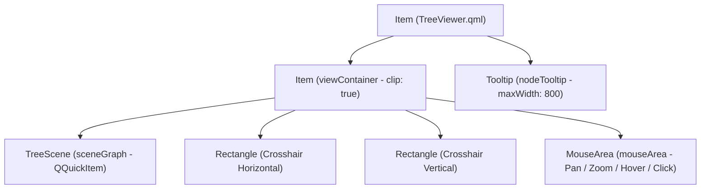

# UI Spec: TreeViewer
**File:** `app/qml/components/TreeViewer.qml`  **Pack:** `03-view-tree.md`  **Legacy Reference:** `src/Classes/PassiveTreeView.lua` (L172–519) + `ItemSlotHelper.DrawViewer` + `CalcBreakdownControl`  **Status:** Test-Covered

--------------------------------------------------------------------------------

## 1. Purpose & Parity Notes
*   **Role:** The core embeddable, multi-instance passive skill tree viewport primitive. Operates across multiple contexts: interactive full-tree browsing in the Tree tab, fixed non-interactive jewel socket previews with crosshairs in the Items tab (`showCrosshair: true`, zoom 17), calculation breakdown focus views (`showFocusRing: true`, zoom 5), and Timeless Jewel seed previews.
*   **Intentional Deviations from Legacy PoB:**
    *   *Retained Scene Graph Architecture:* Tree graph data is managed via `TreeViewController.cpp` and rendered through a native QQuickItem scene graph (`TreeScene`), while pan/zoom matrix state is owned locally per viewer instance.
    *   *Pointer Drag & Click Threshold:* Clicks execute on mouse button release; mouse translation exceeding 5px (`Math.abs(dx) > 5 || Math.abs(dy) > 5`) switches state from node activation to smooth view panning, mirroring legacy `PassiveTreeView.lua:224-242`.
    *   *Dynamic Tooltip Reparenting:* Node tooltip is driven by `pob_getNodeTooltipLines` with stat diffs and path costs. Holding `Ctrl` hides the tooltip; holding `Shift` hides jewel socket radius tooltips so socket coverage rings remain visible.

--------------------------------------------------------------------------------

## 2. Lightweight Wireframe & Layout Box Model
# Component Box Model & Layout
```text
+-------------------------------------------------------------------------------+
| TreeViewer (Item, clip: true, anchors.fill: parent)                            |
| +---------------------------------------------------------------------------+ |
| | TreeScene [sceneGraph] (native QQuickItem: node textures, orbits, links)  | |
| +---------------------------------------------------------------------------+ |
| | Crosshair: Vertical + Horizontal 2px Rectangles (color: rgba(1, 1, 1, 0.2))| |
| | (visible: showCrosshair, centered at floor(width/2), floor(height/2))     | |
| +---------------------------------------------------------------------------+ |
| | MouseArea [mouseArea] (z: 2, anchors.fill: parent, hoverEnabled: true)    | |
| |   AcceptedButtons: Left | Right                                           | |
| +---------------------------------------------------------------------------+ |
| Tooltip [nodeTooltip] (maxWidth: 800px, stat diffs, path cost, gold respec)   |
+-------------------------------------------------------------------------------+
```

# ASCII Anatomy & Wireframe
```text
Full Interactive Tree View (Tree Tab):
+-------------------------------------------------------------------------------+
|  (Passives Scene Graph)                                                       |
|        O---O                                                                  |
|       /     \       * [Hovered Node: Heartseeker]                             |
|      O       (O) <--- Intermediate path highlighted                           |
|       \     /        Trace path active (Shift held)                           |
|        O---O                                                                  |
|                                                                               |
|                   \ Hover Tooltip (x + 12, y + 12):                           |
|                    +--------------------------------------------+             |
|                    | Heartseeker                                |             |
|                    | +30% to Critical Strike Multiplier         |             |
|                    | ------------------------------------------ |             |
|                    | Path distance: 3 points                    |             |
|                    +--------------------------------------------+             |
+-------------------------------------------------------------------------------+

Jewel Socket Embed Mode (Items Tab / Timeless Finder):
+-------------------------------------+
|                  |                  | (1) 20% White Crosshair (2px)
|           .------|------.           |     (showCrosshair: true)
|          /       |       \          |
|  --------+-------[#]-----+--------  | (2) Centered on focusNodeId
|          \       |       /          |     (focusZoom: 17, interactive: false)
|           '------|------'           |
|                  |                  |
+-------------------------------------+
```

# Responsive / Overflow Rules
*   **Minimum safe width/height:** 200x200px. Fills available viewport via `anchors.fill: parent`.
*   **Wheel Zoom Scaling:** Standard mouse wheel steps zoom by ±1; holding `Shift` steps by ±3.
*   **Viewport Bounds Clamping:** `TreeScene` enforces maximum pan bounds based on passive tree orbit extents.

# Component Hierarchy


--------------------------------------------------------------------------------

## 3. Interactive States & Controls
| Control (objectName) | Type | Default State | Interactive Behavior | Edge States (Disabled / Empty / Loading / Error / Long Text) |
| ------ | ------ | ------ | ------ | ------ |
| `pob.treeviewer.root` | Item | `interactive: true` | Coordinates viewport transforms and signals | Pan/zoom disabled when `interactive === false`. |
| `pob.treeviewer.scene` | TreeScene | Active | Renders hardware-accelerated nodes and links | Displays search highlights when `showSearch: true`. |
| `pob.treeviewer.ma` | MouseArea | `hoverEnabled: true` | Left/Right drag pans; click invokes node action | Swallows input; disabled when `interactive === false`. |

# Complete State Matrix
*   **Idle / Free Pan:** `interactive: true`, `focusNodeId: -1`. User can freely pan and zoom across tree canvas.
*   **Focused Embed:** `focusNodeId > 0`, `interactive: false`. Viewport locks center to target node with `focusZoom`.
*   **Dragging Viewport:** Cursor moved > 5px while left mouse held -> `dragging: true`, pans canvas by delta, suppresses tooltip.
*   **Shift Trace Mode:** Holding `Shift` records sequential node hover path into `tracePath`, previewing alternate path allocations.
*   **Ctrl+Click Zoom:** Holding `Ctrl` zooms in (+2) on left click or zooms out (-2) on right click without clicking nodes.
*   **Node Allocation Click:** Left click on unallocated node invokes `pob_clickNode`, raising `nodeAction` if UI popups are required.

# State Matrix & Binding Hazards
*   *Trace Path Persistence:* Releasing `Shift` must reset `tracePath = []` to prevent stale alternate paths from lingering.
*   *Click vs Drag Disambiguation:* Firing node clicks on mouse press results in accidental allocations while attempting to pan. Clicks are strictly executed inside `onReleased` only if `dragging === false`.

--------------------------------------------------------------------------------

## 4. Data & Bridge Contract
*   **Reads (Engine Calls via `_updateHover` and `_updateTooltip`):**
    *   `sceneGraph.hitTest(x, y)` -> returns `nodeId` under cursor
    *   `luaEngine.invoke("pob_getHoverInfo", [nodeId, tracePath, shift])` -> `{ id, trace }`
    *   `luaEngine.invoke("pob_getNodeTooltipLines", [nodeId, tracePath])` -> `{ show, isSocket, lines: [{ size, text, sep, center }] }`
*   **Writes / Bridge Methods Invoked:**
    *   `pob_clickNode(id, tracePath)` -> `{ action: "mastery" | "tattoo" | "classConfirm" | "none" }`
    *   `pob_rightClickNode(id)` -> node deallocation or context menu
*   **Signals Emitted:**
    *   `activated()` -> emitted on mouse press to claim active keyboard focus
    *   `nodeAction(result: var)` -> emitted when click requires modal UI interaction
*   **Qt6 Bridge Safety:** Protected against out-of-bounds node hit-tests (`hitTest` returns `-1`).

--------------------------------------------------------------------------------

## 5. Testable Acceptance Criteria (Qt6::QuickTest)
*   **AC-01 (Mount & Zero Warnings):** When `TreeViewer.qml` mounts, 0 QML warnings are logged, `hoverNodeId === -1`, and `showCrosshair === false`.
*   **AC-02 (Drag Threshold Disambiguation):** Left click and drag of 3px does NOT set `dragging === true`; dragging past 6px sets `dragging === true` and hides tooltip.
*   **AC-03 (Ctrl+Click Zoom Navigation):** When `Ctrl` is held, left-clicking anywhere increments zoom factor by 2 without invoking `pob_clickNode`.
*   **AC-04 (Crosshair Alignment in Embed Mode):** Given `showCrosshair: true`, crosshair rectangles intersect exactly at `(floor(width/2), floor(height/2))`.
*   **AC-05 (Node Action Signal Dispatch):** Clicking a mastery node returns `{ action: "mastery" }`, emitting `nodeAction` with the returned payload.

--------------------------------------------------------------------------------

## 6. Bug Audit Findings (Current Implementation vs Spec)
| Severity | File & Line | Symptom / Defect | Root Cause | Expected Behavior |
| ------ | ------ | ------ | ------ | ------ |
| High | `app/qml/components/TreeViewer.qml:3565` | Panning the tree accidentally allocates passive nodes on release. | Drag state was not tracked across mouse release. | Set `dragging = true` past 5px; check `if (dragging) return` on release. |
| Medium | `app/qml/components/TreeViewer.qml:3490` | Jewel socket tooltips obscure radius rings when holding Shift to inspect sockets. | Tooltip remained visible regardless of Shift state. | Hide tooltip if `nodeTooltip.isSocket && shift`. |
| Low | `app/qml/components/TreeViewer.qml:3580` | Crosshair lines off-center by 1 pixel on odd window resolutions. | Using float division without coordinate rounding. | Use `Math.floor(parent.width / 2) - 1`. |
