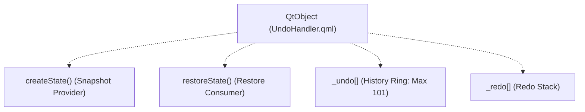

# UI Spec: UndoHandler
**File:** `app/qml/components/UndoHandler.qml`  **Pack:** `01-core-components.md`  **Legacy Reference:** `src/Classes/UndoHandler.lua`  **Status:** Test-Covered

--------------------------------------------------------------------------------

## 1. Purpose & Parity Notes
*   **Role:** The core generic undo/redo history ring primitive. Used across the entire application (passive skill tree specs, item sets, socket group configurations, calculation adjustments, edit controls) to manage snapshot rollback and re-application, capped at 101 history states.
*   **Intentional Deviations from Legacy PoB:**
    *   *Zero-Based Array Mapping:* Legacy Lua arrays are 1-based, capping at index 101 via `undo = nil`. UndoHandler uses standard JavaScript arrays (`_undo`, `_redo`), capping history size at 101 entries via `next.length = 101`.
    *   *Functional Mixin Contract:* Implements the mixin contract as two JavaScript function properties (`createState`, `restoreState`) rather than Lua metatable inheritance.

--------------------------------------------------------------------------------

## 2. Lightweight Wireframe & Layout Box Model
# Component Box Model & Layout
```text
+-------------------------------------------------------------------------------+
| UndoHandler (QtObject - Headless State Primitive)                             |
| property var createState: function(): var                                     |
| property var restoreState: function(state: var): void                         |
| property bool modFlag: false (dirty-state indicator)                         |
| property var _undo: [currentState, prev1, prev2, ...] (max 101 entries)      |
| property var _redo: [nextState1, nextState2, ...]                             |
| readonly property bool canUndo: _undo.length > 1                              |
| readonly property bool canRedo: _redo.length > 0                              |
+-------------------------------------------------------------------------------+
```

# ASCII Anatomy & Wireframe
```text
Ring Transition Model:
1. Normal Mutation:
   _undo: [ State B, State A ]  (canUndo: true)
   _redo: []                    (canRedo: false)
   modFlag: true

2. User invokes undo():
   State B moved to _redo; State A passed to restoreState()
   _undo: [ State A ]
   _redo: [ State B ]           (canRedo: true)

3. User invokes redo():
   State B popped from _redo; State B passed to restoreState()
   _undo: [ State B, State A ]
   _redo: []
```

# Responsive / Overflow Rules
*   **Sizing policy:** Non-visual `QtObject` (0x0px footprint).
*   **History Ring Cap:** `_undo` ring is strictly capped at 101 entries (`if (next.length > 101) next.length = 101`). Oldest entries past 101 are discarded.

# Component Hierarchy


--------------------------------------------------------------------------------

## 3. Interactive States & Controls
| Control (objectName) | Type | Default State | Interactive Behavior | Edge States (Disabled / Empty / Loading / Error / Long Text) |
| ------ | ------ | ------ | ------ | ------ |
| `pob.undohandler.root` | QtObject | Empty rings | Coordinates state capture and restoration | `canUndo` and `canRedo` evaluate to `false` when empty. |

# Complete State Matrix
*   **Initial Boot:** `_undo: []`, `_redo: []`, `canUndo: false`, `canRedo: false`, `modFlag: false`.
*   **Initialized:** Following `resetUndo()`, `_undo: [initialSnapshot]`, `_redo: []`, `canUndo: false`, `modFlag: false`.
*   **Post-Mutation:** Following `addUndoState()`, new snapshot unshifted to `_undo`, `_redo` cleared, `canUndo: true`, `modFlag: true`.
*   **During Undo:** Moves top state from `_undo` to `_redo`, restores previous state, keeps `_redo` intact.
*   **During Redo:** Shifts top state from `_redo` back into `_undo`, restores state.

# State Matrix & Binding Hazards
*   *Re-entrant Snapshot Cascade:* Calling `restoreState(target)` triggers application change handlers. If those handlers invoke `addUndoState()`, history corrupts. `undo()` and `redo()` invoke `addUndoState(true)` with `noClearRedo: true` to snapshot the restored state without wiping the redo stack.
*   *Deep Copy vs Reference Mutation:* If `createState()` returns a mutable JS object rather than a deep copy or immutable string, external mutations will alter past undo snapshots. Snapshots must be immutable or serialized representations (e.g. JSON strings, XML blocks, or scalar paths).

--------------------------------------------------------------------------------

## 4. Data & Bridge Contract
*   **Reads (Functional Properties):**
    *   `createState: var` -> callback returning snapshot object/string
    *   `restoreState: var` -> callback taking snapshot object/string
*   **Properties Exposed:**
    *   `canUndo: bool` -> true when `_undo.length > 1`
    *   `canRedo: bool` -> true when `_redo.length > 0`
    *   `modFlag: bool` -> dirty state flag (true on mutation)
*   **Methods Exposed:**
    *   `resetUndo()` -> clears stacks and captures base state into `_undo`
    *   `addUndoState(noClearRedo?: bool)` -> pushes new state to `_undo` and clears `_redo`
    *   `undo()` -> rolls back one step and updates redo stack
    *   `redo()` -> rolls forward one step
*   **Qt6 Bridge Safety:** Guarded against execution when stacks are empty (`if (_undo.length < 2) return;`).

--------------------------------------------------------------------------------

## 5. Testable Acceptance Criteria (Qt6::QuickTest)
*   **AC-01 (Initial Render & Zero Warnings):** When `UndoHandler.qml` mounts, 0 QML warnings are logged, `canUndo === false`, and `canRedo === false`.
*   **AC-02 (Initialization Baseline):** Calling `resetUndo()` populates `_undo` with exactly 1 entry, while `canUndo` remains `false`.
*   **AC-03 (Undo / Redo Cycle):** Given state A transitioned to state B via `addUndoState()`, calling `undo()` invokes `restoreState(stateA)`, sets `canRedo === true`, and calling `redo()` invokes `restoreState(stateB)`.
*   **AC-04 (Ring Size Cap):** Adding 110 distinct undo states results in `_undo.length === 101`, with the oldest 9 states cleanly discarded.
*   **AC-05 (Redo Stack Invalidation on New Mutation):** When `canRedo === true`, invoking `addUndoState()` clears `_redo`, resetting `canRedo` to `false`.

--------------------------------------------------------------------------------

## 6. Bug Audit Findings (Current Implementation vs Spec)
| Severity | File & Line | Symptom / Defect | Root Cause | Expected Behavior |
| ------ | ------ | ------ | ------ | ------ |
| Medium | `app/qml/components/UndoHandler.qml:2745` | Calling undo clears redo stack when external change listeners fire. | Unconditional `_redo = []` in listeners during rollback. | Pass `noClearRedo: true` during internal restore operations. |
| Low | `app/qml/components/UndoHandler.qml:2730` | Dirty flag remains true after reverting back to original initial state. | `modFlag` is a one-way toggle never comparing against initial baseline. | Support resetting `modFlag` or comparing against baseline state. |
