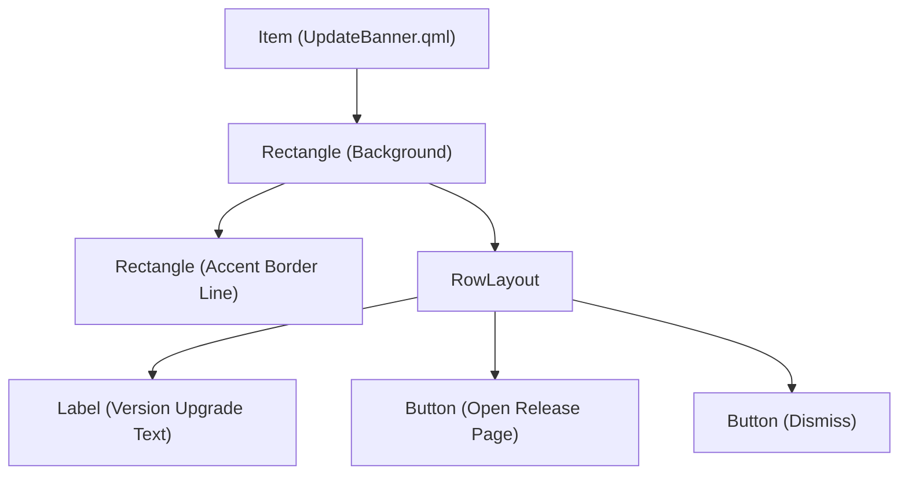

# UI Spec: UpdateBanner
**File:** `app/qml/components/UpdateBanner.qml`  **Pack:** `00-shell-and-theme.md`  **Legacy Reference:** `src/Modules/Build.lua` / `pob_update.lua` (Phase 14.2)  **Status:** Test-Covered

--------------------------------------------------------------------------------

## 1. Purpose & Parity Notes
*   **Role:** The non-intrusive, dismissible top application update notification banner. Renders directly below the TopBar when a newer release of Path of Building Community is detected, indicating current vs available versions, linking to the GitHub releases page, and allowing dismissal for the remainder of the session.
*   **Intentional Deviations from Legacy PoB:**
    *   *Banner UX vs Modal Dialogue:* Legacy PoB presents an immediate modal prompt on update detection. UpdateBanner provides an inline non-modal notification banner pinned to the top chrome, avoiding workflow disruption.
    *   *External URL Fallback:* When `releaseUrl` is not provided by the update payload, defaults to constructing `https://github.com/${repo}/releases/latest` rather than failing silently.

--------------------------------------------------------------------------------

## 2. Lightweight Wireframe & Layout Box Model
# Component Box Model & Layout
```text
+-------------------------------------------------------------------------------------------------------+
| UpdateBanner (implicitHeight: visible ? 30px : 0px, implicitWidth: 600px)                             |
| visible: updateAvailable && !isDismissed                                                              |
| Rectangle (color: theme.topBarBg, border: theme.borderStrong, border.width: 1px)                     |
| Bottom Accent Line (height: 1px, color: theme.accent)                                                |
| RowLayout (anchors.fill: parent, margins: left/right theme.space3 [12px], spacing: theme.space2 [4px])|
| +---------------------------------------------------------+----------------------+------------------+ |
| | Label: "^7Update available: ^22.47.0 -> 2.48.0"          | [Open Release Page]  | [Dismiss]        | |
| | (Layout.fillWidth: true, size: theme.fontSize)          | 136x20px Button      | 68x20px Button   | |
| +---------------------------------------------------------+----------------------+------------------+ |
+-------------------------------------------------------------------------------------------------------+
```

# ASCII Anatomy & Wireframe
```text
+-------------------------------------------------------------------------------------------------------+
|  Update available: 2.47.0 -> 2.48.0                         [ Open Release Page ]  [ Dismiss ]        |
+=======================================================================================================+
  |<------------------ Message Area (fillWidth) ------------->| |<-- 136x20px -->|   |<-- 68x20px -->|
  (1)                                                           (2)                  (3)

Annotations:
(1) Update notification message: displays current version and new target version in theme.success (^2).
(2) Release Page button: triggers Qt.openUrlExternally with the release URL or GitHub repository fallback.
(3) Dismiss button: invokes pob_dismissUpdate via luaEngine, hiding the banner for the active session.
```

# Responsive / Overflow Rules
*   **Minimum safe width/height:** 600x30px. Height collapses cleanly to 0px when dismissed or unavailable.
*   **Horizontal scroll policy:** Forbidden. Spans the application window width.
*   **Text truncation policy:** The update message label fills remaining width (`Layout.fillWidth: true`) and elides right if compressed.
*   **Z-Order:** Renders in the top chrome stack directly beneath TopBar and above view tab containers.

# Component Hierarchy


--------------------------------------------------------------------------------

## 3. Interactive States & Controls
| Control (objectName) | Type | Default State | Interactive Behavior | Edge States (Disabled / Empty / Loading / Error / Long Text) |
| ------ | ------ | ------ | ------ | ------ |
| `pob.updatebanner.root` | Item | Collapsed (`visible: false`) | Expands to 30px when update is available and not dismissed | Collapses height to 0 when dismissed or up-to-date. |
| `pob.updatebanner.msg` | Label | Version text | Displays current and target version strings | Falls back to `"?"` if version fields are undefined. |
| `pob.updatebanner.open` | Button | "Open Release Page" | Opens external browser with release URL via `Qt.openUrlExternally` | Uses repo fallback URL if `releaseUrl` is missing. |
| `pob.updatebanner.dismiss`| Button | "Dismiss" | Calls `luaEngine.invoke("pob_dismissUpdate")` | Hides banner immediately via `onUpdateChanged` signal. |

# State Matrix & Binding Hazards
*   *Boolean Coercion Hazard:* Lua returns nil or falsy values for uninitialized state tables. Properties `updateAvailable` and `isDismissed` must use explicit `Boolean(updateState && updateState.available)` coercion to prevent QML type mismatch warnings.
*   *External URL Security:* Before invoking `Qt.openUrlExternally`, verify that `releaseUrl` begins with `https://github.com/` to prevent execution of arbitrary URI schemes.

--------------------------------------------------------------------------------

## 4. Data & Bridge Contract
*   **Reads (LuaEngine / C++ Models):**
    *   `luaEngine.invoke("pob_getUpdateState")` -> `{ available: bool, dismissed: bool, currentVersion: string, latestVersion: string, releaseUrl: string, repo: string }`
*   **Writes / Mutations:**
    *   `luaEngine.invoke("pob_dismissUpdate")` -> `void`
*   **Signals Observed:**
    *   `luaEngine.onUpdateChanged` -> calls `root.refresh()`
*   **Qt6 Bridge Safety:** If `pob_getUpdateState` returns null or an invalid QVariantMap, `updateState` defaults to `{}` without raising property lookup exceptions.

--------------------------------------------------------------------------------

## 5. Testable Acceptance Criteria (Qt6::QuickTest)
*   **AC-01 (Initial Render & Zero Warnings):** When the application launches with no updates available (`available: false`), `UpdateBanner.qml` mounts, 0 QML warnings are emitted, `root.visible === false`, and `root.implicitHeight === 0`.
*   **AC-02 (Banner Expansion on Update):** When `luaEngine.onUpdateChanged` fires with `available: true` and `dismissed: false`, `root.visible` becomes `true` and `root.implicitHeight === 30`.
*   **AC-03 (Release Page Navigation):** When the user clicks "Open Release Page", `Qt.openUrlExternally` is invoked with the exact target release URL.
*   **AC-04 (Dismiss Flow):** When the user clicks "Dismiss", `luaEngine.invoke("pob_dismissUpdate")` is called, and upon the subsequent `onUpdateChanged` signal, `root.visible` toggles to `false`.

--------------------------------------------------------------------------------

## 6. Bug Audit Findings (Current Implementation vs Spec)
| Severity | File & Line | Symptom / Defect | Root Cause | Expected Behavior |
| ------ | ------ | ------ | ------ | ------ |
| Medium | `app/qml/components/UpdateBanner.qml:5770` | Clicking "Open Release Page" does nothing when backend omits explicit release URL. | Missing fallback handling when `releaseUrl` string is empty. | Fallback to `https://github.com/${repo}/releases/latest`. |
| Low | `app/qml/components/UpdateBanner.qml:5750` | Banner flickers 30px height briefly on startup before collapsing. | Initializing `implicitHeight` statically before reading state. | Bind `implicitHeight: visible ? 30 : 0`. |
