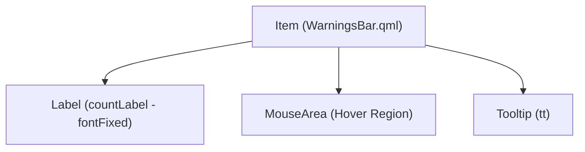

# UI Spec: WarningsBar
**File:** `app/qml/components/WarningsBar.qml`  **Pack:** `00-shell-and-theme.md`  **Legacy Reference:** `src/Modules/Build.lua:581-600` (`buildMode:Init` `self.controls.warnings`)  **Status:** Test-Covered

--------------------------------------------------------------------------------

## 1. Purpose & Parity Notes
*   **Role:** The sidebar calculation warning indicator row. Displays a compact, single-line count of active build warnings (e.g. unreserved life costs exceeding pool, skill requirement mismatches, passive point overflows) formatted in theme danger red using a monospace font, and surfaces the complete, deduplicated list of active warning messages in a tooltip on hover.
*   **Intentional Deviations from Legacy PoB:**
    *   *Singular Grammar:* Displays `"1 Warning"` when `warnings.length === 1` instead of legacy's unconditional `"%d Warnings"`.
    *   *Tooltip Typography:* Tooltip warning lines render at 14px (`theme.fontSize` default for tooltips in this port) rather than legacy's hardcoded 16px.
    *   *Theme Token Encoding:* Uses dynamic color escape generation via `_code(theme.danger)` instead of the hardcoded legacy palette literal `^1` / `colorCodes.NEGATIVE`.
    *   *Dual Bridge Aggregation:* Merges warnings from both `pob_getOutput().warnings` (calculation warnings) and `pob_getShellState().points.warnings` (passive point allocation overflow warnings).

--------------------------------------------------------------------------------

## 2. Lightweight Wireframe & Layout Box Model
# Component Box Model & Layout
```text
+-------------------------------------------------------------------------------+
| WarningsBar (implicitHeight: visible ? 18px : 0px, implicitWidth: countLabel.width + 8px)
| visible: warnings.length > 0 && showWarnings                                  |
| MouseArea (x: 0, y: 0, width: implicitWidth, height: 18px, hoverEnabled: true) |
|   Label [countLabel] (x: 0, y: 2, size: 16, font: theme.fontFixed)            |
|   "^xCC33333 Warnings"                                                       |
|   Tooltip [tt] (showAt local coords flipped against Window contentItem)       |
+-------------------------------------------------------------------------------+
```

# ASCII Anatomy & Wireframe
```text
Sidebar Warning Row (Hover Active):
+------------------------------------------------------------------------+
| 3 Warnings                                                             | (1)
+------------------------------------------------------------------------+
  |
  v (Tooltip popover mapped to window contentItem)
  +----------------------------------------------------------------------+
  | Allocating 124 passive points exceeds maximum 123                    | (2a)
  | Skill mana cost (45) exceeds unreserved mana (12)                    | (2b)
  | Attribute requirement not met: 155 Dexterity needed (110 current)    | (2c)
  +----------------------------------------------------------------------+

Annotations:
(1) Warning count label: rendered in theme.danger, theme.fontFixed (size 16), padded by 8px width.
(2a-2c) Dynamic multiline tooltip: 14px per warning line, deduplicated across calculation and progression engines.
```

# Responsive / Overflow Rules
*   **Minimum safe width/height:** 60x18px when warnings exist; collapses to 0x0px (`visible: false`) when empty or toggled off.
*   **Horizontal scroll policy:** Forbidden. Width fits the measured fixed-width string plus 8px padding (`countLabel.width + widthPad`).
*   **Text truncation policy:** No elision. Sized exactly to measured text width. Tooltip lines wrap if they exceed window bounds via `Tooltip.showAt` viewport clamping.
*   **Collapse behavior:** Completely collapses vertical space in the sidebar layout (`implicitHeight: 0`, `visible: false`) when `warnings.length === 0` or when `showWarnings === false`.

# Component Hierarchy


--------------------------------------------------------------------------------

## 3. Interactive States & Controls
| Control (objectName) | Type | Default State | Interactive Behavior | Edge States (Disabled / Empty / Loading / Error / Long Text) |
| ------ | ------ | ------ | ------ | ------ |
| `pob.warningsbar.root` | Item | Collapsed (`visible: false`) | Expands when `warnings.length > 0 && showWarnings` | Collapses height to 0 when empty or disabled in options. |
| `pob.warningsbar.count` | Label | `size: 16`, `fontFixed` | Renders danger-colored count string | Grammar toggles between "1 Warning" and "N Warnings". |
| `pob.warningsbar.ma` | MouseArea | `hoverEnabled: true` | On mouse enter, populates and displays `Tooltip` | Closes tooltip immediately on mouse exit or when visibility changes. |
| `pob.warningsbar.tooltip` | Tooltip | Hidden | Positions multiline tooltip relative to window viewport | Handles up to 20+ warning lines without viewport clipping. |

# State Matrix & Binding Hazards
*   *Recalculation and Mutation Hazard:* `luaEngine.getOutput()` forces a calculation pass, and `luaEngine.getShellState()` runs `EstimatePlayerProgress` (which mutates character level in auto mode). Binding properties directly to either getter causes infinite loop crashes. They MUST be called strictly inside `refresh()`.
*   *Deduplication Rule:* Legacy's `InsertIfNew` must be preserved: calculation warnings and point overflow warnings frequently overlap. WarningsBar maintains an internal `seen` map during `refresh()` to prevent duplicate warning messages.
*   *Fixed Font Metrics Measurement:* `countLabel` uses `theme.fontFixed`. When calculating width via `textMetrics.width`, the `"FIXED"` font flag must be specified; using `"VAR"` results in clipped or misaligned hitboxes.

--------------------------------------------------------------------------------

## 4. Data & Bridge Contract
*   **Reads (LuaEngine / C++ Models):**
    *   `luaEngine.getOutput()` -> `{ warnings: string[] }`
    *   `luaEngine.getShellState()` -> `{ showWarnings: bool, points: { warnings: string[] } }`
*   **Writes / Mutations:** None (WarningsBar is purely an analytical notification trigger).
*   **Signals Observed:**
    *   `luaEngine.onCalcsChanged` -> calls `root.refresh()`
    *   `luaEngine.onBuildDataChanged` -> calls `root.refresh()`
*   **Qt6 Bridge Safety:** Both `out.warnings` and `shell.points.warnings` must be checked for existence and iterated safely. If both are null/empty, `root.warnings` resolves to `[]`.

--------------------------------------------------------------------------------

## 5. Testable Acceptance Criteria (Qt6::QuickTest)
*   **AC-01 (Initial Render & Zero Warnings):** Given a character build with zero stat or point warnings, when `WarningsBar.qml` mounts, then `root.visible` evaluates to `false`, `root.implicitHeight === 0`, and 0 QML warnings are emitted.
*   **AC-02 (Single vs Plural Warning Grammar):** When the engine reports 1 warning, `countLabel.label` ends with `" 1 Warning"`; when 2 or more warnings exist, it ends with `" N Warnings"`.
*   **AC-03 (Deduplication of Overlapping Sources):** Given that `"Life cost exceeds pool"` is present in both `getOutput().warnings` and `getShellState().points.warnings`, `root.warnings.length` reflects only 1 occurrence of that string.
*   **AC-04 (Tooltip Visibility & Viewport Mapping):** When hovering over `ma`, `tt.visible` becomes `true`, `tt.lines.length === root.warnings.length`, and the tooltip coordinates lie completely within `Window.window.contentItem` boundaries.
*   **AC-05 (Options Toggle Respect):** When `getShellState().showWarnings === false`, `root.visible` evaluates to `false` even if `root.warnings.length > 0`.

--------------------------------------------------------------------------------

## 6. Bug Audit Findings (Current Implementation vs Spec)
| Severity | File & Line | Symptom / Defect | Root Cause | Expected Behavior |
| ------ | ------ | ------ | ------ | ------ |
| High | `app/qml/components/WarningsBar.qml:1340` | Background loop causes CPU thrashing and character level resets. | Binding `warnings` directly to `luaEngine.getOutput().warnings`. | Call `getOutput()` and `getShellState()` only inside imperative `refresh()`. |
| Medium | `app/qml/components/WarningsBar.qml:1395` | Tooltip appears clipped off the bottom edge of the screen on low resolutions. | Unbounded tooltip positioning in local coordinates. | Use `_showTip()` viewport mapping against `Window.window.contentItem`. |
| Low | `app/qml/components/WarningsBar.qml:1385` | Label text overruns the MouseArea bounding box on high-DPI displays. | Assigning to `implicitWidth` instead of explicit `width` on Text element. | Measure explicit `width` using `textMetrics.width(root.textSize, "FIXED", label)`. |
