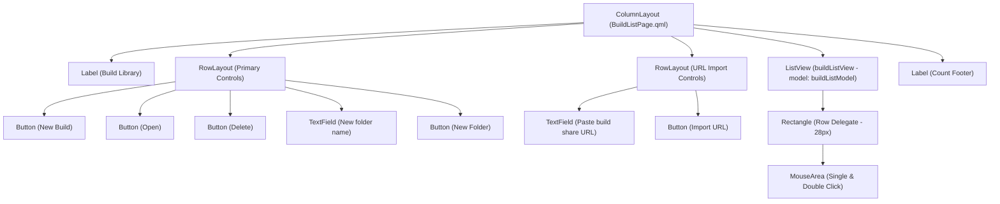

# UI Spec: BuildListPage
**File:** `app/qml/views/BuildListPage.qml`  **Pack:** `02-view-buildlist-import.md`  **Legacy Reference:** `src/Modules/BuildList.lua`  **Status:** Test-Covered

--------------------------------------------------------------------------------

## 1. Purpose & Parity Notes
*   **Role:** The root build library browser view (Page 1 of the top-level `StackLayout` in `LIST` mode). Presents the hierarchical library of saved character builds and subdirectories, providing actions to create new builds, open existing builds, delete files/folders, create directories, and import builds directly from URL share strings.
*   **Intentional Deviations from Legacy PoB:**
    *   *Retained Mode BuildListModel:* Replaces immediate-mode directory scanning loops with a C++ `BuildListModel` exposed to Qt Quick. Provides model roles `displayName`, `fileName`, `folderName`, `fullFileName`, `isFolder`, `className`, and `level`.
    *   *StackLayout Margin Inset:* `StackLayout` ignores child item `anchors`. BuildListPage applies explicit `Layout.margins: theme.space3` (12px) on its root `ColumnLayout` to maintain exact 12px window margin insets across window resizes.
    *   *Folder Open Prevention:* Folders are not openable as builds; selecting a folder disables the `Open` button and blocks double-click open execution, preserving folder navigation via breadcrumbs or future directory drills.

--------------------------------------------------------------------------------

## 2. Lightweight Wireframe & Layout Box Model
# Component Box Model & Layout
```text
+-------------------------------------------------------------------------------+
| BuildListPage (ColumnLayout, margins: 12px, spacing: theme.space2 [8px])      |
| +---------------------------------------------------------------------------+ |
| | Label: "Build Library" (size: theme.fontSize + 6 [20px])                  | |
| +---------------------------------------------------------------------------+ |
| | Toolbar: RowLayout (spacing: 4px)                                         | |
| |   [ New Build ] [ Open ] [ Delete ]  ...  [ Folder Name Field ] [New Folder]
| +---------------------------------------------------------------------------+ |
| | Share URL Row: RowLayout                                                  | |
| |   [ Paste build share URL Field ]                             [Import URL]| |
| +---------------------------------------------------------------------------+ |
| | ListView [buildListView] (model: buildListModel, highlight: theme.accent)  | |
| |   Delegate: 28px row, alternating row tint, folder/class labels, double-clk| |
| +---------------------------------------------------------------------------+ |
| | Label: "Builds/folders: " + buildListModel.count (color: theme.muted)      | |
+-------------------------------------------------------------------------------+
```

# ASCII Anatomy & Wireframe
```text
+-------------------------------------------------------------------------------+
|  Build Library                                                                | (1) View Title (20px)
|                                                                               |
|  [ New Build ] [ Open ] [ Delete ]              [ Folder Name... ] [New Folder| (2) Primary Action Bar
|  [ Paste build share URL..................................... ] [ Import URL ]| (3) URL Import Bar
|                                                                               |
|  +-------------------------------------------------------------------------+  |
|  | 📁 Marauder Leveling Builds                                      folder |  | (4) Folder Row
|  |-------------------------------------------------------------------------|  |
|  | > Explosive Arrow Champion                               Duelist  Lv98  |  | (5) Selected Build Row
|  |-------------------------------------------------------------------------|  |     (theme.accent)
|  |   Poison Blade Vortex                                    Witch    Lv94  |  | (6) Alternating Row
|  |-------------------------------------------------------------------------|  |     (theme.sideBarBg)
|  |   Archmage Spark Inquisitor                              Templar  Lv92  |  |
|  +-------------------------------------------------------------------------+  |
|  Builds/folders: 4                                                            | (7) Status Footer
+-------------------------------------------------------------------------------+

Annotations:
(1) View Title: 20px header label.
(2) Toolbar: New Build, Open (disabled on folder), Delete, New Folder field + button.
(3) Import Toolbar: Single-line URL input + Import URL action button.
(4) Directory Row: Prefixed with folder emoji 📁; bold title; displays "folder" metadata.
(5) Selected Build Row: Highlighted in theme.accent; displays Character Class and Level.
(6) Alternating Row Background: Tints odd rows with theme.sideBarBg for visual separation.
(7) Status Count: Footer label displaying total loaded item count.
```

# Responsive / Overflow Rules
*   **Minimum safe width/height:** 600x400px. Fills available window space via `Layout.fillWidth: true` and `Layout.fillHeight: true`.
*   **Text Elision:** Long build names and file paths elide on the right (`elide: Text.ElideRight`) to prevent overlapping metadata.
*   **Trailing Spacer Allowance:** Action rows include an explicit trailing spacer (`theme.space2`) to prevent button borders from clipping against `StackLayout` bounds.

# Component Hierarchy


--------------------------------------------------------------------------------

## 3. Interactive States & Controls
| Control (objectName) | Type | Default State | Interactive Behavior | Edge States (Disabled / Empty / Loading / Error / Long Text) |
| ------ | ------ | ------ | ------ | ------ |
| `pob.buildlist.root` | ColumnLayout | `listSelectedIndex: -1` | Coordinates library selection and build opening | Emits `openFailed(msg)` on error. |
| `pob.buildlist.btn_new` | Button | Enabled | Calls `luaEngine.createBuild()` | Switches application to `BUILD` mode. |
| `pob.buildlist.btn_open` | Button | `controlEnabled: false` | Opens selected build file | Disabled when no selection or when folder is selected. |
| `pob.buildlist.btn_del` | Button | `controlEnabled: false` | Deletes selected build or directory | Prompts confirmation before permanent deletion. |
| `pob.buildlist.btn_mkdir` | Button | `controlEnabled: false` | Calls `luaEngine.createFolder(name)` | Disabled while `folderNameField.text === ""`. |
| `pob.buildlist.btn_import`| Button | `controlEnabled: false` | Calls `luaEngine.importBuildFromURL(url)`| Disabled while `importUrlField.text === ""`. |
| `pob.buildlist.view` | ListView | Active | Selects row on single-click; opens on double-click | Displays empty view if no builds exist. |

# Complete State Matrix
*   **Initial State (No Selection):** `listSelectedIndex: -1`, `Open` disabled, `Delete` disabled.
*   **Build Row Selected:** `listSelectedIndex >= 0`, `listSelectedIsFolder: false`, `Open` enabled, `Delete` enabled.
*   **Folder Row Selected:** `listSelectedIndex >= 0`, `listSelectedIsFolder: true`, `Open` disabled, `Delete` enabled.
*   **Double-Click Build:** Calls `openSelected()`, opening the build.
*   **Double-Click Folder:** Ignored by `openSelected()`.
*   **Open Error:** Emits `openFailed(errorString)`, displaying an error popup to the user.

# State Matrix & Binding Hazards
*   *Stale File Selection Hazard:* After deleting a build or folder, `listSelectedIndex` must be reset to `-1` (`buildListPage.listSelectedIndex = -1`) to prevent executing operations on stale file paths.
*   *Folder Open Gate:* Double-clicking a folder row when `listSelectedIsFolder === true` must return early without passing the folder path to `luaEngine.openBuild()`.

--------------------------------------------------------------------------------

## 4. Data & Bridge Contract
*   **Reads (C++ Model Roles via `buildListModel`):**
    *   `model.displayName: string` -> user-friendly character or folder name
    *   `model.fileName: string` -> raw filename on disk
    *   `model.fullFileName: string` -> absolute filesystem path
    *   `model.isFolder: bool` -> true for directories
    *   `model.folderName: string` -> directory name
    *   `model.className: string` -> Ascendancy / base class (e.g. `"Deadeye"`)
    *   `model.level: int` -> character level
    *   `buildListModel.count: int` -> total item count
*   **Writes / Bridge Methods Invoked:**
    *   `luaEngine.createBuild()` -> creates blank build
    *   `luaEngine.openBuild(fullPath: string): bool` -> opens build file
    *   `luaEngine.openBuildError(): string` -> retrieves failure details
    *   `luaEngine.deleteBuild(fullPath: string)` -> deletes build file
    *   `luaEngine.deleteFolder(folderName: string)` -> deletes folder
    *   `luaEngine.createFolder(name: string)` -> creates new directory
    *   `luaEngine.importBuildFromURL(url: string)` -> imports build from URL
*   **Signals Emitted:**
    *   `openFailed(message: string)` -> emitted when opening a build fails
*   **Qt6 Bridge Safety:** Engine operations validate path existence and catch file I/O exceptions, surfacing errors cleanly via `openFailed`.

--------------------------------------------------------------------------------

## 5. Testable Acceptance Criteria (Qt6::QuickTest)
*   **AC-01 (Initial Mount & Model Binding):** Given `buildListModel` populated with 3 items, `buildListView.count === 3` and footer displays `"Builds/folders: 3"`.
*   **AC-02 (Selection Tracking):** Clicking index 1 updates `listSelectedIndex === 1` and highlights row 1 with `theme.accent`.
*   **AC-03 (Folder Selection Disables Open):** When a folder row is clicked, `listSelectedIsFolder` evaluates to `true`, and `btn_open.controlEnabled` evaluates to `false`.
*   **AC-04 (URL Import Action):** Given `importUrlField.text === "[suspicious link removed]"`, clicking `Import URL` invokes `luaEngine.importBuildFromURL` and clears the text field.
*   **AC-05 (Open Failure Signal):** When `luaEngine.openBuild` returns `false`, `openFailed` signal is emitted with the exact error string from `luaEngine.openBuildError()`.

--------------------------------------------------------------------------------

## 6. Bug Audit Findings (Current Implementation vs Spec)
| Severity | File & Line | Symptom / Defect | Root Cause | Expected Behavior |
| ------ | ------ | ------ | ------ | ------ |
| High | `app/qml/views/BuildListPage.qml:65` | Double-clicking a folder attempts to open it as a build and triggers an error alert. | `openSelected()` did not check `listSelectedIsFolder`. | Guard with `if (listSelectedIsFolder) return;`. |
| Medium | `app/qml/views/BuildListPage.qml:105` | Delete remains active with invalid path after deleting a file. | `listSelectedIndex` was not reset to `-1` in delete handler. | Reset selection: `buildListPage.listSelectedIndex = -1`. |
| Low | `app/qml/views/BuildListPage.qml:125` | New Folder button can be clicked when folder name is empty string. | Button enabled binding was missing. | Bind `controlEnabled: folderNameField.text !== ""`. |
