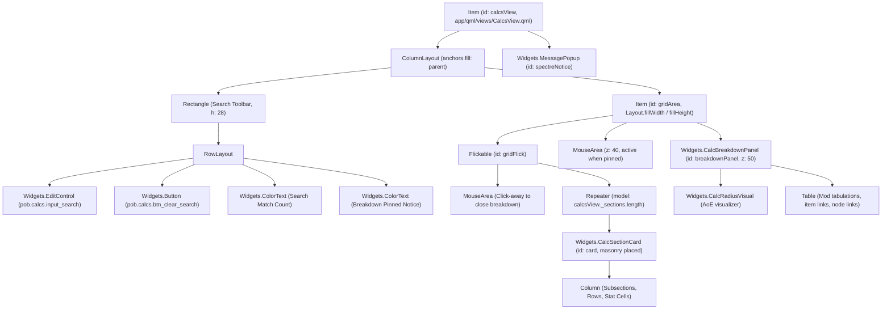

# UI Spec: CalcsView
**File:** `app/qml/views/CalcsView.qml` (and child components `app/qml/components/CalcSectionCard.qml`, `CalcBreakdownPanel.qml`, `CalcRadiusVisual.qml`)  
**Pack:** `06-view-config-calcs.md`  
**Legacy Reference:** `src/Classes/CalcsTab.lua:1-510`, `CalcSectionControl.lua:1-450`, `CalcBreakdownControl.lua:1-850`, `src/Modules/CalcSections.lua`, `app/lua/pob_calcs.lua`  
**Status:** Test-Covered

---

## 1. Purpose & Parity Notes
* **Role:** Provides an exhaustive mathematical breakdown and inspection grid of character offensive, defensive, reservation, attribute, and skill stats. Includes independent skill socket/part/stage selectors for calculation inspection, subsection collapse state persistence, real-time search term highlighting, and an on-demand breakdown inspection panel supporting formula steps, modifier sources, item links, embedded passive tree nodes, and AoE radius visualizers.
* **Intentional Deviations from Legacy PoB:**
  * **Responsive Masonry Grid:** Replaced legacy immediate-mode screen-space rendering with a responsive masonry layout algorithm (`computeLayout`) that organizes Group 1 (Offence, cols 1-3) and Groups 2/3 (Defence/Attributes, cols 4-5) across available horizontal space, reflowing cleanly to a 3-column layout in portrait or constrained viewports.
  * **Dual-State Breakdown Inspection:** Hovering over any stat cell opens a transient floating breakdown tooltip; clicking pins the breakdown in place with a distinctive green accent border (`#40FF40`). Clicking outside or pressing Escape dismisses the pinned inspector.
  * **Embedded Interactive Cross-References:** Modifiers originating from passive skill tree nodes or equipped equipment render interactive cross-reference links that open the embedded `TreeViewer` or full item tooltip directly inside the breakdown inspector.
  * **AoE Radius Visualizer:** Geometric AoE stats render interactive visual overlays over `Assets/range_guide.png` displaying exact in-game distance units and corpse explosion boundaries.

---

## 2. Lightweight Wireframe & Layout Box Model
# Default Window (1100x720)
```text
+----------------------------------------------------------------------------------------------------+
| Search: [crit chance                   ] [Clear]  ^x33FF77 4 matches  ---Spacer---  ^x40FF40 Pinned|
+----------------------------------------------------------------------------------------------------+
| View Skill Details (Group 1, Cols 1..3)                     | Defence & Pool (Group 2, Col 4)      |
| Socket: [Body Armour: Cyclone (v)] Part: [All (v)]          | Life:       5,420                    |
| Mode:   [Effective DPS (v)       ] [x] Show Minion Stats    | Mana:       1,240 (Reserved: 1,110)  |
|                                                             | Energy Shld:  210                    |
| +-------------------------+ +-----------------------------+ +------------------------------------+ |
| | Hit Damage (Group 1) [-]| | Attack Network (Group 1) [-]| | Armour & Evasion (Group 3, Col 5)  | |
| | Physical:   12,450      | | Attack Rate:    8.42        | | Armour:    45,200 (82% Phys Red)   | |
| | Fire:        4,120      | | Accuracy Rating: 3,450 (100)| | Evasion:   12,100 (54% Evade)      | |
| | Crit Chance: 68.4% [PIN]| | Crit Multi:     485%        | | Resistances: 75 / 75 / 75 / -20    | |
| +-------------------------+ +-----------------------------+ +------------------------------------+ |
|                                                                                                    |
| +------------------------------------------------------------------------------------------------+ |
| | PINNED STAT BREAKDOWN PANEL (Active on "Crit Chance", z: 50, border: #40FF40)                  | |
| | Base Value: 5.00% (Voidforge)                                                                  | |
| | Increased Critical Strike Chance: +420%                                                        | |
| |  - Tree: Dismembering (+60%) [View Node]                                                       | |
| |  - Item: Diamond Ring (+45%) [View Item]                                                       | |
| | Effective Crit Chance: 5.00% * (1 + 4.20) = 26.00%                                             | |
| | [x Close]                                                                                      | |
| +------------------------------------------------------------------------------------------------+ |
+----------------------------------------------------------------------------------------------------+
| [Scrollbar Horizontal: contentW 1160px] [Scrollbar Vertical: contentH 840px]                       |
+----------------------------------------------------------------------------------------------------+
```

# Responsive / Overflow Rules
* **Minimum safe width/height:** 960x640. Baseline: 1100x720.
* **Masonry layout columns:**
  * Width >= 1180px: 5 columns (Cols 1-3 Offence, Col 4 Defence, Col 5 Attributes/Misc).
  * Width < 1180px or `portraitMode: true`: 3 columns max. Groups 2 and 3 reflow beneath Group 1.
* **Scrolling policy:** Responsive `Flickable` (`id: gridFlick`) with `contentWidth` and `contentHeight` derived from `calcsView.layoutInfo`. Scrollbars engage as needed.
* **Breakdown panel positioning:** Floats above the grid (`z: 50`) anchored adjacent to the clicked/hovered cell. Clamped within `gridArea` bounds to prevent clipping at window edges.

# Component Hierarchy


---

## 3. Interactive States & Controls
| Control (objectName) | Type | Default State | Interactive Behavior | Edge States (Disabled / Empty / Loading / Error / Long Text) |
| :--- | :--- | :--- | :--- | :--- |
| `pob.calcs.input_search` | EditControl | Empty | Highlights matching stat rows and labels in real time | Width 260px. Reverts/clears on Escape. |
| `pob.calcs.btn_clear_search` | Button | Hidden | Clears search input query and removes stat highlights | Visible only when `searchQuery.length > 0`. Width 48px. |
| `pob.calcs.drop_skill_group` | DropDownControl | Cur Socket Group | Changes active skill group used for Calcs tab inspection | Located inside "View Skill Details" header card. Width 220px. |
| `pob.calcs.drop_skill_part` | DropDownControl | Cur Skill Part | Selects projectile, explosion, or strike sub-skill part | Hidden if skill contains only 1 part. Width 150px. |
| `pob.calcs.drop_calc_mode` | DropDownControl | "Effective DPS" | Switches calculation display mode (Effective, Unbuffed, etc.) | Width 160px. Updates calculation environment outputs. |
| `pob.calcs.check_show_minion` | CheckBox | Unchecked | Toggles stat display between player character and summoned minion | Tooltip: "Show stats for the minion instead of the player." |
| `pob.calcs.btn_toggle_sec_<id>`| Button | "-" | Toggles collapse of specific calculation section or subsection | Persists to build XML state. Flips label to "+". |
| `pob.calcs.cell_stat_<key>` | Rectangle | Normal | Hover shows transient breakdown; click pins breakdown panel | Highlighted with border `#40FF40` when pinned. Cell text elides right. |
| `pob.calcs.btn_close_breakdown`| Button | Enabled | Closes floating or pinned calculation breakdown panel | Click-away outside panel also closes inspector. |
| `pob.calcs.link_breakdown_node`| Text (Button) | Link | Opens embedded `TreeViewer` centered on the contributing node | Tooltip shows full passive node text. |
| `pob.calcs.link_breakdown_item`| Text (Button) | Link | Displays hover item tooltip for contributing equipped gear | Tooltip shows complete item attributes and mods. |

---

## 4. Data & Bridge Contract
* **Reads (LuaEngine / C++ Models):**
  * `luaEngine.invoke("pob_calcsGetGrid", [])`: Returns calculation grid model:
    * `colWidth`: Column width integer (default 230).
    * `portrait`: Boolean flag.
    * `sections`: List of section descriptors `{ id, group, widthCols, colour, enabled, height, special, subs: QVariantList }`.
    * Each sub contains `{ id, label, collapsed, extra, rows: QVariantList }`.
    * Each row contains `{ label, color, bgCol, textSize, cells: QVariantList }`.
    * Each cell contains `{ key, width, text, breakdown, control }`.
  * `luaEngine.invoke("pob_calcsGetSkillSelect", [])`: Returns skill selector state `{ socketGroup, skill, part, stage, mine, minion, showMinion }`.
  * `luaEngine.invoke("pob_calcsGetBreakdown", [cellKey])`: Serializes breakdown data for cell:
    * `ok`: Boolean.
    * `count`: Number of breakdown sections.
    * `sections`: List of breakdown sections `{ type, title, text, rows, cols, radius }` where `type` is `"TEXT"`, `"TABLE"`, or `"RADIUS"`.
  * `luaEngine.invoke("pob_calcsSearch", [query])`: Returns `{ matched: QVariantMap, count: int }`.
* **Writes / Mutations:**
  * `luaEngine.invoke("pob_calcsToggleSubsection", [sectionIndex, subIndex])`
  * `luaEngine.invoke("pob_calcsSetSkill", [fieldName, value])`
  * `luaEngine.invoke("pob_calcsSetInput", [inputName, value])`
  * `luaEngine.invoke("pob_calcsUndo", [])`
  * `luaEngine.invoke("pob_calcsRedo", [])`
* **Signals Observed:**
  * `luaEngine.onCalcsChanged`, `onSkillsChanged`, `onItemsChanged`: Triggers `calcsView.refresh()`.
  * `luaEngine.onModeChanged`: Rebinds view when switching to `BUILD` mode.
* **Qt6 Bridge Safety:**
  * `_sections` guards with `(sections && sections.length !== undefined)` before passing into `computeLayout`.
  * Breakdown keys are formatted as `"si:ui:ri:ci"` coordinate tuples to avoid invalid object dereferences in Lua.

---

## 5. Testable Acceptance Criteria (Qt6::QuickTest)
* **AC-01 (Initial Render & Zero Warnings):**
  * When `CalcsView` loads, 0 QML warnings or invalid binding evaluations occur.
  * `gridFlick` initializes with `contentWidth > 0` and `contentHeight > 0`.
* **AC-02 (Masonry Layout Reflow):**
  * In 1600x900 resolution, `computeLayout` places Group 1 across columns 1-3, Group 2 in column 4, and Group 3 in column 5.
  * In 960x640 resolution or when `portraitMode === true`, max columns clamp to 3, and Groups 2 and 3 reflow beneath Group 1.
* **AC-03 (Primary User Flow - Stat Breakdown Inspection):**
  * Hovering over a cell with `breakdown === true` populates `breakdownData` and displays `breakdownPanel`.
  * Clicking the cell sets `breakdownPinned = true` and updates border color to `#40FF40`.
  * The panel remains visible while moving the cursor across the panel to inspect sub-table rows.
* **AC-04 (Dismissing Pinned Breakdown):**
  * With breakdown pinned, clicking the background `DismissArea` or outside the panel closes the breakdown.
  * Pressing `Escape` key closes the breakdown and resets `breakdownPinned = false`.
* **AC-05 (Search Highlighting):**
  * Typing `Crit` into `pob.calcs.input_search` updates `searchHitCount` and highlights matching cards/rows with `theme.accent`.
  * Clicking `Clear` removes all highlight states and resets `searchHitCount` to 0.
* **AC-06 (Keyboard Shortcuts):**
  * Pressing `Ctrl+F` gives focus to `pob.calcs.input_search`.
  * Pressing `Ctrl+Z` invokes `pob_calcsUndo`.
  * Pressing `Ctrl+Y` invokes `pob_calcsRedo`.

---

## 6. Bug Audit Findings (Current Implementation vs Spec)
| Severity | File & Line | Symptom / Defect | Root Cause | Expected Behavior |
| :--- | :--- | :--- | :--- | :--- |
| **High** | `app/qml/views/CalcsView.qml (id: calcsView, function showBreakdown)` | Clicking a breakdown cell while another breakdown is pinned fails to switch to the new breakdown. | Guard `if (!pin and breakdownPinned) return;` followed by `if (pin and breakdownPinned and activeCellKey === cellKey)` closes the panel but does not re-open the newly clicked cell key when different. | If `pin === true` and `activeCellKey !== cellKey`, load new breakdown immediately and remain pinned. |
| **High** | `app/qml/views/CalcsView.qml (id: calcsView, function computeLayout)` | Masonry layout drops sections or draws overlapping cards when `_sections` contains disabled cards. | `positions` array pre-allocates entries, but index lookup in reflow pass assumes contiguous visible items, causing index shifts. | Synchronize positions directly using section index key `positions[i] = { x: ..., y: ..., visible: true }`. |
| **Med** | `app/qml/views/CalcsView.qml (id: gridFlick)` | Clicking inside the breakdown panel itself inadvertently triggers the click-away interceptor and dismisses the inspector. | Background click-away `MouseArea` spans entire parent geometry without excluding `breakdownPanel` bounds. | Ensure `breakdownPanel` consumes its own mouse events or place click-away interceptor strictly beneath the panel's Z-order. |
| **Med** | `app/qml/views/CalcsView.qml (id: searchBox)` | Search highlights do not clear when backspacing to an empty string. | `onEdited: (t) => calcsView.runSearch(t)` only runs search; empty query handling in `runSearch` fails to trigger card redrawing if `searchMatches` reference does not change. | Reassign `searchMatches = ({})` using property reassignment to force declarative binding updates across delegate cards. |
| **Low** | `app/qml/views/CalcsView.qml (id: searchBox)` | Search input text field lacks numeric and special character escaping for Lua regex queries. | Raw text passed directly to `pob_calcsSearch` without escaping brackets or hyphens. | Sanitize query string or wrap in Lua pattern protection before dispatching. |
| **Low** | `app/qml/views/CalcsView.qml (all interactive controls)` | Lack of programmatic `objectName` properties prevents automated end-to-end testing. | Controls lack `objectName` identifiers. | Assign stable names matching `pob.calcs.<control>` per Section 3 table. |
