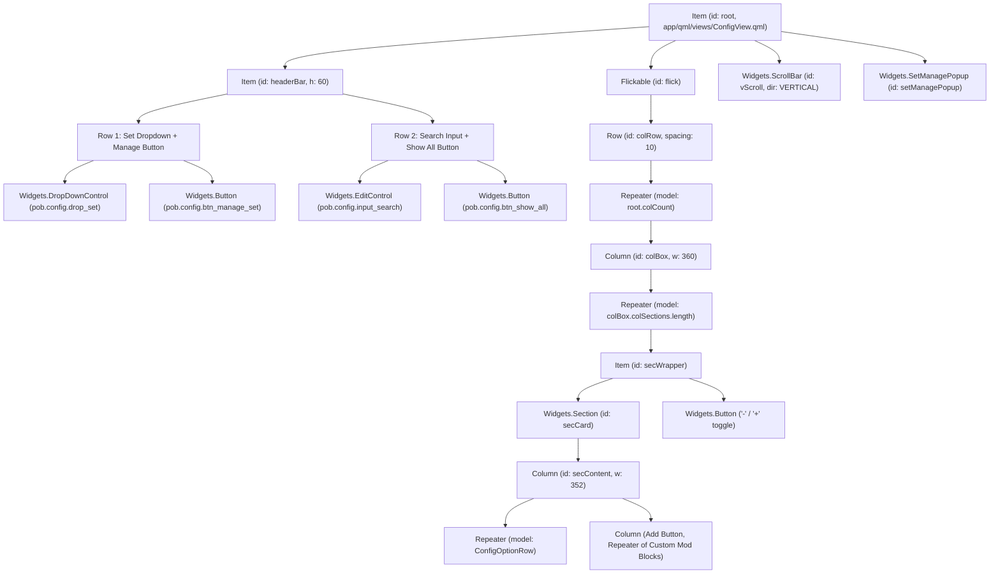

# UI Spec: ConfigView
**File:** `app/qml/views/ConfigView.qml`  
**Pack:** `06-view-config-calcs.md`  
**Legacy Reference:** `src/Classes/ConfigTab.lua:1-350`, `src/Modules/ConfigOptions.lua`, `app/lua/pob_config.lua`, `port-plan/reference/tabs-catalog.md`  
**Status:** Test-Covered

---

## 1. Purpose & Parity Notes
* **Role:** Exposes calculation toggles, environment conditions, combat buffs, enemy parameters, and custom modifier inputs. Dynamically generates input controls across collapsible section cards arranged in a responsive multi-column layout from the `ConfigOptions` registry, synchronized with the active calculation environment.
* **Intentional Deviations from Legacy PoB:**
  * **Dynamic Column Layout:** Automatically reflows sections across 1 to 3 columns of 360px width based on viewport width (`Math.max(1, Math.min(3, Math.floor((flick.width - 10) / 370)))`), replacing legacy hardcoded column positioning while honoring `sec.col` order.
  * **Debounced Search:** Querying options via search input debounces engine calls by 120 ms (`searchDebounce`) with live Lua-pattern-tolerant filtering and matches highlighting.
  * **Custom Modifiers Management:** Custom modifier groups use integrated rich `TextArea` inputs inside dedicated group boxes with independent enable checkboxes and delete triggers, rather than a single monolithic text field.
  * **Ineligible Option Indication:** When "Show All Configurations" is toggled, options whose conditions are not met in the current build render with a prominent warning tint (`theme.warning`), red label text, and an explanatory "Condition not met" tooltip rather than being completely omitted.

---

## 2. Lightweight Wireframe & Layout Box Model
# Default Window (1100x720)
```text
+----------------------------------------------------------------------------------------------------+
| Config set: [Default (v)] [Manage...]                                                              |
| [Search (Ctrl+F)...                             ] [Show All Configurations / Hide Ineligible]      |
+----------------------------------------------------------------------------------------------------+
| COLUMN 1 (w: 360)                  | COLUMN 2 (w: 360)                  | COLUMN 3 (w: 360)        |
| +--------------------------------+ | +--------------------------------+ | +----------------------+ |
| | General [-]                    | | | Combat Buffs [-]               | | | Custom Modifiers [-] | |
| | [x] Are you always on Full Life| | | [x] Do you have Frenzy Charges?| | | [Add Mod Group]      | |
| | [ ] Are you always on Low Life?| | |  Number of Frenzy Charges:     | | | +------------------+ | |
| | Enemy Level: [84   ]           | | |  [3     ]                      | | | | [X] [Title... ] [x]| |
| |                                | | | [x] Do you have Power Charges? | | | | +50 to max Life  | | |
| +--------------------------------+ | +--------------------------------+ | | | +15% to all Res  | | |
| +--------------------------------+ | +--------------------------------+ | | +------------------+ | |
| | Enemy Stats [-]                | | | Map Modifiers [-]              | | +----------------------+ |
| | Is the enemy a Boss?           | | | [ ] Monsters have 40% Phys Dmg | |                          |
| | [Pinnacle Boss (v)           ] | | |     Reduction                  | |                          |
| +--------------------------------+ | +--------------------------------+ |                          |
+------------------------------------+------------------------------------+--------------------------+
|                                                                         | [V-Scrollbar: 18px]      |
+----------------------------------------------------------------------------------------------------+
```

# Responsive / Overflow Rules
* **Minimum safe width/height:** 960x640. Standard baseline: 1100x720.
* **Column reflow rules:**
  * Width >= 1130px: 3 columns (`colCount: 3`).
  * Width 760px - 1129px: 2 columns (`colCount: 2`).
  * Width < 760px: 1 column (`colCount: 1`).
* **Scrolling policy:** Horizontal scrolling disabled (`Flickable.contentWidth` matches container width or clamps to column requirement). Vertical scrollbar (`vScroll`) steps by 50px increments and synchronizes with `flick.contentY`.
* **Section card bounding:** Section cards have fixed width 360px. Heights expand dynamically based on visible option items (`secCollapsed ? 22 : Math.max(36, secContent.implicitHeight + 22)`).

# Component Hierarchy


---

## 3. Interactive States & Controls
| Control (objectName) | Type | Default State | Interactive Behavior | Edge States (Disabled / Empty / Loading / Error / Long Text) |
| :--- | :--- | :--- | :--- | :--- |
| `pob.config.drop_set` | DropDownControl | Active Set | Selects active configuration set (`pob_configSetActiveSet`) | Width 210px. Disabled when config set count <= 1. |
| `pob.config.btn_manage_set` | Button | Enabled | Opens `setManagePopup` for creating, copying, or deleting config sets | Width 90px. |
| `pob.config.input_search` | EditControl | Empty | Filters options via Lua pattern match; debounced 120 ms | Width 360px. Reverts/clears on Escape. |
| `pob.config.btn_show_all` | Button | "Show All Configurations" | Toggles display of inactive and ineligible options | Label toggles to "Hide Ineligible Configurations" when active. |
| `pob.config.sec_collapse_<id>` | Button | "-" | Toggles collapse state of configuration section card | 16x16px button on top right of section border. Flips to "+" when collapsed. |
| `pob.config.opt_check_<var>` | CheckBox | Option State | Toggles boolean config variable (`pob_configSetOption`) | Invalid options highlighted with warning border and red text. |
| `pob.config.opt_input_<var>` | EditControl | Numeric / Text | Sets integer, float, or string config parameter | Commits on blur or Enter. Clamped to min/max if specified in metadata. |
| `pob.config.opt_drop_<var>` | DropDownControl | Cur Selection | Selects enumeration value from config options list | Width matches card content width. Elides long option names. |
| `pob.config.btn_add_custom_mod`| Button | "^7Add Mod Group" | Creates new custom modifier block in "Custom Modifiers" section | Width 120px. |
| `pob.config.btn_delete_mod_<idx>`| Button | "^1X" | Deletes specific custom modifier block | Width 20px, height 18px. Irreversible without Undo. |
| `pob.config.input_mod_title_<idx>`| EditControl | "Default" | Renames title of custom modifier block | Width 294px. Commits on Enter or focus lost. |
| `pob.config.check_mod_enable_<idx>`| CheckBox | Checked | Toggles active calculation state of custom modifier block | 18x18px checkbox adjacent to mod group title. |
| `pob.config.text_mod_body_<idx>`| TextArea | Empty | Accepts multiline user modifier text (e.g. `+50 to maximum Life`) | Scrollable inside 84px card. Applies modifiers on focus exit. |

---

## 4. Data & Bridge Contract
* **Reads (LuaEngine / C++ Models):**
  * `luaEngine.invoke("pob_configGetState", [searchQuery])`: Returns state map:
    * `activeSetIndex`: 1-based integer index.
    * `sets`: List of `{ id, title }`.
    * `toggleConfigs`: Boolean indicating if ineligible options are forced visible.
    * `sections`: List of section cards `{ name, col, collapsed, isCustomMods, items: QVariantList }`.
    * Each option in `items` contains `{ varName, type, label, val, defaultVal, placeholder, tooltip, tooltipFunc, invalid, options: QVariantList }`.
    * `customMods`: List of `{ title, enabled, text }`.
  * `luaEngine.invoke("pob_configListSets", [])`: Returns list of set names for manage popup.
* **Writes / Mutations:**
  * `luaEngine.invoke("pob_configSetActiveSet", [setIndex])`
  * `luaEngine.invoke("pob_configSetOption", [varName, newValue])`
  * `luaEngine.invoke("pob_configSetToggleAll", [bool])`
  * `luaEngine.invoke("pob_configToggleSection", [sectionName])`
  * `luaEngine.invoke("pob_configAddCustomMod", [])`
  * `luaEngine.invoke("pob_configRemoveCustomMod", [1BasedIndex])`
  * `luaEngine.invoke("pob_configUpdateCustomMod", [1BasedIndex, titleOrNull, enabledOrNull, textOrNull])`
  * `luaEngine.invoke("pob_configUndo", [])`
  * `luaEngine.invoke("pob_configRedo", [])`
* **Signals Observed:**
  * `luaEngine.onConfigChanged`, `onCalcsChanged`, `onTreeChanged`, `onItemsChanged`, `onSkillsChanged`: Triggers coalesced refresh (`root.refresh()`).
  * `luaEngine.onModeChanged`: Refreshes view state when switching into `BUILD` mode.
* **Qt6 Bridge Safety:**
  * Iteration over `root.sections`, `colSections`, and `sec.items` guards against non-array structures using `.length !== undefined`.
  * Custom modifier text values check for `undefined` before binding to prevent inserting literal string `"undefined"` into text areas.

---

## 5. Testable Acceptance Criteria (Qt6::QuickTest)
* **AC-01 (Initial Render & Zero Warnings):**
  * When `ConfigView` renders, 0 QML warnings or unhandled exceptions are logged.
  * Section columns render with `width === 360` and positive height.
* **AC-02 (Responsive Column Layout):**
  * At viewport width 700px, `colCount` evaluates to 1 and sections render in a single column.
  * At viewport width 900px, `colCount` evaluates to 2.
  * At viewport width 1200px, `colCount` evaluates to 3.
* **AC-03 (Primary User Flow - Modifying Options):**
  * Toggling `pob.config.opt_check_<var>` emits `pob_configSetOption` and triggers a build calculation update (`calcsChanged`).
  * Changing an enemy level in an input field commits the numeric value and recalculates hit chances.
* **AC-04 (Custom Modifiers Workflow):**
  * Clicking `pob.config.btn_add_custom_mod` adds a new custom modifier block to `customMods`.
  * Typing `+100 to maximum Life` into `pob.config.text_mod_body_<idx>` and unfocusing the field parses the modifier into character stats.
  * Clicking `pob.config.btn_delete_mod_<idx>` removes the modifier block immediately.
* **AC-05 (Search & Filter Debouncing):**
  * Typing into `pob.config.input_search` starts `searchDebounce` (120 ms).
  * Only options matching the filter query remain visible; unmatched options are hidden without layout disruption.
* **AC-06 (Keyboard Shortcuts & Hotkeys):**
  * Pressing `Ctrl+F` focuses and selects all text in `pob.config.input_search`.
  * Pressing `Ctrl+Z` invokes `pob_configUndo`.
  * Pressing `Ctrl+Y` invokes `pob_configRedo`.

---

## 6. Bug Audit Findings (Current Implementation vs Spec)
| Severity | File & Line | Symptom / Defect | Root Cause | Expected Behavior |
| :--- | :--- | :--- | :--- | :--- |
| **High** | `app/qml/views/ConfigView.qml (id: cmArea, onActiveFocusChanged)` | Custom modifier edits are lost if the user switches tabs or quits the app without clicking outside the TextArea first. | Mutation only fires in `onActiveFocusChanged` when `!activeFocus`. Window closing or tab switching does not blur focus cleanly before state destruction. | Flush pending text in `Component.onDestruction` or debounce on text editing (`onTextChanged`). |
| **High** | `app/qml/views/ConfigView.qml (id: root, property columns)` | Sections array crashes on startup or evaluates to empty columns if `st.sections` is returned as a plain Lua map instead of a sequential table. | `columns` IIFE iterates up to `list.length`. If Lua marshalling produces a `QVariantMap`, `.length` is undefined and `cols` remain empty. | Normalize `sections` with `QmlBridge.toArray(st.sections)` before bucket distribution. |
| **Med** | `app/qml/views/ConfigView.qml (id: flick)` | Content height is underestimated, causing bottommost section controls in long columns to be cut off beneath the viewport. | `contentHeight: colRow.implicitHeight + 28` does not track the height of individual child columns; if one column is significantly taller, `colRow.implicitHeight` may lag. | Bind `contentHeight` to `Math.max.apply(null, columns.map(c => c.implicitHeight)) + 40`. |
| **Med** | `app/qml/views/ConfigView.qml (id: searchEdit)` | Rapid typing in the search box can trigger out-of-order responses or UI freezing during active recalculations. | 120 ms debounce triggers full `root.refresh()` which synchronously calls `pob_configGetState` while calculation threads are active. | Throttle search queries and ignore stale responses using a request revision sequence ID. |
| **Low** | `app/qml/views/ConfigView.qml (id: setSelect)` | Dropdown is constrained to fixed width 210px, causing long configuration set titles to clip without an ellipsis. | Missing `elide: Text.ElideRight` or dynamic metric sizing. | Add `elide: Text.ElideRight` and display full set title in a hover tooltip. |
| **Low** | `app/qml/views/ConfigView.qml (all interactive controls)` | Lack of `objectName` tags prevents automated UI test harnesses from locating controls. | Controls lack programmatic `objectName` identifiers. | Assign stable names conforming to `pob.config.<control>` per Section 3 table. |
