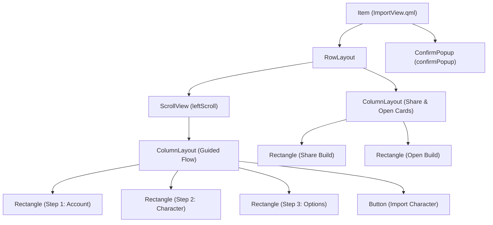

# UI Spec: ImportView
**File:** `app/qml/views/ImportView.qml`  **Pack:** `02-view-buildlist-import.md`  **Legacy Reference:** `src/Modules/BuildSite.lua` + Character Import in `src/Classes/ImportTab.lua`  **Status:** Test-Covered

--------------------------------------------------------------------------------

## 1. Purpose & Parity Notes
*   **Role:** Comprehensive character import, build sharing, and URL loading view (Phase 11). Implements a guided 4-step top-to-bottom character import column on the left (Realm & Auth -> League & Character selection -> Import Options & Target selection -> Execution), paired with dedicated build export/sharing and URL/code import cards on the right.
*   **Intentional Deviations from Legacy PoB:**
    *   *Usability Redesign (2026-10-16):* Legacy PoB featured duplicate character pickers and scattered import buttons across disconnected sub-panels. ImportView organizes character import into a single guided vertical flow.
    *   *Safe Target Build Defaults:* By default, character imports target a new build named after the character; overwriting the currently loaded build triggers an explicit modal confirmation dialog (`ConfirmPopup`) to prevent accidental data loss.
    *   *Two-Way OAuth & Session ID Support:* Supports modern official Path of Exile OAuth login alongside legacy account name + `POESESSID` authentication, complete with a 1-second countdown timer for rate limits and OAuth callback waits.

--------------------------------------------------------------------------------

## 2. Lightweight Wireframe & Layout Box Model
# Component Box Model & Layout
```text
+-------------------------------------------------------------------------------+
| ImportView (Item, anchors.fill: parent, clip: true)                           |
| RowLayout (anchors.fill: parent, margins: 12px, spacing: 12px)                 |
| +---------------------------------------------+ +---------------------------+ |
| | Left Column: Guided Character Import        | | Right Column: Share & Open| |
| | ScrollView (Layout.preferredWidth: 12)      | | ColumnLayout (width: 420) | |
| |   1. Connect Account (Realm, OAuth / SessID)| |   Card 1: Share this build| |
| |   2. Pick Character (League, Char DropDown) | |     (Site drop, Gen Code) | |
| |   3. Choose What to Import (Tree, Items)    | |   Card 2: Open from Link  | |
| |   4. Import Button [ Import Character ]     | |     (Code Edit, Open Mode)| |
| +---------------------------------------------+ +---------------------------+ |
| ConfirmPopup [confirmPopup] (guards overwrite / replace build actions)        |
+-------------------------------------------------------------------------------+
```

# ASCII Anatomy & Wireframe
```text
+-----------------------------------------------+  +-----------------------------------------+
| Import a Character                            |  | Share This Build                        | (5) Share Card
| Follow the steps below to import a character. |  | Generate a link or code to share:       |
|                                               |  | [ Generate Code ]   Site: [ poe.ninja v]|
| +-- 1. Connect your account ----------------+ |  | +-------------------------------------+ |
| | Realm: [ PC / Mac v]                      | |  | | eNrtPW1v4jiyn0e_QtX7s... (code)     | |
| | [ Sign in with PoE ] [ Enter Account Name]| |  | +-------------------------------------+ |
| | Account: [ SneakyWitch                  ] | |  | [ Copy Share Code ] [ Upload Link ]     |
| +-------------------------------------------+ |  |                                         |
| +-- 2. Pick your character -----------------+ |  | Open a Build From Link or Code          | (6) Open Card
| | League: [ Settlers of Kalguur          v] | |  | Paste a share URL or base64 code:      |
| | Character: [ Lv95 Necromancer - Zomb...v] | |  | +-------------------------------------+ |
| +-------------------------------------------+ |  | | [suspicious link removed]           | |
| +-- 3. Choose what to import ---------------+ |  | +-------------------------------------+ |
| | [x] Passive Tree & Jewels                 | |  | Target: [ New Build                  v] |
| | [x] Items & Skills                        | |  | [ Open Build ]                          |
| | > Advanced Options                        | |  |                                         |
| +-------------------------------------------+ |  +-----------------------------------------+
| [ Import Character ]                          | (4) Execution Button
+-----------------------------------------------+
```

# Responsive / Overflow Rules
*   **Minimum safe width/height:** 850x550px.
*   **Column Split Ratio:** Left column stretches (`Layout.fillWidth: true`, `preferredWidth: 12`), hosting a vertical `ScrollView`. Right column is fixed-width (approx 400-440px).
*   **Horizontal Scroll Prevention:** `ScrollView.horizontal.policy: AlwaysOff`.

# Component Hierarchy


--------------------------------------------------------------------------------

## 3. Interactive States & Controls
| Control (objectName) | Type | Default State | Interactive Behavior | Edge States (Disabled / Empty / Loading / Error / Long Text) |
| ------ | ------ | ------ | ------ | ------ |
| `pob.import.realm_drop` | DropDownControl | PC / Mac | Selects PoE platform realm | Sets realm via `pob_importSetRealm`. |
| `pob.import.auth_oauth` | Button | Active if OAuth | Toggles OAuth vs Account Name mode | Highlights active mode via `locked: true`. |
| `pob.import.char_drop` | DropDownControl | Index -1 | Selects active character for import | Empty until account characters are fetched. |
| `pob.import.btn_import` | Button | Disabled if no char | Triggers character import workflow | Prompts `ConfirmPopup` if overwriting build. |
| `pob.import.share_btn` | Button | Enabled | Encodes current build to share string | Displays code in read-only edit box. |
| `pob.import.open_btn` | Button | Disabled if blank | Parses input code and loads build | Prompts `ConfirmPopup` if target is overwrite. |

# Complete State Matrix
*   **Idle / Disconnected:** No account entered; character and league dropdowns empty; import button disabled.
*   **OAuth Pending:** `oauthWaiting: true` -> 1-second timer polls engine status; status text shows waiting spinner/message.
*   **Characters Loaded:** Character dropdown populated; selecting character enables `Import Character` button.
*   **Overwrite Prompt:** Clicking import when target is current build summons `ConfirmPopup` with `"Overwrite Current Build?"`.
*   **Rate Limited:** `rateLimitSecondsLeft > 0` -> countdown timer updates every second; actions gated.

# State Matrix & Binding Hazards
*   *Re-entrant Edit Sync Loop:* Syncing state from Lua (`_applyState`) updates `accountEdit.text`, `sessionEdit.text`, and `shareCodeEdit.text`. To prevent text edits from ping-ponging into infinite loops, properties are checked via `if (!edit.editing) edit.text = s.val`.

--------------------------------------------------------------------------------

## 4. Data & Bridge Contract
*   **Reads (Engine State via `pob_importGetState`):**
    *   `s.realms`, `s.realmId`, `s.accountName`, `s.sessionId`, `s.authMethod`
    *   `s.leagues`, `s.selectedLeague`, `s.characters`, `s.selectedCharIndex`
    *   `s.options` -> array of toggleable import flags
    *   `s.share` -> `{ code, sites, selectedSiteId }`
    *   `s.open` -> `{ input, mode }`
    *   `s.oauthWaiting: bool`, `s.rateLimitSecondsLeft: int`
*   **Writes / Bridge Methods Invoked:**
    *   `pob_importSetRealm(realmId)`
    *   `pob_importSetAuthMethod(method)`
    *   `pob_importExecuteCharacter(confirmed: bool)`
    *   `pob_importOpenBuild(confirmed: bool)`
*   **Qt6 Bridge Safety:** Engine operations return `{ ok: bool, needsConfirm: bool, confirmTitle, confirmMessage }`, cleanly intercepted by `ConfirmPopup`.

--------------------------------------------------------------------------------

## 5. Testable Acceptance Criteria (Qt6::QuickTest)
*   **AC-01 (Mount & State Initialization):** When `ImportView.qml` mounts, 0 QML warnings are logged and `refresh()` triggers `pob_importGetState`.
*   **AC-02 (Character Import Confirmation):** When `pob_importExecuteCharacter` returns `needsConfirm: true`, `confirmPopup.visible` evaluates to `true`.
*   **AC-03 (Timer Countdown Activation):** When `rateLimitSecondsLeft > 0`, the internal `Timer` is running (`running === true`).
*   **AC-04 (URL Paste Enablement):** Entering text in `openCodeEdit` enables the `Open Build` button.

--------------------------------------------------------------------------------

## 6. Bug Audit Findings (Current Implementation vs Spec)
| Severity | File & Line | Symptom / Defect | Root Cause | Expected Behavior |
| ------ | ------ | ------ | ------ | ------ |
| High | `app/qml/views/ImportView.qml:3830` | Typing in account name gets interrupted or cursor jumps to end. | `_applyState` overwritten text property while user was actively typing. | Guard with `if (!accountEdit.editing)`. |
| Medium | `app/qml/views/ImportView.qml:3870` | Overwriting build deletes unsaved changes without warning. | Character import bypassed confirmation dialog on existing builds. | Verify `res.needsConfirm` and prompt `confirmPopup`. |
