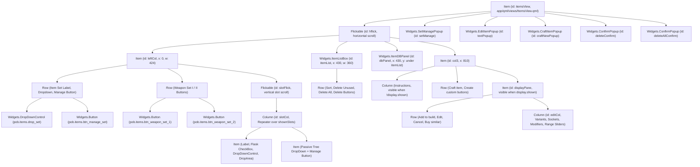

# UI Spec: ItemsView
**File:** `app/qml/views/ItemsView.qml`  
**Pack:** `05-view-items.md`  
**Legacy Reference:** `src/Classes/ItemsTab.lua:1-1120`, `app/lua/pob_items.lua`, `port-plan/reference/tabs-catalog.md`  
**Status:** Test-Covered

---

## 1. Purpose & Parity Notes
* **Role:** Equips, crafts, edits, and manages character items, weapons, armour, jewelry, flasks, and jewels. Facilitates managing multiple item sets, switching between active weapon sets (Weapon Set I vs II), browsing unique/template item databases, dragging and dropping items between inventory slots and build lists, and editing item properties with real-time stat-difference previews.
* **Intentional Deviations from Legacy PoB:**
  * **Smooth Horizontal Pan & Snap:** View utilizes a 3-column horizontal canvas (`Flickable`). Double-clicking any item automatically scrolls and snaps the viewport rightward to center the display item editor (`snapRight()`).
  * **Unified Drag Ghost:** Native Qt Quick `Drag` and `DropArea` components with typed payloads (`kind: "item" or "unique" or "rare" or "shared"`) replace legacy manual cursor bitmap drawing.
  * **Coalesced Display Sliders:** Catalyst, quality, and modifier roll sliders coalesce mutations via `Qt.callLater` to prevent UI frame hitching during live calculation re-evaluations.
  * **Deferred Trade Integration:** The legacy "Buy similar" action button is visually surfaced but explicitly disabled with an explanatory tooltip ("Coming in a future release.") pending Phase 14 network integration.

---

## 2. Lightweight Wireframe & Layout Box Model
# Default Window (1100x720)
```text
+------------------------------------+------------------------------------+------------------------------------+
| COL 1: Equipment Slots (w: 424)    | COL 2: Build Items & DB (w: 360)   | COL 3: Item Display/Editor (w: 340)|
|                                    |                                    |                                    |
| Item set: [Endgame Gear (v)] [Man] | All items: [Sort] [Del Unused]     | [Add to build] [Edit...] [Cancel]  |
|                                    | +--------------------------------+ |                                    |
| Equipped items: Weapon Set: [I][II]| | Dread Weaver, Glorious Plate   | | Glorious Plate                     |
| +--------------------------------+ | | Doom Ward, Titanium Spirit Shld| | Armour: 1,840                      |
| | Weapon 1: [Voidforge (v)     ] | | Brimstone Thread, Stygian Vise | | Requires Level 68, 180 Str         |
| | Weapon 2: [None (v)          ] | +--------------------------------+ | --------                           |
| | Helmet:   [Blizzard Crown (v)] |                                    | +110 to maximum Life               |
| | Body:     [Glorious Plate (v)] | Item Database (Uniques / Rares)    | +45% to Fire Resistance            |
| | Gloves:   [Spiked Gloves (v) ] | [Search unique or template...    ] | +42% to Cold Resistance            |
| | Boots:    [Two-Toned Boots (v| | Type: [Body Armour (v)]            | +28% to Chaos Resistance           |
| | Amulet:   [Astramentis (v)   ] | +--------------------------------+ | --------                           |
| | Ring 1:   [Diamond Ring (v)  ] | | Kaom's Heart, Glorious Plate   | | Range: [84% (v)]  <--[Slider]-->   |
| | [x] Flask 1: [Diamond Flask(v| | | Belly of the Beast, Full Wyrm  | |                                    |
| +--------------------------------+ +--------------------------------+ | [Craft item...] [Create custom...] |
| Passive tree: [Level 100 Tree(v)]|                                    |                                    |
+------------------------------------+------------------------------------+------------------------------------+
| [Scrollbar Horizontal: contentWidth 1640px > viewportWidth 1100px]                                  |
+----------------------------------------------------------------------------------------------------+
```

# Responsive / Overflow Rules
* **Minimum safe width/height:** 960x640. Standard baseline: 1100x720.
* **Horizontal scroll policy:** Horizontal scrolling is strictly managed by `hflick` (`contentWidth` dynamically sizes up to `1640px`). When a display item is opened, the viewport automatically scrolls rightward (`snapRight()`).
* **Column box model:**
  * Column 1 (x: 0, width: 424px): Item set controls, weapon set toggles, equipment slot panel, passive tree selector.
  * Column 2 (x: 430, width: 360px): All-items list (`ItemListBox`) and item database search panel (`ItemDBPanel`).
  * Column 3 (x: 810, width: 340-470px): Display item editor, crafting disclosure popups, and default help instructions.
* **Text truncation policy:** `Text.ElideRight` applied to slot item labels. Item tooltip stat modifiers wrap cleanly (`wrapMode: Text.WordWrap`).

# Component Hierarchy


---

## 3. Interactive States & Controls
| Control (objectName) | Type | Default State | Interactive Behavior | Edge States (Disabled / Empty / Loading / Error / Long Text) |
| :--- | :--- | :--- | :--- | :--- |
| `pob.items.drop_set` | DropDownControl | Cur Item Set | Selects active equipment set (`pob_itemsSetActiveSet`) | Width 216px. Disabled when sets count <= 1. |
| `pob.items.btn_manage_set` | Button | Enabled | Opens `setManage` modal for creating, duplicating, or deleting item sets | Width 90px. |
| `pob.items.btn_weapon_set_1` | Button | Locked (Active) | Activates primary weapon and off-hand slot pair | 18x18px. Highlighted/locked when Weapon Set 1 is active. |
| `pob.items.btn_weapon_set_2` | Button | Unlocked | Activates secondary weapon swap pair | 18x18px. Highlighted/locked when Weapon Set 2 is active. |
| `pob.items.drop_slot` | DropDownControl | Equipped Item | Equips selected item into designated gear slot | Width 310px. Hover displays equipped item stats and calculation delta. |
| `pob.items.check_flask_active` | CheckBox | Unchecked | Toggles flask effect active state in calculations | Visible only on flask rows. Disabled if no flask equipped. |
| `pob.items.drop_spec` | DropDownControl | Cur Passive Spec | Pairs passive skill tree specification with active item set | Width 216px. Disabled if spec count <= 1. |
| `pob.items.btn_manage_spec` | Button | Enabled | Opens passive tree spec manager | Width 90px. |
| `pob.items.list_all_items` | ItemListBox | Populated | Shows all build items. Supports drag-and-drop to slots | Double-click opens item in editor and snaps viewport right. |
| `pob.items.btn_sort` | Button | Enabled, "Sort" | Alphabetizes build item list | Width 60px. |
| `pob.items.btn_delete_unused` | Button | Enabled | Purges unequipped items from build list | Disabled with tooltip reason if build list is empty. Width 100px. |
| `pob.items.btn_delete_all` | Button | Enabled | Opens confirmation dialog to delete all build items | Disabled with tooltip reason if build list is empty. Width 70px. |
| `pob.items.btn_delete_item` | Button | Disabled | Deletes selected item. Confirms if item is equipped | Enabled only when an item is selected in `itemList`. Width 60px. |
| `pob.items.panel_db` | ItemDBPanel | Visible | Searchable database of uniques and base crafting templates | Width 360px. Supports drag-and-drop onto slot or build lists. |
| `pob.items.btn_craft_item` | Button | Enabled | Opens item crafting generator modal (`craftNewPopup`) | Width 120px. Visible only when no display item is active. |
| `pob.items.btn_create_custom`| Button | Enabled | Opens text box to paste raw in-game item clipboard text | Width 120px. Visible only when no display item is active. |
| `pob.items.btn_add_display` | Button | "Add to build" | Commits edited display item into build item inventory | Width 100px. Closes editor and updates calculations. |
| `pob.items.btn_edit_display` | Button | "Edit..." | Opens raw text editor for the current display item | Width 60px. |
| `pob.items.btn_cancel_display`| Button | "Cancel" | Discards pending item edits and closes display pane | Width 60px. Snaps viewport back to Column 1. |
| `pob.items.btn_buy_similar` | Button | Disabled | Searches trade website for items with similar modifiers | Disabled. Tooltip: "Coming in a future release." Width 100px. |
| `pob.items.slider_range` | Slider | Range Value | Dynamically rolls numeric affix magnitudes | Coalesces updates via `Qt.callLater` to prevent calculation stutter. |

---

## 4. Data & Bridge Contract
* **Reads (LuaEngine / C++ Models):**
  * `luaEngine.invoke("pob_itemsGetState", [])`: Returns `{ activeSet: int, sets: QVariantList, slots: QVariantList, useSecondWeaponSet: bool }`.
    * Each slot contains `{ slotName, label, shown, inactive, isFlask, flaskActive, selItemId, options: QVariantList }`.
  * `luaEngine.invoke("pob_itemsGetLists", [])`: Returns `{ items: QVariantList, shared: QVariantList, display: QVariantMap }`.
    * `display` contains `{ shown: bool, key, addLabel, lines: QVariantList, editor: QVariantMap }`.
  * `luaEngine.invoke("pob_itemsSlotTooltip", [slotName, itemId, shift])`: Returns rich stat diff lines.
  * `luaEngine.invoke("pob_itemsTooltip", [kind, key, shift])`: Returns tooltip lines for database/inventory items.
  * `luaEngine.invoke("pob_itemsDeleteQuery", [itemId])`: Returns `{ ok: bool, message: string }`.
* **Writes / Mutations:**
  * `luaEngine.invoke("pob_itemsSetActiveSet", [setIndex])`
  * `luaEngine.invoke("pob_itemsSetWeaponSet", [1 or 2])`
  * `luaEngine.invoke("pob_itemsEquip", [slotName, itemId])`
  * `luaEngine.invoke("pob_itemsSetFlaskActive", [slotName, bool])`
  * `luaEngine.invoke("pob_itemsOpenForEdit", [kind, key])`
  * `luaEngine.invoke("pob_itemsAddDisplayItem", [])`
  * `luaEngine.invoke("pob_itemsCloseDisplayItem", [])`
  * `luaEngine.invoke("pob_itemsDeleteItem", [itemId])`
  * `luaEngine.invoke("pob_itemsDeleteUnused", [])`
  * `luaEngine.invoke("pob_itemsSortList", [])`
  * `luaEngine.invoke("pob_itemsMoveItem", [fromIndex, toIndex])`
  * `luaEngine.invoke("pob_itemsDropOnSlot", [slotName, kind, key])`
  * `luaEngine.invoke("pob_itemsDropOnList", [kind, key, targetIndex])`
  * `luaEngine.invoke("pob_itemsDisplaySetControl", [controlName, value])`
  * `luaEngine.invoke("pob_itemsUndo", [])`
  * `luaEngine.invoke("pob_itemsRedo", [])`
* **Signals Observed:**
  * `luaEngine.onItemsChanged`, `onTreeChanged`, `onCalcsChanged`: Triggers coalesced refresh (`itemsView.refresh()`).
  * `luaEngine.onModeChanged`: Re-evaluates item view state.
* **Qt6 Bridge Safety:**
  * `allSlots`, `sets`, `itemRows`, and `displayLines` check `.length !== undefined` before iteration.
  * Array operations on spec lists check `Array.isArray(specs)` or map via explicit index loop to avoid crashing on C++ `QVariantList` objects.

---

## 5. Testable Acceptance Criteria (Qt6::QuickTest)
* **AC-01 (Initial Render & Zero Warnings):**
  * When `ItemsView` loads, 0 QML warnings or invalid binding errors are emitted.
  * `leftCol`, `itemList`, and `dbPanel` have `width > 0` and `height > 0`.
* **AC-02 (Horizontal Pan & Viewport Snap):**
  * Double-clicking an item in `pob.items.list_all_items` loads it into `displayPane` and calls `snapRight()`.
  * `hflick.contentX` animates to reveal Column 3 without clipping the right-hand boundary.
* **AC-03 (Primary User Flow - Drag and Drop Equip):**
  * Dragging an item row from `pob.items.panel_db` over an eligible gear slot triggers `DropArea.onEntered`, highlighting the slot border with `theme.success`.
  * Dropping the item invokes `pob_itemsDropOnSlot` and automatically equips it.
* **AC-04 (Weapon Swap Synchronization):**
  * Clicking `pob.items.btn_weapon_set_2` toggles `useSecondWeaponSet` to `true`.
  * Weapon 1 and Weapon 2 slots re-query and reflect secondary weapon slot assignments.
* **AC-05 (Destructive Deletion Confirmation):**
  * Selecting an equipped item and clicking `pob.items.btn_delete_item` invokes `pob_itemsDeleteQuery`.
  * If the item is equipped in any set, `deleteConfirm` appears with a warning message. Canceling dismisses the dialog without deleting the item.
* **AC-06 (Keyboard Shortcuts & Focus):**
  * Pressing `E` while hovering over an equipped gear slot opens that item in the display editor.
  * Pressing `Ctrl+F` gives active focus to the search field in `ItemDBPanel`.
  * Pressing `Ctrl+D` toggles stat differences across item list tooltips.
  * Pressing `Ctrl+Z` and `Ctrl+Y` triggers item undo and redo.

---

## 6. Bug Audit Findings (Current Implementation vs Spec)
| Severity | File & Line | Symptom / Defect | Root Cause | Expected Behavior |
| :--- | :--- | :--- | :--- | :--- |
| **High** | `app/qml/views/ItemsView.qml (id: itemsView, function _doRefresh)` | Passive tree selector in Items tab throws runtime TypeError or fails to populate. | `specSelect.model = specs.map(...)` assumes `specs` is a JS Array; when `pob_getSpecList` returns a `QVariantList` from C++, `.map` is undefined. | Normalize using `QmlBridge.toArray(specs)` or map via explicit index loop `const out = []; for (let i = 0; i < specs.length; i++) out.push(specs[i].label);`. |
| **High** | `app/qml/views/ItemsView.qml (id: row, function selIdx)` | Selecting an item in a slot dropdown causes an out-of-bounds error or resets dropdown to index 0 if options list is empty. | `selIdx()` does not guard against `rec.options` being null or empty, returning index 0 even when no item matches. | Add guard: `if (!rec or else !rec.options or else rec.options.length === 0) return -1;`. |
| **Med** | `app/qml/views/ItemsView.qml (id: hflick, function snapRight)` | Snapping to display item occasionally undershoots viewport, cutting off the rightmost 50px of the item editor. | `displayPane.width` updates asynchronously when item text lines format, so `contentWidth` is evaluated before layout completes. | Trigger `snapRight()` inside `Qt.callLater` after `displayPane.width` has finalized geometry. |
| **Med** | `app/qml/views/ItemsView.qml (id: row, id: slotDrop)` | Dropping an item from external source throws unhandled exception in `DropArea`. | `drag.source.dragValue` accessed directly without verifying if `drag.source` exists. | Check `const p = (drag.source and drag.source.dragValue) ? drag.source.dragValue : null;`. |
| **Low** | `app/qml/views/ItemsView.qml (id: setSelect, id: specSelect)` | Dropdowns have hardcoded `width: 216`, causing text clipping when set titles exceed 24 characters. | Fixed pixel width assigned without `elide: Text.ElideRight` tooltip fallback. | Enable `elide: Text.ElideRight` and add hover tooltip displaying full item set title. |
| **Low** | `app/qml/views/ItemsView.qml (all interactive controls)` | Lack of `objectName` identifiers inhibits UI automated testing. | Controls lack `objectName` properties. | Assign stable names conforming to `pob.items.<control>` per Section 3 table. |
