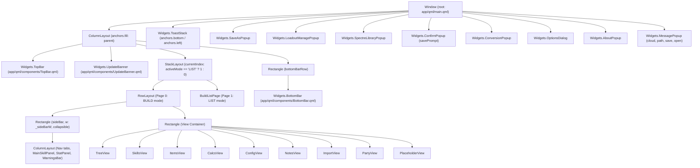

# UI Spec: MainShell

**File:** `app/qml/main.qml` (and shell components `app/qml/components/TopBar.qml`, `BottomBar.qml`, `UpdateBanner.qml`, `MainSkillPanel.qml`, `StatPanel.qml`, `WarningsBar.qml`)  
**Pack:** `00-shell-and-theme.md`  
**Legacy Reference:** `Modules/Main.lua:205-440`, `Modules/Build.lua:121-308`, `Modules/Build.lua:1314-1383`, `port-plan/reference/tabs-catalog.md`  
**Status:** Test-Covered

---

## 1. Purpose & Parity Notes

- **Role:** Serves as the top-level application window shell, hosting the global top navigation bar (`TopBar.qml`), the collapsible left-hand navigation sidebar (with primary build view buttons, main skill selector, real-time stat panel, and warnings banner), the main view `StackLayout` (swapping between `BUILD` views and `LIST` build browser), modal dialog hosts, toast notification stack, and the status footer (`BottomBar.qml`).
- **Intentional Deviations from Legacy PoB:**
    - Top bar build name plate dynamically allocates width using Qt Quick `RowLayout` layout spacers and constraints rather than legacy fixed manual arithmetic (`Modules/Build.lua:150-155`).
    - Dedicated `UpdateBanner.qml` provides a non-modal, dismissible GitHub release notification banner at the top of the body rather than legacy modal alert blocking startup.
    - Shell popups (`SaveAsPopup`, `LoadoutManagePopup`, `SpectreLibraryPopup`, `ConversionPopup`, `OptionsDialog`, `AboutPopup`) are lazily instantiated as top-level components within the main window coordinate system rather than drawn as inline SimpleGraphic primitives.
    - View switching shortcuts (`Ctrl+1`..`Ctrl+8`) are dynamically generated via an `Instantiator` inspecting the engine's `luaEngine.viewList()` registry.

---

## 2. Lightweight Wireframe & Layout Box Model

# Default Window (1100x720)

```text
+----------------------------------------------------------------------------------------------------+
| TopBar: [<<] [<< Back] [Save] [Save As] [Build Name *]  ---Spacer---  [0/123 Pts] [Auto|Man] [Lvl] [Class v] [Asc v] [Loadouts v] [Mode: BUILD]|
+----------------------------------------------------------------------------------------------------+
| UpdateBanner: "A new version of Path of Building (v2.x.x) is available. [View] [Dismiss]"          |
+--------------------------+-------------------------------------------------------------------------+
| Sidebar (w: 220, collaps)| View Content Stack (`StackLayout`, currentIndex: activeMode === "LIST")  |
| BUILD                    |                                                                         |
|  [ Tree ] (Ctrl+1)       |                                                                         |
|  [ Skills ] (Ctrl+2)     |  [Active View: TreeView / SkillsView / ItemsView / CalcsView /          |
|  [ Items ] (Ctrl+3)      |   ConfigView / NotesView / ImportView / PartyView / PlaceholderView]    |
|  [ Calcs ] (Ctrl+4)      |                                                                         |
|  [ Config ] (Ctrl+5)     |                                                                         |
| TOOLS                    |                                                                         |
|  [ Import/Export ]       |                                                                         |
|  [ Notes ]               |                                                                         |
|  [ Party ]               |                                                                         |
|                          |                                                                         |
| [Main Skill Panel]       |                                                                         |
|  Socket: [Body Armour v] |                                                                         |
|  Skill:  [Cyclone v]     |                                                                         |
| [Live Stat Panel]        |                                                                         |
|  Total DPS: 1,420,500    |                                                                         |
|  Life: 5,420 / ES: 210   |                                                                         |
| [Warnings Bar]           |                                                                         |
+--------------------------+-------------------------------------------------------------------------+
| BottomBar: [Options] [About] [Check for Update (disabled)]  ^8PoB Community Fork v2.48.0   devMode: off|
+----------------------------------------------------------------------------------------------------+
```

# Responsive / Overflow Rules

- **Minimum safe width/height:** 960x640. Minimum supported production baseline: 1100x720.
- **Horizontal scroll policy:** Strictly forbidden at the window shell level. All shell toolbars use bounded widths, spacers, and eliding.
- **Text truncation policy:** `Text.ElideRight` applied to build name plate, dropdown selected text, and sidebar tab buttons. Hover tooltip fallback displays full unabbreviated text.
- **Sidebar collapse:** Collapses smoothly from `theme.sideBarWidth` (220px) to `0px` via `NumberAnimation` on `_sideBarW` (150ms duration). Content area claims remaining viewport width automatically.

# Component Hierarchy



---

## 3. Interactive States & Controls

|Control (objectName)|Type|Default State|Interactive Behavior|Edge States (Disabled / Empty / Loading / Error / Long Text)|
|:--|:--|:--|:--|:--|
|`pob.topbar.collapse`|Button|Enabled, label `<<`|Toggles sidebar collapsed state (`!root.collapsed`), persists via `luaEngine.setSideBarCollapsed`|Hidden in `LIST` mode (`visible: root.hasBuild`). Label switches to `>>` when collapsed.|
|`pob.topbar.back`|Button|Enabled, label `<< Back`|Returns to build list. If unsaved changes exist, opens `savePrompt` ("LIST" mode), else calls `luaEngine.closeBuild()`|Hidden in `LIST` mode. Disabled if `hasBuild` is false.|
|`pob.topbar.save`|Button|Enabled, label `Save`|Saves build to current `dbFileName`. If unnamed, opens `saveAsPopup`. Signals `onSaveFailed` on error|Disabled if `root.shell.canSave === false`. Shows error popup on save failure.|
|`pob.topbar.saveAs`|Button|Enabled, label `Save As`|Opens `saveAsPopup` for exporting/saving build under a new filename|Disabled if `hasBuild` is false.|
|`pob.topbar.namePlate`|Item|Read-only, `displayName`|Displays active build name. Hover triggers `nameTip` displaying full file subpath|Max width 260px; truncates with `Text.ElideRight`. Appends `*` in `theme.warning` color if `unsaved`. Displays "Unnamed build" if empty.|
|`pob.topbar.points`|Rectangle|Read-only Label|Displays allocated/total passive and ascendancy points. Hover triggers `pointsTip` breakdown|Bounded width. Border highlights on hover (`theme.borderStrong`).|
|`pob.topbar.levelMode`|Button|"Auto" or "Manual"|Toggles level calculation mode via `luaEngine.setLevelAutoMode`|Reflects `root.shell.levelAutoMode`. Dynamic tooltip explains calculation mode.|
|`pob.topbar.level`|EditControl|Numeric (1-100)|Commits character level via `luaEngine.setCharacterLevel`. Switches mode to "Manual"|Clamped between 1 and 100. Disallows non-numeric characters. Reverts on Esc or blur.|
|`pob.topbar.class`|DropDownControl|Cur class selected|Selects character class. If tree requires reset, opens `classConfirm` modal|Width 90px. Shows placeholder if empty. Triggers confirm dialog with "Connect Path" option if applicable.|
|`pob.topbar.ascend`|DropDownControl|Cur ascendancy|Selects ascendancy class via `luaEngine.setAscendClass`|Width 105px. Disabled when current class has 0 ascendancies (e.g. Scion initial state).|
|`pob.topbar.secondary`|DropDownControl|Cur secondary|Selects alternate ascendancy (e.g. Wildwood) via `luaEngine.setSecondaryAscendClass`|Width 115px. Disabled if `classList.secondaryEnabled !== true`.|
|`pob.topbar.loadouts`|DropDownControl|Cur loadout|Switches loadout or triggers loadout manage dialog|Width 115px. Headers and separators are non-selectable.|
|`pob.shell.sidebar.btn_nav_<id>`|Rectangle (Nav)|Enabled|Switches active view via `luaEngine.setActiveView(id)`. Active tab has 3px left accent bar|Elides long tab text. Background tints to `theme.hover` on mouse enter.|
|`pob.bottombar.options`|Button|Enabled, "Options"|Emits `optionsRequested()`, opening `optionsDialog`|Fixed 68x20px.|
|`pob.bottombar.about`|Button|Enabled, "About"|Emits `aboutRequested("")`, opening `aboutPopup`|Fixed 68x20px.|
|`pob.bottombar.update`|Button|Enabled, "Check for Update"|Invokes `pob_checkForUpdates`|Triggers non-modal `UpdateBanner` when a release is available.|
|`pob.shell.dialog.save_prompt`|ConfirmPopup|Closed|Prompts user to Save, Don't Save, or Cancel on exit or closing build|Modal overlay, dims background. Enter triggers Confirm ("Save"), Esc cancels.|

---

## 4. Data & Bridge Contract

- **Reads (LuaEngine / C++ Models):**
    - `luaEngine.currentMode`: String property (`"BUILD"` or `"LIST"`), drives top-level page stack index.
    - `luaEngine.currentView`: String property (`"TREE"`, `"SKILLS"`, `"ITEMS"`, `"CALCS"`, `"CONFIG"`, `"NOTES"`, `"IMPORT"`, `"PARTY"`).
    - `luaEngine.getShellState()`: Returns dictionary containing `level`, `levelAutoMode`, `buildName`, `dbFileName`, `dbFileSubPath`, `unsaved`, `canSave`, `sideBarCollapsed`, and `points` (`{ str: string, tooltip: string }`).
    - `luaEngine.getClassList()`: Returns `{ curClassId, curAscendClassId, curSecondaryAscendClassId, secondaryEnabled, classes: QVariantList, secondaryAscendancies: QVariantList }`.
    - `luaEngine.viewList()`: Returns list of registered views `{ id, label, key, group, tab }`.
    - `luaEngine.invoke("pob_loadoutsGetState", [])`: Returns `{ activeDropdownIndex0, dropdown: QVariantList }`.
    - `luaEngine.getAboutContent()`: Returns `{ versionNumber, versionBranch, devMode }`.
- **Writes / Mutations:**
    - `luaEngine.setActiveView(viewId)`: Activates target view in `BUILD` mode.
    - `luaEngine.setSideBarCollapsed(bool)`: Persists sidebar collapse preference to settings.
    - `luaEngine.saveDBFile("")`: Saves build to current path. Returns `{ ok: bool, error: string }`.
    - `luaEngine.closeBuild()`: Closes open build and transitions engine to `LIST` mode.
    - `luaEngine.setLevelAutoMode(bool)`: Switches between auto level estimation and manual override.
    - `luaEngine.setCharacterLevel(int)`: Updates character level (1-100).
    - `luaEngine.setClass(int classId, string mode)`: Checks or applies character class mutation.
    - `luaEngine.setAscendClass(int id)`: Updates primary ascendancy.
    - `luaEngine.setSecondaryAscendClass(int id)`: Updates secondary ascendancy.
    - `luaEngine.invoke("pob_loadoutsSelect", [value])`: Switches active build loadout.
- **Signals Observed:**
    - `luaEngine.currentModeChanged`: Fired on mode swap; triggers conversion checks and top bar synchronization.
    - `luaEngine.currentViewChanged`: Fired when active view changes; drives view container component activation.
    - `luaEngine.cloudErrorRequested(path, provider, status)`: Opens `cloudErrorPopup`.
    - `luaEngine.pathErrorRequested(invalidPath, errMsg)`: Opens `pathErrorPopup`.
    - `luaEngine.buildDataChanged`, `calcsChanged`: Triggers `topBar.refresh()`, updating points, class, and level.
- **Qt6 Bridge Safety:**
    - All lists returned from Lua (`classList.classes`, `classList.secondaryAscendancies`, `loadoutState.dropdown`, `allViews`) must be normalized with `QmlBridge.toArray()` or validated using `list && list.length !== undefined` before index access or iteration. **Never execute `Array.isArray()` directly on `QVariantList` bridge payloads** (evaluates to `false` in Qt6 QML).

---

## 5. Testable Acceptance Criteria (Qt6::QuickTest)

- **AC-01 (Initial Render & Zero Warnings):**
    - When `main.qml` loads in both `LIST` and `BUILD` modes, 0 QML engine warnings are emitted to stderr.
    - All visible shell controls (`TopBar`, `BottomBar`, `sideBar`, view containers) have `width > 0` and `height > 0`.
- **AC-02 (No Text Overflow / Clipping):**
    - At window resolutions 960x640, 1100x720, and 1920x1080, no text item in `TopBar`, `BottomBar`, or sidebar has `paintedWidth > width + 1` without active `elide: Text.ElideRight` and a hover tooltip fallback.
- **AC-03 (Primary User Flow - Mode & View Switching):**
    - In `BUILD` mode, clicking sidebar button `pob.shell.sidebar.btn_nav_SKILLS` causes `luaEngine.currentView` to become `"SKILLS"` and displays `SkillsView` while hiding other view components.
    - Pressing `Ctrl+1` through `Ctrl+5` activates Tree, Skills, Items, Calcs, and Config views respectively.
    - Clicking `pob.shell.topbar.btn_back` when `unsaved === false` transitions `activeMode` to `"LIST"` and displays `BuildListPage`.
- **AC-04 (Keyboard & Focus Navigation):**
    - Pressing `Ctrl+S` in `BUILD` mode saves the build via `luaEngine.saveDBFile("")` or opens `SaveAsPopup` if unnamed.
    - Pressing `Ctrl+W` invokes `savePrompt` if unsaved, or closes the build if saved.
    - Pressing `F1` opens `AboutPopup` directly on the Help section matching the active view.
- **AC-05 (Sidebar Collapse Animation & Layout Bounding):**
    - Clicking `pob.shell.topbar.btn_collapse` toggles `sideBarCollapsed` between `false` and `true`.
    - When collapsed, `sideBar.width` animates to 0px; the right-hand view container expands to occupy the full window width (`1100px - margins`). Sibling layouts report no zero-size errors.
- **AC-06 (Unsaved Changes Guard on Exit):**
    - Triggering window close (`onClosing`) while in `BUILD` mode with `unsaved === true` rejects the close event (`close.accepted = false`) and displays `pob.shell.dialog.save_prompt`.

---

## 6. Bug Audit Findings (Current Implementation vs Spec)

|Severity|File & Line|Symptom / Defect|Root Cause|Expected Behavior|
|:--|:--|:--|:--|:--|
|**High**|`app/qml/components/TopBar.qml:5183`|Loadouts dropdown (`loadoutDrop`) is completely empty despite valid loadouts returned by engine.|Direct call to `Array.isArray(loadoutState.dropdown)`. In Qt6 QML, a C++ `QVariantList` returned across the Lua bridge fails `Array.isArray()`, returning `false` and assigning `[]`.|Normalize using `QmlBridge.toArray(loadoutState.dropdown)` or guard with `(loadoutState.dropdown && loadoutState.dropdown.length !== undefined)`.|
|**High**|`app/qml/main.qml:6503-6518`|Sidebar navigation buttons fail to render or throw runtime exceptions on startup.|`groups` IIFE assumes `allViews` is a JavaScript Array with `.length`. If `luaEngine.viewList()` returns a raw `QVariantMap` or undefined before initialization, `.length` is undefined and iteration fails.|Guard `allViews` with `var list = QmlBridge.toArray(root.allViews) \|
|**Med**|`app/qml/components/TopBar.qml:5590-5650`|Class and Ascendancy dropdown labels clip text when character classes have long names or high DPI scaling is enabled.|Fixed hardcoded `Layout.preferredWidth` values (`classDrop`: 95, `ascendDrop`: 120, `secondaryDrop`: 150) without text measurement or dropdown elide tooltip fallbacks.|Derive widths via `textMetrics.width(...)` or apply `elide: Text.ElideRight` with hover tooltip showing full ascendancy title.|
|**Med**|`app/qml/components/TopBar.qml:5470-5485`|Unsaved asterisk indicator (`*`) can clip or trigger 1px layout overflow in `namePlate`.|`unsavedMark.width` calculates metric width using normal font weight (`"VAR"`), but renders with `font.bold: true`, making painted text wider than allocated width.|Calculate `unsavedMark` width using `textMetrics.width(..., "VAR_BOLD", " *")` or add 2px safety padding.|
|**Med**|`app/qml/components/TopBar.qml:5515-5540`|Passive points summary plate cannot be inspected or activated via keyboard navigation.|`pointsPlate` implements hover exclusively through a `MouseArea` without `focus: true`, `Keys.onReturnPressed`, or Tab navigation stops.|Enable `activeFocusOnTab: true` and trigger `_updatePointsTip()` on focus in / focus out.|
|**Low**|`app/qml/main.qml:6940-6960`|Qt runtime warns `QQuickShortcut: Invalid sequence: Ctrl+undefined` in console on load.|`Instantiator` binds `sequence: "Ctrl+" + modelData.key` without checking if `modelData.key` exists. Views with undefined hotkeys produce invalid sequences.|Add condition `enabled: root.activeMode === "BUILD" && !!modelData.key`.|
|**Low**|`app/qml/main.qml:6470-6800`|UI controls lack stable programmatic `objectName` identifiers, preventing reliable UI test automation.|Missing `objectName` property assignments across `TopBar`, sidebar buttons, and modal dialogs.|Assign stable names conforming to `pob.shell.<scope>.<control>` per Section 3.|
