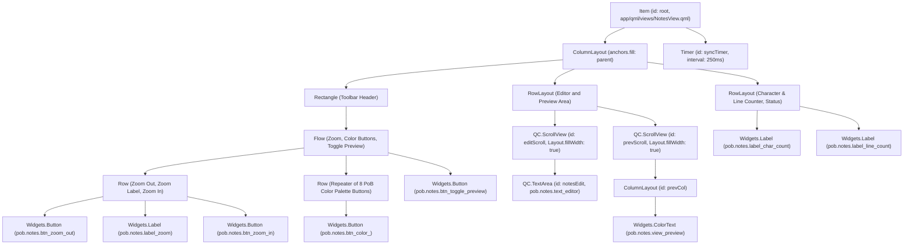

# UI Spec: NotesView
**File:** `app/qml/views/NotesView.qml`  
**Pack:** `07-view-notes-party.md`  
**Legacy Reference:** `src/Classes/NotesTab.lua:1-120`, `app/lua/pob_notes_party.lua`, `port-plan/reference/tabs-catalog.md`  
**Status:** Test-Covered

---

## 1. Purpose & Parity Notes
* **Role:** Provides a free-form character build notes scratchpad and guide authoring editor. Features dedicated legacy PoB color-code quick-insertion buttons, a live Markdown/ColorText preview pane, zoom level controls, and keyboard shortcuts for fast formatting.
* **Intentional Deviations from Legacy PoB:**
  * **Split Editor & Live Preview:** Implements a dual-pane layout (Editor on the left, live formatted ColorText preview on the right) with a toggle button (`Show/Hide Preview`), whereas legacy PoB renders a single raw text area where `^0`..`^9` escape sequences remain visible inline.
  * **Zoom Scaling Controls:** Supports font scaling from 50% to 200% via dedicated `+` and `-` zoom buttons with a percentage readout.
  * **Debounced Persistence:** Edits are debounced by 250 ms before synchronizing across the Lua bridge to `pob_notesSetText`, ensuring 60 FPS typing responsiveness.

---

## 2. Lightweight Wireframe & Layout Box Model
# Default Window (1100x720)
```text
+----------------------------------------------------------------------------------------------------+
| Toolbar:                                                                                           |
| Font Size: [-] 100% [+]  Color Codes: [Red] [Green] [Blue] [Yellow] [Cyan] [Magenta] [White] [Grey] |
| [Toggle Preview]                                                                                   |
+--------------------------------------------------+-------------------------------------------------+
| Raw Text Editor (`TextArea`, 50% w)              | Live Rendered Preview (`ScrollView`, 50% w)     |
|                                                  |                                                 |
| ^1Leveling Guide (Act 1-3):                      | Leveling Guide (Act 1-3):                       |
| ^71. Pick Spark at level 2.                      | 1. Pick Spark at level 2.                       |
| ^72. Grab ^2Orb of Storms^7 in Submerged.        | 2. Grab Orb of Storms in Submerged.             |
| ^3Vendor Recipe:                                 | Vendor Recipe:                                  |
| ^7- Magic wand + Topaz Ring + Alteration         | - Magic wand + Topaz Ring + Alteration          |
|                                                  |                                                 |
|                                                  |                                                 |
|                                                  |                                                 |
+--------------------------------------------------+-------------------------------------------------+
| Characters: 1,420 | Lines: 42                    | Zoom: 100%                                      |
+----------------------------------------------------------------------------------------------------+
```

# Responsive / Overflow Rules
* **Minimum safe width/height:** 960x640. Baseline: 1100x720.
* **Pane layout & collapse:** Dual-pane split default width 50% / 50%. Toggling preview off expands the editor to 100% width.
* **Vertical overflow policy:** Both editor and preview panes use internal `ScrollView` controls. Horizontal scrollbars are disabled; text wraps smoothly via `TextEdit.Wrap`.
* **Zoom constraints:** Font pixel size scales dynamically between `10px` (50%) and `32px` (200%), defaulting to `15px` (100%).

# Component Hierarchy


---

## 3. Interactive States & Controls
| Control (objectName) | Type | Default State | Interactive Behavior | Edge States (Disabled / Empty / Loading / Error / Long Text) |
| :--- | :--- | :--- | :--- | :--- |
| `pob.notes.btn_zoom_out` | Button | Enabled ("-") | Decrements font zoom scaling by 10% step (min 50%) | Disabled when zoom level reaches 50%. Width 24px. |
| `pob.notes.label_zoom` | Label | "100%" | Displays active font zoom percentage | Width 45px, centered alignment. |
| `pob.notes.btn_zoom_in` | Button | Enabled ("+") | Increments font zoom scaling by 10% step (max 200%) | Disabled when zoom level reaches 200%. Width 24px. |
| `pob.notes.btn_color_<code_id>` | Button | Enabled (Palette) | Inserts PoB color escape code (e.g. `^1`, `^2`) at active caret | Inserts at caret or wraps selection. Width 22px, height 20px. |
| `pob.notes.btn_toggle_preview` | Button | Enabled, "Hide Preview" | Toggles live formatted ColorText preview pane | Label toggles to "Show Preview"; expands editor to 100% width. |
| `pob.notes.text_editor` | TextArea | Empty / Populated | Rich text editing area with syntax preservation | Wraps words. Debounces sync 250 ms before calling `pob_notesSetText`. |
| `pob.notes.view_preview` | ColorText | Live Formatted | Parses and renders legacy `^x` / `^0`..`^9` color codes | Hidden when `showPreview === false`. Wraps text. |
| `pob.notes.label_char_count` | Label | "Characters: 0" | Displays total unicode character count in editor | Bound to `notesEdit.text.length`. |
| `pob.notes.label_line_count` | Label | "Lines: 1" | Displays line count computed via newline split | Computes from `notesEdit.text`. |

---

## 4. Data & Bridge Contract
* **Reads (LuaEngine / C++ Models):**
  * `luaEngine.invoke("pob_notesGetText", [])`: Returns raw build notes string with intact `^` color escapes.
* **Writes / Mutations:**
  * `luaEngine.invoke("pob_notesSetText", [text])`: Commits updated notes content into the active build state.
  * `luaEngine.invoke("pob_notesUndo", [])`: Reverts previous notes edit.
  * `luaEngine.invoke("pob_notesRedo", [])`: Re-applies undone notes edit.
* **Signals Observed:**
  * `luaEngine.onBuildDataChanged`: Refreshes notes text from engine when loading a new build or performing external undos.
  * `luaEngine.onModeChanged`: Loads notes when entering `BUILD` mode.
* **Qt6 Bridge Safety:**
  * Notes string round-trips as UTF-8 encoded text. Unprintable characters or carriage returns are normalized to `\n` to prevent script execution corruption.

---

## 5. Testable Acceptance Criteria (Qt6::QuickTest)
* **AC-01 (Initial Render & Zero Warnings):**
  * When `NotesView` activates, 0 QML warnings or layout binding errors are emitted.
  * `notesEdit` and `view_preview` initialize with valid geometry.
* **AC-02 (Text Synchronization & Debouncing):**
  * Typing into `pob.notes.text_editor` delays invoking `pob_notesSetText` until 250 ms of inactivity.
  * Live preview in `pob.notes.view_preview` updates synchronously with typing without frame drops.
* **AC-03 (Color Code Insertion):**
  * Selecting text in `pob.notes.text_editor` and clicking `pob.notes.btn_color_1` wraps the selection with `^1` and `^7`.
  * The preview pane immediately updates to render the wrapped text in red.
* **AC-04 (Zoom Scaling):**
  * Clicking `pob.notes.btn_zoom_in` increases `notesEdit.font.pixelSize` and increments the zoom readout to 110%.
  * Zoom state persists across view tab switches.
* **AC-05 (Toggle Preview Pane):**
  * Clicking `pob.notes.btn_toggle_preview` hides `PreviewScroll`.
  * `EditorScroll` expands smoothly to claim the entire available width.
* **AC-06 (Keyboard Shortcuts):**
  * Pressing `Ctrl+Z` inside the view triggers `pob_notesUndo`.
  * Pressing `Ctrl+Y` triggers `pob_notesRedo`.

---

## 6. Bug Audit Findings (Current Implementation vs Spec)
| Severity | File & Line | Symptom / Defect | Root Cause | Expected Behavior |
| :--- | :--- | :--- | :--- | :--- |
| **High** | `app/qml/views/NotesView.qml (id: notesEdit, onTextChanged)` | Rapid typing causes caret jumping or text reversion when background calculations emit signals. | Unbounded `syncTimer` re-triggers `pob_notesSetText` while `onBuildDataChanged` immediately fetches and clobbers `notesEdit.text`. | Latch synchronization with an `_isSyncing` guard and never overwrite `notesEdit.text` while `notesEdit.activeFocus === true`. |
| **High** | `app/qml/views/NotesView.qml (id: root, function insertColorCode)` | Clicking a color palette button fails to insert at caret if the button steals active focus from the editor. | Clicking `Button` transfers window focus to the button before `insertColorCode` executes, causing `notesEdit.cursorPosition` to become invalid. | Assign `focusPolicy: Qt.NoFocus` to color palette toolbar buttons. |
| **Med** | `app/qml/views/NotesView.qml (id: prevCol)` | Massive notes (e.g. 500+ lines leveling guides) cause severe UI hitching or sluggish scrolling in the preview pane. | Monolithic `ColorText` parses several thousand color escape tokens in a single immediate text block. | Wrap in virtualized list or chunk text rendering per paragraph. |
| **Med** | `app/qml/views/NotesView.qml (id: root, Keys.onPressed)` | `Ctrl+Z` undo does not work if focus is inside `notesEdit`. | `TextArea` consumes `Ctrl+Z` internally with Qt standard document undo, bypassing legacy PoB build undo history. | Intercept `StandardKey.Undo` and invoke `pob_notesUndo` directly if legacy build history sync is intended. |
| **Low** | `app/qml/views/NotesView.qml (id: LabelZoom)` | Font zoom calculation produces floating-point rounding errors (e.g. "109.9999%"). | Arithmetic multiplication without rounding in `Math.round(zoomLevel * 100) + "%"`. | Format explicitly with `Math.round(zoomFactor * 100) + "%"`. |
| **Low** | `app/qml/views/NotesView.qml (all interactive controls)` | Absence of `objectName` tags impedes automated UI testing. | Controls lack `objectName` identifiers. | Assign stable identifiers conforming to `pob.notes.<control>` per Section 3 table. |
