# UI Spec: PartyView
**File:** `app/qml/views/PartyView.qml`  
**Pack:** `07-view-notes-party.md`  
**Legacy Reference:** `src/Classes/PartyTab.lua:1-260`, `app/lua/pob_notes_party.lua`, `port-plan/reference/tabs-catalog.md`  
**Status:** Test-Covered

---

## 1. Purpose & Parity Notes
* **Role:** Imports, configures, and simulates aura bot, curse bot, warcry, and link skill support characters in the active party. Computes collaborative buff interactions, priority conflicts, and enemy debuff escalations within the live calculation engine.
* **Intentional Deviations from Legacy PoB:**
  * **Dual-Column Scrollable Surface:** Organizes party buffers into two responsive columns:
    * Left Column: Usage guidelines, build code/URL input toolbar, import destination dropdown, append checkbox, and support buffers (Auras, Warcry Skills, Link Skills).
    * Right Column: Party Member Stats, Enemy Conditions, Enemy Modifiers, and Curses.
  * **Dynamic Buffer Editor Sizing:** Focus-driven height expansion: individual `PartyBufferBox` controls dynamically expand to claim available height when focused (`editorHeight: focused ? expandedH : 106`), reducing unnecessary scrolling.
  * **Plain-Word Network Gating:** The "Import" action button detects URL inputs and displays an explanatory tooltip ("URL fetch requires Phase 10 network; paste a build code instead") while enabling instant imports for compressed build codes.

---

## 2. Lightweight Wireframe & Layout Box Model
# Default Window (1100x720)
```text
+----------------------------------------------------+----------------------------------------------------+
| LEFT COLUMN (ScrollView)                           | RIGHT COLUMN (ScrollView)                          |
|                                                    |                                                    |
| "To import a build it must be exported with..."    | +------------------------------------------------+ |
| "Auras with highest effect take priority..."       | | Party Member Stats [-]                         | |
| Enter a build code/URL below:                      | | [Summary: None                               ] | |
| [eNrtfWlz2ziS4OfyK1D1...                ] Valid    | | [Editor: Multiline text / stats...           ] | |
| Destination: [All Buffs (v)] [Import] [x] Append   | +------------------------------------------------+ |
| [x] Show Advanced Info [Disable Effects] [Rebuild] |                                                    |
|                                                    | +------------------------------------------------+ |
| +------------------------------------------------+ | | Enemy Conditions [-]                           | |
| | Auras [-]                                      | | | [Editor: Is the enemy Shocked, Chilled... ] | |
| | [Summary: 14 Auras active (Grace, Hatred...)]  | +------------------------------------------------+ |
| | [Editor: Multiline aura breakdown...         ] |                                                    |
| +------------------------------------------------+ | +------------------------------------------------+ |
|                                                    | | Enemy Modifiers [-]                            | |
| +------------------------------------------------+ | | [Editor: Nearby enemies take 10% inc dmg...  ] | |
| | Warcry Skills [-]                              | +------------------------------------------------+ |
| | [Summary: Seismic Cry, Intimidating Cry      ] |                                                    |
| +------------------------------------------------+ | +------------------------------------------------+ |
|                                                    | | Curses [-]                                     | |
| +------------------------------------------------+ | | [Summary: Elemental Weakness, Flammability   ] | |
| | Link Skills [-]                                | +------------------------------------------------+ |
| +------------------------------------------------+ |                                                    |
+----------------------------------------------------+----------------------------------------------------+
```

# Responsive / Overflow Rules
* **Minimum safe width/height:** 960x640. Standard baseline: 1100x720.
* **Dual column proportion:** Symmetrical split: Left Column `Layout.preferredWidth: 1`, Right Column `Layout.preferredWidth: 1`. Both wrap in `QC.ScrollView`.
* **Horizontal scroll policy:** Strictly forbidden. Buffer boxes fill column width (`Layout.fillWidth: true`).
* **Dynamic height allocation:** Inactive buffer editors measure 106px; the active focused buffer box expands to claim remaining column height (`_leftExpandedH: Math.max(160, root.height - 460)`).

# Component Hierarchy

```mermaid
flowchart TD
    PartyRoot["Item (id: root, app/qml/views/PartyView.qml)"] --> SplitRow["RowLayout (anchors.fill: parent, spacing: 12)"]
    
    SplitRow --> LeftScroll["ScrollView (Left Column)"]
    LeftScroll --> LeftCol["ColumnLayout"]
    LeftCol --> InstructionCol["Column (Repeater of _descLines)"]
    LeftCol --> ImportRow["RowLayout (Import Code Input + Status Label)"]
    ImportRow --> InputImportCode["Widgets.EditControl (pob.party.input_import_code)"]
    ImportRow --> LabelImportStatus["Widgets.Label (pob.party.label_import_detail)"]
    LeftCol --> ActionFlow["Flow (Destination Dropdown, Import Btn, Append Check, Clear Btn)"]
    ActionFlow --> DestDrop["Widgets.DropDownControl (pob.party.drop_destination)"]
    ActionFlow --> BtnImport["Widgets.Button (pob.party.btn_import)"]
    ActionFlow --> CheckAppend["Widgets.CheckBox (pob.party.check_append)"]
    ActionFlow --> BtnClear["Widgets.Button (pob.party.btn_clear)"]
    LeftCol --> AdvancedFlow["Flow (Advanced Info Check, Disable Effects Btn, Rebuild Btn)"]
    AdvancedFlow --> CheckAdv["Widgets.CheckBox (pob.party.check_advanced)"]
    AdvancedFlow --> BtnDisable["Widgets.Button (pob.party.btn_disable_effects)"]
    AdvancedFlow --> BtnRebuild["Widgets.Button (pob.party.btn_rebuild)"]
    LeftCol --> AurasBox["Widgets.PartyBufferBox (id: aurasBox, title: 'Auras')"]
    LeftCol --> WarcriesBox["Widgets.PartyBufferBox (id: warcriesBox, title: 'Warcry Skills')"]
    LeftCol --> LinksBox["Widgets.PartyBufferBox (id: linksBox, title: 'Link Skills')"]

    SplitRow --> RightScroll["ScrollView (Right Column)"]
    RightScroll --> RightCol["ColumnLayout"]
    RightCol --> PartyStatsBox["Widgets.PartyBufferBox (id: partyStatsBox)"]
    RightCol --> EnemyCondBox["Widgets.PartyBufferBox (id: enemyCondBox)"]
    RightCol --> EnemyModsBox["Widgets.PartyBufferBox (id: enemyModsBox)"]
    RightCol --> CursesBox["Widgets.PartyBufferBox (id: cursesBox)"]
```


---

## 3. Interactive States & Controls
| Control (objectName) | Type | Default State | Interactive Behavior | Edge States (Disabled / Empty / Loading / Error / Long Text) |
| :--- | :--- | :--- | :--- | :--- |
| `pob.party.input_import_code` | EditControl | Empty | Accepts pasted support build share code | Width 328px. Validates syntax live via `pob_partySetImportCode`. |
| `pob.party.drop_destination` | DropDownControl | "All Buffs" | Selects destination import target ("All", "Auras", "Curses", etc.) | Width 160px. Tooltip notes link skill export limitations. |
| `pob.party.btn_import` | Button | Disabled | Executes support character import (`pob_partyImport`) | Enabled only when code is valid and non-URL (`importValid && !importIsUrl`). Width 120px. |
| `pob.party.check_append` | CheckBox | Unchecked | When checked, imports append to lists instead of overwriting | Tooltip explains curses still replace. |
| `pob.party.btn_clear` | Button | Enabled | Purges all imported party data across all buffer boxes | Width 120px. |
| `pob.party.check_advanced` | CheckBox | Unchecked | Toggles visibility of advanced stat calculation details | When checked, reveals editable raw buffer editors in buffer boxes. |
| `pob.party.btn_disable_effects` | Button | Enabled | Temporarily removes party buffs without deleting data | Width 150px. Use "Rebuild All" to re-enable. |
| `pob.party.btn_rebuild` | Button | Enabled | Re-parses and re-applies all support modifiers in calcs | Width 120px. |
| `pob.party.box_auras` | PartyBufferBox | Normal | Displays active party auras; expands editor on focus | Height toggles between 106px and expanded height. |
| `pob.party.box_warcries` | PartyBufferBox | Normal | Displays active warcry buffs; expands editor on focus | Synchronizes edits via `pob_partySetBuffer("warcries", text)`. |
| `pob.party.box_links` | PartyBufferBox | Normal | Displays active link skill connections | Height toggles dynamically. |
| `pob.party.box_party_stats` | PartyBufferBox | Normal | Displays raw attributes contributed by party members | Has no summary readout (`hasSummary: false`). |
| `pob.party.box_enemy_cond` | PartyBufferBox | Normal | Displays enemy status conditions applied by party | Updates enemy status flags in calculation env. |
| `pob.party.box_enemy_mods` | PartyBufferBox | Normal | Displays custom debuff modifiers applied to enemies | Parses custom modifier lines. |
| `pob.party.box_curses` | PartyBufferBox | Normal | Displays active party curse debuffs | Follows curse priority rules over support characters. |

---

## 4. Data & Bridge Contract
* **Reads (LuaEngine / C++ Models):**
  * `luaEngine.invoke("pob_partyGetState", [])`: Returns state map:
    * `importCode`: Active import input string.
    * `importValid`: Boolean indicating whether code decoded successfully.
    * `importIsUrl`: Boolean indicating if input is an unresolved HTTP link.
    * `importDetail`: Status or validation failure text.
    * `destinations`: List of string destination names.
    * `destinationIndex`: 1-based integer index.
    * `append`: Boolean.
    * `showAdvanced`: Boolean.
    * `buffers`: Map of `{ auras, warcries, links, partyStats, enemyCond, enemyMods, curses, simpleAuras, simpleWarcries, simpleLinks, simpleCurses }`.
* **Writes / Mutations:**
  * `luaEngine.invoke("pob_partySetImportCode", [code])`
  * `luaEngine.invoke("pob_partySetDestination", [destIndex])`
  * `luaEngine.invoke("pob_partySetAppend", [bool])`
  * `luaEngine.invoke("pob_partySetShowAdvanced", [bool])`
  * `luaEngine.invoke("pob_partyImport", [])`
  * `luaEngine.invoke("pob_partyClear", [])`
  * `luaEngine.invoke("pob_partyDisableEffects", [])`
  * `luaEngine.invoke("pob_partyRebuildAll", [])`
  * `luaEngine.invoke("pob_partySetBuffer", [bufferKey, text])`
* **Signals Observed:**
  * `luaEngine.onPartyChanged`, `onCalcsChanged`: Triggers coalesced refresh (`root.refresh()`).
  * `luaEngine.onModeChanged`: Re-synchronizes party state when entering `BUILD` mode.
* **Qt6 Bridge Safety:**
  * Destination list is guarded with `(destinations && destinations.length !== undefined)` before assignment to prevent crashing on empty C++ collections.
  * Buffer assignments verify string validity before passing to `setBufferText`.

---

## 5. Testable Acceptance Criteria (Qt6::QuickTest)
* **AC-01 (Initial Render & Zero Warnings):**
  * When `PartyView` renders, 0 QML warnings or invalid binding evaluations occur.
  * Left and Right columns occupy equal widths and adjust smoothly to window resizing.
* **AC-02 (Build Code Import Flow):**
  * Pasting a valid support build code into `pob.party.input_import_code` updates `importValid: true` and enables `pob.party.btn_import`.
  * Clicking `pob.party.btn_import` populates `aurasBox` and `cursesBox` with support buffs.
* **AC-03 (URL Detection Guard):**
  * Pasting an HTTP link into `pob.party.input_import_code` sets `importIsUrl: true`.
  * `pob.party.btn_import` remains disabled, displaying tooltip `"URL fetch requires Phase 10 network; paste a build code instead"`.
* **AC-04 (Advanced Mode & Buffer Focus Expansion):**
  * Checking `pob.party.check_advanced` reveals multiline text editors in all buffer boxes.
  * Clicking inside `warcriesBox` expands its height to `_leftExpandedH`, while collapsing `aurasBox` to 106px.
* **AC-05 (Disable Effects & Rebuild All):**
  * Clicking `pob.party.btn_disable_effects` disables support calculation deltas without wiping buffer strings.
  * Clicking `pob.party.btn_rebuild` re-enables buffs and updates calculations.
* **AC-06 (Clear All Buffs):**
  * Clicking `pob.party.btn_clear` clears all party buffers and resets calculation outputs.

---

## 6. Bug Audit Findings (Current Implementation vs Spec)
| Severity | File & Line | Symptom / Defect | Root Cause | Expected Behavior |
| :--- | :--- | :--- | :--- | :--- |
| **High** | `app/qml/views/PartyView.qml (id: importCodeIn, onCommitted)` | Pressing Enter in the import input with a valid code imports twice, duplicating appended buffs. | `onCommitted` invokes `pob_partySetImportCode` and immediately executes `pob_partyImport` without waiting for debounced state return. | Only invoke `pob_partyImport` once after state is confirmed valid. |
| **High** | `app/qml/views/PartyView.qml (id: root, property _leftExpandedH)` | On short screens (< 600px height), `_leftExpandedH` evaluates to 160px, causing the two columns to clip and overflow their parent Viewports. | Calculation `Math.max(160, root.height - 460)` does not account for `_descLines` and import toolbar heights on small displays. | Bind `_leftExpandedH` to `Math.max(120, (leftScroll.height - topToolbars.height - 60))`. |
| **Med** | `app/qml/views/PartyView.qml (id: destSelect)` | Dropdown is constrained to fixed width 160px, clipping longer destination names (e.g. "Enemy Modifiers"). | Missing dynamic text metric measurement or elision on dropdown. | Allow dynamic width or enforce `elide: Text.ElideRight` with hover tooltip. |
| **Med** | `app/qml/views/PartyView.qml (id: aurasBox, id: cursesBox)` | Edits inside the raw buffer editor trigger a calculation rebuild on every single keystroke, freezing UI typing. | `onBufferEdited` dispatches `pob_partySetBuffer` synchronously without input debouncing. | Debounce buffer text updates by 300 ms before invoking `pob_partySetBuffer`. |
| **Low** | `app/qml/views/PartyView.qml (id: appendCheck, id: advCheck)` | Checkbox labels clip on localized fonts due to hardcoded `+ 24` layout padding. | Label width arithmetic assumes English font metrics. | Derive box container width from `labelWidth + theme.space3`. |
| **Low** | `app/qml/views/PartyView.qml (all interactive controls)` | Lack of `objectName` identifiers prevents automated testing. | Controls lack programmatic `objectName` properties. | Assign stable names conforming to `pob.party.<control>` per Section 3 table. |
