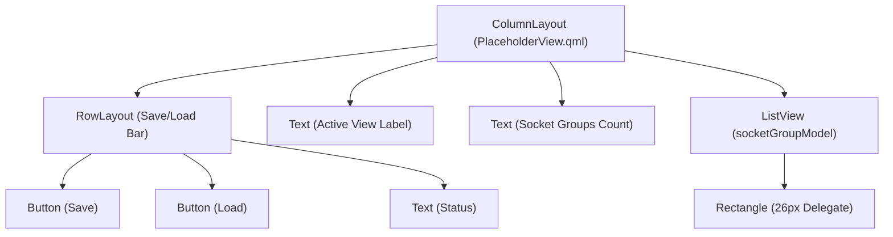

# UI Spec: PlaceholderView
**File:** `app/qml/views/PlaceholderView.qml`  **Pack:** `02-view-buildlist-import.md`  **Legacy Reference:** Generic build content view in `src/Modules/Main.lua`  **Status:** Test-Covered

--------------------------------------------------------------------------------

## 1. Purpose & Parity Notes
*   **Role:** Fallback build content view displayed for tabs that do not yet have a dedicated custom UI view during incremental feature porting. Shows a minimal build save/load status toolbar alongside a live socket-group diagnostic list.
*   **Intentional Deviations from Legacy PoB:**
    *   *Decoupled Status Scoping:* In legacy PoB, save/load status and view label lookups were bound directly to the root window state. In PlaceholderView, `saveLoadStatus` and `viewLabel(id)` are localized strictly to the placeholder component.
    *   *Direct Model Integration:* Binds directly to C++ `socketGroupModel` and `saveLoadModel`, rendering real-time skill group metadata without polling the Lua graphics loop.

--------------------------------------------------------------------------------

## 2. Lightweight Wireframe & Layout Box Model
# Component Box Model & Layout
```text
+-------------------------------------------------------------------------------+
| PlaceholderView (ColumnLayout, anchors.fill: parent, margins: 12px, sp: 8px)  |
| +---------------------------------------------------------------------------+ |
| | Toolbar: RowLayout (spacing: 8px)                                         | |
| |   [ Save ] [ Load ]  Status: <saveLoadStatus>                             | |
| +---------------------------------------------------------------------------+ |
| | Text: "Active view: <id> (<viewLabel>)" (size: theme.fontSize + 4)        | |
| +---------------------------------------------------------------------------+ |
| | Text: "Socket groups: <count>" (color: theme.accent, bold: true)          | |
| +---------------------------------------------------------------------------+ |
| | ListView (model: socketGroupModel, Layout.fillWidth/Height: true)          | |
| |   Delegate: 26px row, alternating tint, status icon + title + slot + summ| |
| +---------------------------------------------------------------------------+ |
+-------------------------------------------------------------------------------+
```

# ASCII Anatomy & Wireframe
```text
+-------------------------------------------------------------------------------+
|  [ Save ]  [ Load ]   Status: Saved -> /builds/TestBuild.xml                  | (1) Save/Load Status Bar
|                                                                               |
|  Active view: CALCS  (Calculations)                                           | (2) View Diagnostic Label
|  Socket groups: 3                                                             | (3) Socket Group Header
|                                                                               |
|  +-------------------------------------------------------------------------+  |
|  | ✔  Main Attack Skill               [Body Armour]   Tornado Shot, GMP    |  | (4) Enabled Group Row
|  |-------------------------------------------------------------------------|  |
|  | ✖  Aura Setup                      [Helmet]        Grace, Determination |  | (5) Disabled Row (alt bg)
|  |-------------------------------------------------------------------------|  |
|  | ✔  Movement Skill                  [Boots]         Dash, Second Wind    |  |
|  +-------------------------------------------------------------------------+  |
+-------------------------------------------------------------------------------+

Annotations:
(1) Save/Load Toolbar: Triggers save/load operations via saveLoadModel; reflects status text.
(2) Active View Label: Resolves activeView id to human-readable label via viewLabel().
(3) Summary Count: Bold theme.accent label showing total socket groups in model.
(4) Socket Group Row: Checkmark (✔/✖), title, item slot bracketed, and 320px skill summary.
```

# Responsive / Overflow Rules
*   **Minimum safe width/height:** 400x300px. Fills parent view container via `anchors.fill: parent`.
*   **Text Elision:** Skill titles and slot names elide on the right (`elide: Text.ElideRight`) if container width is constrained.
*   **Summary Column Width:** Fixed allocation of 320px for `skillSummary` to maintain columnar alignment across rows.

# Component Hierarchy


--------------------------------------------------------------------------------

## 3. Interactive States & Controls
| Control (objectName) | Type | Default State | Interactive Behavior | Edge States (Disabled / Empty / Loading / Error / Long Text) |
| ------ | ------ | ------ | ------ | ------ |
| `pob.placeholder.root` | ColumnLayout | `activeView: ""` | Hosts placeholder diagnostics | Shows raw `activeView` string if id is unregistered. |
| `pob.placeholder.btn_save`| Button | Enabled | Calls `saveLoadModel.saveBuild()` | Updates status with file path or error message. |
| `pob.placeholder.btn_load`| Button | Enabled | Calls `saveLoadModel.loadBuildFile()` | Updates status with `"Loaded OK"` or error message. |
| `pob.placeholder.list` | ListView | Active | Renders socket groups | Empty list rendered if build has 0 socket groups. |

# Complete State Matrix
*   **Idle:** `saveLoadStatus: "idle"`.
*   **Successful Save:** `saveLoadStatus: "Saved → <defaultSavePath>"`.
*   **Save Failure:** `saveLoadStatus: "Save error: <lastError>"`.
*   **Successful Load:** `saveLoadStatus: "Loaded OK"`.
*   **Load Failure:** `saveLoadStatus: "Load error: <lastError>"`.

# State Matrix & Binding Hazards
*   *Asynchronous Engine Timing:* `viewLabel()` queries `luaEngine.viewList()`. If the view list is queried before engine initialization finishes, it returns `activeView` as fallback without throwing an exception.

--------------------------------------------------------------------------------

## 4. Data & Bridge Contract
*   **Reads (C++ Model Roles & Properties):**
    *   `saveLoadModel.defaultSavePath(): string` -> current save path
    *   `saveLoadModel.lastError: string` -> error string
    *   `socketGroupModel.count: int` -> total socket groups
    *   `model.enabled: bool`, `model.title: string`, `model.slot: string`, `model.skillSummary: string`
*   **Writes / Bridge Methods Invoked:**
    *   `saveLoadModel.saveBuild(path)` -> writes XML build file
    *   `saveLoadModel.loadBuildFile(path)` -> reads XML build file
    *   `luaEngine.viewList()` -> returns array of `{ id: string, label: string }`
*   **Qt6 Bridge Safety:** Fully isolated diagnostic view; errors in save/load do not crash the view.

--------------------------------------------------------------------------------

## 5. Testable Acceptance Criteria (Qt6::QuickTest)
*   **AC-01 (Mount & Zero Warnings):** When mounted with `activeView: "CALCS"`, 0 QML warnings are logged, and `saveLoadStatus === "idle"`.
*   **AC-02 (View Label Resolution):** Given view list contains `{ id: "CALCS", label: "Calculations" }`, the active view text renders `"Active view: CALCS (Calculations)"`.
*   **AC-03 (Save Status Propagation):** Clicking Save invokes `saveLoadModel.saveBuild()` and formats `saveLoadStatus` accordingly.
*   **AC-04 (Delegate Row Formatting):** Given a socket group with `enabled: false, title: "Auras"`, the delegate renders `"✖ Auras"`.

--------------------------------------------------------------------------------

## 6. Bug Audit Findings (Current Implementation vs Spec)
| Severity | File & Line | Symptom / Defect | Root Cause | Expected Behavior |
| ------ | ------ | ------ | ------ | ------ |
| Low | `app/qml/views/PlaceholderView.qml:240` | Status text overflows right edge on long directory error paths. | Status text lacks `elide: Text.ElideRight` or max width constraint. | Set `elide: Text.ElideRight` on status label. |
