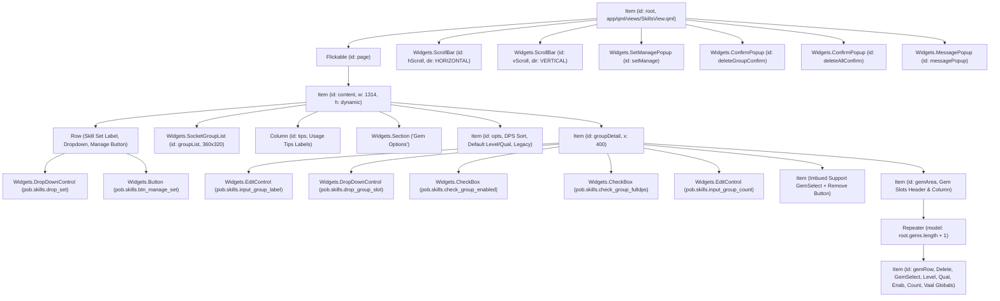

# UI Spec: SkillsView
**File:** `app/qml/views/SkillsView.qml`  
**Pack:** `04-view-skills.md`  
**Legacy Reference:** `src/Classes/SkillsTab.lua:1-965`, `app/lua/pob_skills.lua`, `port-plan/reference/tabs-catalog.md`  
**Status:** Test-Covered

---

## 1. Purpose & Parity Notes
* **Role:** Manages character active skills and support gems, organized into socket groups and skill sets. Users configure socketed equipment slots, toggle active/full-DPS states, select gems with auto-completion and DPS sorting, configure gem levels/qualities, toggle Vaal secondary skills, and manage imbued/corrupted gem behaviors.
* **Intentional Deviations from Legacy PoB:**
  * **Debounced State Commits:** Text inputs (group labels, counts, gem levels, gem qualities) debounce engine mutations by 300 ms (or commit immediately on Enter or blur) instead of dispatching full calculation pipeline recalculations on every raw keystroke.
  * **Count-Model Gem List:** Gem slots use an in-place count-based repeater model (`root.gems.length + 1`) to preserve user typing focus across asynchronous calculation updates.
  * **Visual Link Highlighting:** Hovering any gem name in a socket group dynamically highlights all active and support gems linked to it in the group.

---

## 2. Lightweight Wireframe & Layout Box Model
# Default Window (1100x720)
```text
+----------------------------------------------------------------------------------------------------+
| Skill set: [Default (v)] [Manage...]                                                               |
|                                                                                                    |
| Socket Groups (360x320)                 Group Detail: [Group Label / Name...                     ] |
| +-------------------------------------+  Socketed in: [Body Armour (v)] [x] Enabled [x] Full DPS   |
| | [x] 6L Body Armour: Cyclone         |  Imbued Support: [None (v)] [x]                            |
| | [x] 4L Gloves: Leap Slam            |                                                            |
| | [x] 4L Boots: Cast when Damage Taken|  Gem name:         Lvl: Qual: Enab: Count:                 |
| | [ ] 3L Weapon 1: Ancestral Warchief |  +-------------------------------------------------------+ |
| |                                     |  | [x] [Cyclone (v)     ]  [x]   [1 ]                  | |
| |                                     |  | [x] [Shockwave (v)   ]  [x]                         | |
| |                                     |  | [x] [Melee Phys (v)  ]  [x]                         | |
| |                                     |  | [x] [Fortify (v)     ]  [x]                         | |
| +-------------------------------------+  | [x] [Select gem... (v)] [  ] [  ]  [ ]                         | |
|                                          +-------------------------------------------------------+ |
| Usage Tips:                                                                                        |
| - Ctrl+C / Ctrl+V to copy/paste groups                                                             |
| - Right-click group to set as Main                                                                 |
|                                                                                                    |
| Gem Options                                                                                        |
|  [x] Sort gems by DPS: [Full DPS (v)]                                                              |
|  Default gem level:   [20 / 20 (v)   ]                                                              |
|  Default gem quality:                                                                         |
|  Show support gems:   [All (v)       ]                                                              |
|  [ ] Show legacy gems                                                                              |
+----------------------------------------------------------------------------------------------------+
| [Scrollbar Horizontal: contentDim 1314px] [Scrollbar Vertical: contentDim 640px]                   |
+----------------------------------------------------------------------------------------------------+
```

# Responsive / Overflow Rules
* **Minimum safe width/height:** 960x640. Minimum desktop baseline: 1100x720.
* **Canvas overflow & scrolling:** Main surface uses an explicit `Flickable` (`id: page`) wrapping fixed-coordinate legacy sections. Total content canvas width is `1314px` (`implicitWidth: 400 + 564 + 350`), requiring horizontal scroll on viewports narrower than `1350px`.
* **Scrollbars:** Dual custom scrollbars (`hScroll` and `vScroll`) appear when canvas dimensions exceed the window viewport. Shift + Mouse Wheel scrolls horizontally; standard wheel scrolls vertically.
* **Text truncation policy:** `Text.ElideRight` applied to socket group summary lines and dropdown pickers. Gem error strings render inline in `theme.negative` color.

# Component Hierarchy


---

## 3. Interactive States & Controls
| Control (objectName) | Type | Default State | Interactive Behavior | Edge States (Disabled / Empty / Loading / Error / Long Text) |
| :--- | :--- | :--- | :--- | :--- |
| `pob.skills.drop_set` | DropDownControl | Active Set | Selects active skill set (`pob_skillsSetActiveSet`) | Width 210px. Disabled when total skill sets count <= 1. |
| `pob.skills.btn_manage_set` | Button | Enabled | Opens `setManage` (`SetManagePopup`) for creating/deleting sets | Width 90px. |
| `pob.skills.list_socket_groups` | SocketGroupList | Enabled | Selects active socket group for editing in the detail pane | 360x320px. Handles drag reordering, Delete key, and context right-clicks. |
| `pob.skills.check_sort_dps` | CheckBox | Unchecked | Toggles DPS sorting in gem selection popups | Persists via `pob_skillsSetOption("sortGemsByDPS", bool)`. |
| `pob.skills.drop_sort_field` | DropDownControl | "Full DPS" | Selects primary sort metric for gem recommendation | Width 140px. Enabled only when `check_sort_dps` is checked. |
| `pob.skills.drop_default_level` | DropDownControl | "20 / 20" | Selects default gem level preset for newly added gems | Width 170px. Hover displays level rule tooltip. |
| `pob.skills.input_default_quality` | EditControl | "0" | Sets default quality integer (0-23) for newly added gems | Width 60px. Numeric clamping on commit. |
| `pob.skills.drop_support_types` | DropDownControl | "All" | Filters gem autocompletion (All, Non-Awakened, Awakened) | Width 170px. |
| `pob.skills.check_show_legacy` | CheckBox | Unchecked | Shows legacy/removed PoE gems in autocompletion | Persists via `pob_skillsSetOption("showLegacyGems", bool)`. |
| `pob.skills.input_group_label` | EditControl | Cur Group Name | Renames active socket group | Max 50 chars. Debounces input 300 ms before dispatching mutation. |
| `pob.skills.drop_group_slot` | DropDownControl | Active Slot | Reassigns equipment slot (Body Armour, Weapon 1, etc.) | Width 130px. Disabled when group originates from item source. |
| `pob.skills.check_group_enabled` | CheckBox | Checked | Enables or disables all gems within this socket group | Tooltip displays net build DPS delta on toggle. |
| `pob.skills.check_group_fulldps` | CheckBox | Checked | Includes socket group damage in character Full DPS | Toggles full DPS aggregation. |
| `pob.skills.input_group_count` | EditControl | "1" | Integer multiplier scaling DPS for multi-hit/minion skills | Visible only for source/granted groups. Width 60px. |
| `pob.skills.drop_imbued_support` | GemSelect | Empty | Selects imbued support gem granted to this group | Width 250px. Disabled if slot does not support imbued modifiers. |
| `pob.skills.btn_clear_imbued` | Button | Enabled ("x") | Clears active imbued support gem | Disabled if no imbued gem assigned. |
| `pob.skills.row_gem.btn_delete` | Button | Enabled ("x") | Removes gem from socket group | Width 20px. Disabled on trailing unallocated row. |
| `pob.skills.row_gem.select_gem` | GemSelect | Gem Name | Opens autocompleting gem search picker | Width 300px. Cross-highlights linked gems on mouse hover. |
| `pob.skills.row_gem.input_level` | EditControl | Numeric Lvl | Adjusts gem level (1-40) | Width 60px. Debounced 300 ms. Disabled on empty trailing row. |
| `pob.skills.row_gem.input_quality` | EditControl | Numeric Qual | Adjusts gem quality (0-30) | Width 60px. Hover displays quality stat progression tooltip. |
| `pob.skills.row_gem.check_enabled` | CheckBox | Checked | Toggles active state of individual gem | Hover displays stat difference tooltip. |
| `pob.skills.row_gem.input_count` | EditControl | Numeric Count | Adjusts skill instance count (totems, minions, projectile hits) | Visible only for gems with active skills. Tooltip explains scaling. |
| `pob.skills.row_gem.check_vaal_1` | CheckBox | Unchecked | Toggles primary Vaal skill effect | Visible only for Vaal gem variants. |
| `pob.skills.row_gem.check_vaal_2` | CheckBox | Unchecked | Toggles secondary Vaal skill effect | Visible only for multi-effect Vaal gems. |

---

## 4. Data & Bridge Contract
* **Reads (LuaEngine / C++ Models):**
  * `luaEngine.invoke("pob_skillsGetLists", [])`: Returns lists dictionary `{ slots, sortFields, defaultLevels, defaultLevelDescriptions, supportTypes }`.
  * `luaEngine.invoke("pob_skillsGetState", [])`: Returns state snapshot:
    * `sets`: List of `{ id, title }`.
    * `activeSet`: 1-based integer index.
    * `groups`: List of socket group descriptors `{ label, slotName, enabled, includeInFullDPS, gemCount, activeGemName }`.
    * `displayIndex`: 1-based index of group currently open in detail panel.
    * `detail`: Detailed group object `{ label, slotIndex, enabled, includeInFullDPS, groupCount, source, sourceNote, imbuedShown, imbuedEnabled, imbuedId, imbuedName, imbuedColor, gems: QVariantList }`.
    * Each gem in `detail.gems` contains `{ nameSpec, color, level, quality, enabled, count, countShown, errMsg, global1, global1Shown, global1Label, global2, global2Shown, global2Label, links: QVariantList }`.
    * `options`: `{ sortGemsByDPS, sortField, defaultGemLevel, defaultGemQuality, showSupportGemTypes, showLegacyGems }`.
  * `luaEngine.invoke("pob_skillsGemQualityTooltip", [groupIndex, gemIndex])`: Returns quality breakdown lines.
  * `luaEngine.invoke("pob_skillsGemEnabledTooltip", [groupIndex, gemIndex])`: Returns enable/disable stat difference lines.
  * `luaEngine.invoke("pob_skillsSlotTooltip", [slotIndex])`: Returns equipment slot stats and socket colors.
* **Writes / Mutations:**
  * `luaEngine.invoke("pob_skillsSetActiveSet", [setIndex])`
  * `luaEngine.invoke("pob_skillsSetOption", [key, val])`
  * `luaEngine.invoke("pob_skillsSetGroupLabel", [groupIndex, label])`
  * `luaEngine.invoke("pob_skillsSetGroupSlot", [groupIndex, slotIndex])`
  * `luaEngine.invoke("pob_skillsSetGroupEnabled", [groupIndex, bool])`
  * `luaEngine.invoke("pob_skillsSetGroupFullDPS", [groupIndex, bool])`
  * `luaEngine.invoke("pob_skillsSetGroupCount", [groupIndex, count])`
  * `luaEngine.invoke("pob_skillsSetImbued", [groupIndex, gemId])`
  * `luaEngine.invoke("pob_skillsDeleteGem", [groupIndex, gemIndex])`
  * `luaEngine.invoke("pob_skillsSetGem", [groupIndex, gemIndex, gemId])`
  * `luaEngine.invoke("pob_skillsSetGemLevel", [groupIndex, gemIndex, level])`
  * `luaEngine.invoke("pob_skillsSetGemQuality", [groupIndex, gemIndex, quality])`
  * `luaEngine.invoke("pob_skillsSetGemEnabled", [groupIndex, gemIndex, bool])`
  * `luaEngine.invoke("pob_skillsSetGemCount", [groupIndex, gemIndex, count])`
  * `luaEngine.invoke("pob_skillsSetGemGlobal", [groupIndex, gemIndex, globalIndex, bool])`
  * `luaEngine.invoke("pob_skillsPasteGroup", [])`
  * `luaEngine.invoke("pob_skillsUndo", [])`
  * `luaEngine.invoke("pob_skillsRedo", [])`
* **Signals Observed:**
  * `luaEngine.onSkillsChanged`, `onCalcsChanged`, `onItemsChanged`, `onTreeChanged`: Triggers coalesced view refresh (`root.refresh()`).
  * `luaEngine.onModeChanged`: Clears cached drop lists and forces state reload.
* **Qt6 Bridge Safety:**
  * Bridge collections (`st.groups`, `st.sets`, `detail.gems`, `gem.links`) are guarded with `.length !== undefined` validation before iteration to ensure compatibility with C++ `QVariantList` objects.
  * All mutations pass 1-based indexing conforming to Lua array conventions.

---

## 5. Testable Acceptance Criteria (Qt6::QuickTest)
* **AC-01 (Initial Render & Zero Warnings):**
  * When `SkillsView` renders, 0 QML type errors or coordinate warnings are produced.
  * Socket group list and detail panels have `width > 0` and `height > 0`.
* **AC-02 (Canvas Overflow & Scrollbar Geometry):**
  * In default 1100x720 window, `hScroll.visible` evaluates to `true` and `content.implicitWidth` is at least 1314px.
  * Scrolling via mouse wheel with Shift modifier decrements/increments `page.contentX`.
* **AC-03 (Primary User Flow - Gem Allocation & Autocompletion):**
  * Clicking on the empty trailing gem slot in `gemArea` opens `GemSelect` autocompletion popup.
  * Selecting a gem populates level to `defaultGemLevel`, quality to `defaultGemQuality`, and triggers character calculation updates.
* **AC-04 (Cross-Highlighting of Linked Gems):**
  * Hovering mouse over `select_gem` of an active skill sets `hoverGemRow` to its 1-based row index.
  * All support gems whose index exists in that gem's `links` array receive `highlighted: true`.
* **AC-05 (Debounced Input & Safe Group Mutation):**
  * Typing rapidly into `pob.skills.input_group_label` fires 0 engine mutations until 300 ms of typing inactivity elapses.
  * Pressing `Enter` or blurring focus immediately flushes pending text to `pob_skillsSetGroupLabel`.
* **AC-06 (Keyboard Shortcuts):**
  * Pressing `Ctrl+V` in the view triggers `pob_skillsPasteGroup`.
  * Pressing `Ctrl+Z` invokes `pob_skillsUndo`; `Ctrl+Y` or `Ctrl+Shift+Z` invokes `pob_skillsRedo`.

---

## 6. Bug Audit Findings (Current Implementation vs Spec)
| Severity | File & Line | Symptom / Defect | Root Cause | Expected Behavior |
| :--- | :--- | :--- | :--- | :--- |
| **High** | `app/qml/views/SkillsView.qml (id: root, function _pushDetail)` | Switching socket groups while typing in label or count causes pending text to overwrite the newly selected socket group. | `Debounce` timer flushes with `groupDetail.gi`, but `groupDetail.gi` updates synchronously on click while `value` remains from the prior group. | Clear or flush active debounce timers immediately prior to changing `st.displayIndex`. |
| **High** | `app/qml/views/SkillsView.qml (id: gemRow, property highlighted)` | Linked gem cross-highlighting fails to highlight or throws script error when hovering over support gems. | `root.gems[h - 1].links.indexOf(gemRow.r)` assumes `links` is a native JS Array; when returned as a raw Lua table across bridge, `.indexOf` is undefined. | Normalize links with `(root.gems[h - 1].links && root.gems[h - 1].links.length !== undefined) ? Array.from(root.gems[h - 1].links) : []`. |
| **Med** | `app/qml/views/SkillsView.qml (id: groupSlot)` | Dropdown clips long equipment slot names (e.g. "Secondary Weapon 2 Swap"). | Fixed hardcoded `width: 130` on `groupSlot` without text measurement or elide tooltip fallback. | Calculate dynamic width via `textMetrics.width(...) + 2 * theme.space2` with minimum width 130px. |
| **Med** | `app/qml/views/SkillsView.qml (id: content)` | Canvas controls in Column 2 (`groupDetail`) become completely inaccessible if window width is smaller than 1100px and user does not use Shift+Wheel. | `Flickable` sets `interactive: false` and custom scrollbar height is only 18px with no visible scroll prompt. | Permit native mouse drag or display clear visual scroll affordances when content overflows viewport. |
| **Low** | `app/qml/views/SkillsView.qml (id: defaultQuality)` | Entering non-numeric characters into default quality corrupts options payload. | Relies on `isNumeric: true` without input mask or regex validator. | Add `validator: IntValidator { bottom: 0; top: 30 }`. |
| **Low** | `app/qml/views/SkillsView.qml (all interactive controls)` | Absence of `objectName` tags breaks integration test automation. | Controls lack programmatic `objectName` identifiers. | Assign identifiers matching `pob.skills.<control>` per Section 3 table. |
