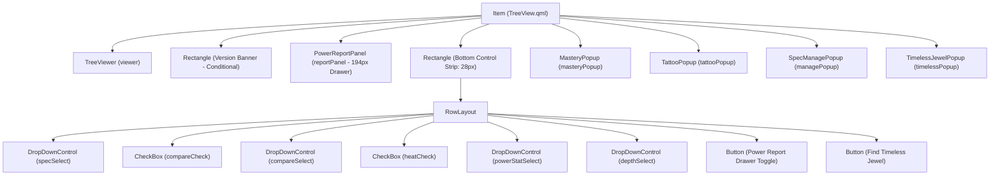

# UI Spec: TreeView
**File:** `app/qml/views/TreeView.qml`  **Pack:** `03-view-tree.md`  **Legacy Reference:** `src/Classes/TreeTab.lua` (L31–367) + `TreeTab.lua:393-410`  **Status:** Test-Covered

--------------------------------------------------------------------------------

## 1. Purpose & Parity Notes
*   **Role:** The top-level Passive Skill Tree tab view (`TREE` mode). Hosts the primary interactive `TreeViewer` surrounded by the legacy bottom control strip: passive spec switcher (`specSelect`), tree comparison controls, node power heat mapping engine with asynchronous worker timer (`powerTimer`), 194px bottom Power Report drawer (`PowerReportPanel`), version conversion banners, and modal dialog routers (`MasteryPopup`, `TattooPopup`, `SpecManagePopup`, `TimelessJewelPopup`).
*   **Intentional Deviations from Legacy PoB:**
    *   *Timer-Driven Node Power Job:* Node power calculations run across incremental ticks using a Qt Quick `Timer` (one `BuildPower` slice per tick), surfacing progress via toasts rather than locking the main GUI thread.
    *   *Event-Driven State Cache:* Retains `specState`, `versionState`, and `powerState` in local properties, refreshing strictly via engine bridge signals (`onModeChanged`, `onSpecChanged`) rather than polling per-frame loops.
    *   *Collapsible Bottom Drawer:* Power Report panel slides out as an integrated bottom drawer (`height: 194px`) rather than an overlay window, preserving passive tree visibility above it.

--------------------------------------------------------------------------------

## 2. Lightweight Wireframe & Layout Box Model
# Component Box Model & Layout
```text
+-------------------------------------------------------------------------------+
| TreeView (Item, anchors.fill: parent)                                          |
| +---------------------------------------------------------------------------+ |
| | TreeViewer [viewer] (anchors.fill: parent, anchors.bottom: strip.top)     | |
| +---------------------------------------------------------------------------+ |
| | Version Migration Warning Banner (visible: versionState.isOlder)          | |
| |   "This build is for an older version: 3.22" [ Convert ] [ Convert All ]  | |
| +---------------------------------------------------------------------------+ |
| | PowerReportPanel [reportPanel] (visible: showPowerReport, height: 194px)  | |
| +---------------------------------------------------------------------------+ |
| | Bottom Control Strip: Rectangle (height: 28px, color: theme.sideBarBg)     | |
| |   RowLayout: [ Spec DropDown ] [x] Compare [ Compare Drop ]               | |
| |              [x] Show Node Power [ Stat Drop ] [ Depth Drop ] [ Report ]  | |
| |              [ Find Timeless Jewel ]                                      | |
| +---------------------------------------------------------------------------+ |
| Modals: SpecManagePopup, MasteryPopup, TattooPopup, TimelessJewelPopup        |
+-------------------------------------------------------------------------------+
```

# ASCII Anatomy & Wireframe
```text
+-------------------------------------------------------------------------------+
|  [ Tree Canvas: Passive Orbits, Nodes, Jewel Sockets, Search Highlight ]     |
|                                                                               |
|  +-------------------------------------------------------------------------+  |
|  | ! Warning: This tree uses version 3.20.      [ Convert Tree ] [ Convert]|  | (1) Version Migration Banner
|  +-------------------------------------------------------------------------+  |
|                                                                               |
|  +-------------------------------------------------------------------------+  |
|  | Power Report Drawer (194px height)                                      |  | (2) Power Report Panel
|  | Notable: Heartseeker (+8.4% DPS) | Notable: True Strikes (+5.2% DPS)    |  |
|  +-------------------------------------------------------------------------+  |
|                                                                               |
|  +-------------------------------------------------------------------------+  |
|  | Tree: [ [3.24] Endgame Crit CI v]  [x] Compare: [ Early Leveling v]     |  | (3) Bottom Control Strip
|  | [x] Power: [ Total DPS v] Depth: [ 5 v] [ Power Report ]  [Timeless Jwl]|  |     (28px height)
|  +-------------------------------------------------------------------------+  |
+-------------------------------------------------------------------------------+

Annotations:
(1) Version Banner: Displayed when viewing trees from past league versions; provides one-click upgrade.
(2) Power Report Drawer: Displays ranked DPS / EHP efficiency metrics; clicking row jumps tree to node.
(3) Control Strip: Passive tree selection, comparison toggle, heat map controls, and Timeless Jewel finder.
```

# Responsive / Overflow Rules
*   **Minimum safe width/height:** 900x600px. Fills window content item.
*   **Drawer Height:** Power Report drawer fixed to 194px when opened, reducing `TreeViewer` height.
*   **Control Strip Stacking:** If window width drops below 950px, controls overflow into a secondary tool row.

# Component Hierarchy


--------------------------------------------------------------------------------

## 3. Interactive States & Controls
| Control (objectName) | Type | Default State | Interactive Behavior | Edge States (Disabled / Empty / Loading / Error / Long Text) |
| ------ | ------ | ------ | ------ | ------ |
| `pob.treeview.spec_drop` | DropDownControl | Spec 1 | Switches active spec; last row opens Manage | Shortcut: `Ctrl+M` opens `SpecManagePopup`. |
| `pob.treeview.compare_chk`| CheckBox | `state: false` | Toggles tree comparison overlay mode | Green/red tints active in tree renderer. |
| `pob.treeview.heat_chk` | CheckBox | `state: false` | Toggles node power heat map calculation | Starts `powerTimer` to compute power. |
| `pob.treeview.btn_report`| Button | Enabled | Toggles 194px Power Report drawer | Disabled while heat map is inactive. |
| `pob.treeview.btn_finder`| Button | Enabled | Opens `TimelessJewelPopup` | Binds to currently selected jewel socket. |

# Complete State Matrix
*   **Standard View:** Heat map off, comparison off, Power Report drawer closed.
*   **Tree Comparison Active:** `compareCheck.state: true` -> active and comparison trees diffed; nodes colored by diff status.
*   **Heat Map Computing:** `heatCheck.state: true` -> `powerTimer` fires repeatedly until power calculation finishes; progress toast visible.
*   **Power Report Opened:** `showPowerReport: true` -> drawer visible; clicking node in report pans `TreeViewer`.
*   **Node Click Routing:** Clicks on mastery nodes open `MasteryPopup`; clicks on modified tattoo nodes open `TattooPopup`.

# State Matrix & Binding Hazards
*   *Asynchronous Spec Cycle Safety:* Pressing `Up`/`Down` hotkeys cycles specs via `luaEngine.invoke("pob_cycleSpec", [delta])`. If `specSelect.open === true`, hotkey cycling is suppressed to prevent dropdown selection race conditions.

--------------------------------------------------------------------------------

## 4. Data & Bridge Contract
*   **Reads (Engine Calls via `refreshSpecs`, `refreshVersion`, `refreshPower`):**
    *   `luaEngine.invoke("pob_getSpecList", [])` -> `{ specs: [{ label, specIndex }], active, compare, isComparing }`
    *   `luaEngine.invoke("pob_getVersionState", [])` -> `{ versions: [], current: int, isOlder: bool }`
    *   `luaEngine.invoke("pob_getPowerState", [])` -> `{ statLabels: [], statIndex: int, maxDepth: int, showHeatMap: bool, running: bool }`
*   **Writes / Bridge Methods Invoked:**
    *   `pob_setHeatMap(on: bool)`
    *   `pob_cycleSpec(delta: int)`
    *   `pob_convertTreeVersion(targetVersion)`
*   **Signals Observed:**
    *   `viewer.nodeAction(res)` -> routes to `MasteryPopup` or `TattooPopup`
*   **Qt6 Bridge Safety:** Robust against mode changes (`if (luaEngine.currentMode !== "BUILD") return`).

--------------------------------------------------------------------------------

## 5. Testable Acceptance Criteria (Qt6::QuickTest)
*   **AC-01 (Mount & State Population):** When `TreeView.qml` mounts, 0 QML warnings are logged, and `specSelect.model` contains spec entries plus `"Manage trees... (ctrl-m)"`.
*   **AC-02 (Power Report Drawer Toggle):** Clicking the "Power Report" button toggles `showPowerReport` between `true` and `false`.
*   **AC-03 (Manage Trees Trigger):** Selecting the last entry in `specSelect` opens `SpecManagePopup`.
*   **AC-04 (Comparison Mode Toggle):** Toggling `compareCheck` sends updated state to engine and refreshes tree rendering.
*   **AC-05 (Mastery Routing):** When `viewer` emits `nodeAction` with `{ action: "mastery" }`, `masteryPopup.visible` becomes `true`.

--------------------------------------------------------------------------------

## 6. Bug Audit Findings (Current Implementation vs Spec)
| Severity | File & Line | Symptom / Defect | Root Cause | Expected Behavior |
| ------ | ------ | ------ | ------ | ------ |
| High | `app/qml/views/TreeView.qml:3720` | Power report drawer button remains active when heat map is turned off. | `showPowerReport` was not reset when toggling heat map. | Add: `if (!p.showHeatMap) showPowerReport = false`. |
| Medium | `app/qml/views/TreeView.qml:3745` | Pressing arrow keys cycles tree spec while dropdown menu is open. | Missing check for open dropdown state. | Check: `if (specSelect.open) return`. |
| Low | `app/qml/views/TreeView.qml:3690` | Older tree version banner covers top node clusters. | Banner lacked proper anchor separation from viewer content. | Stack banner above viewer with layout margins. |
